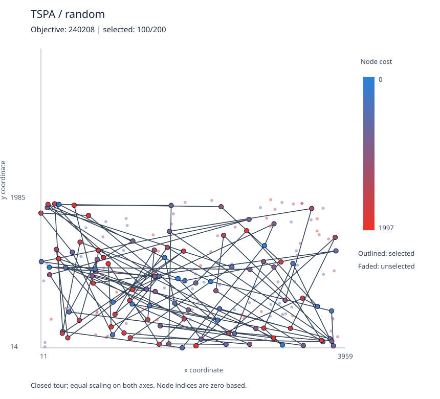
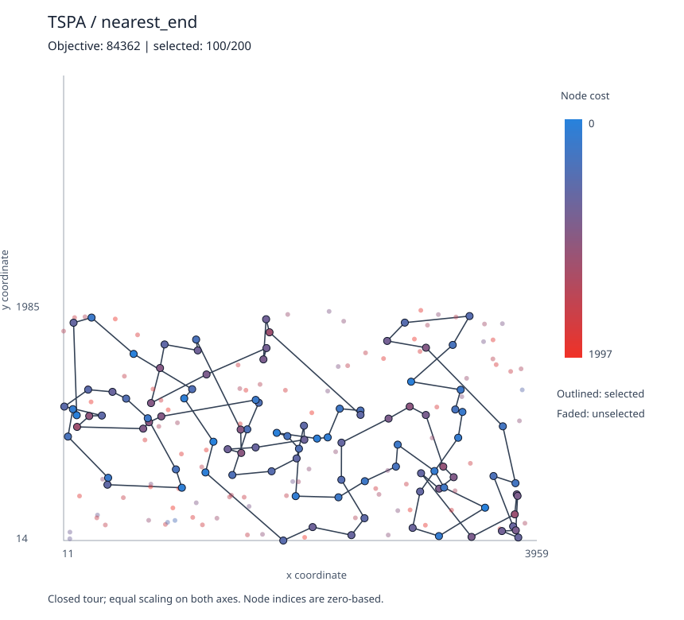
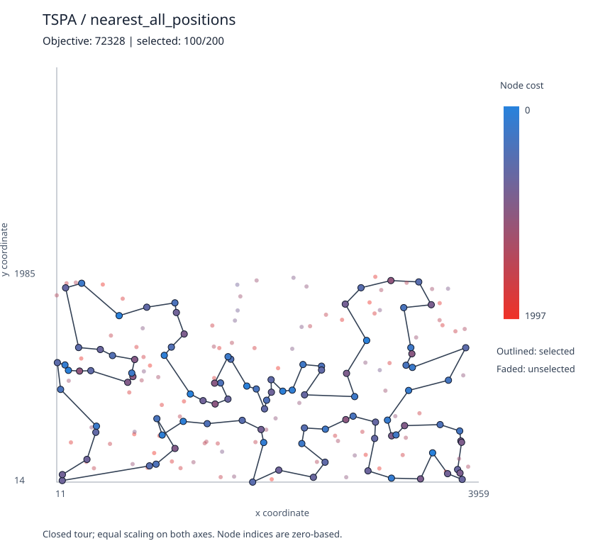
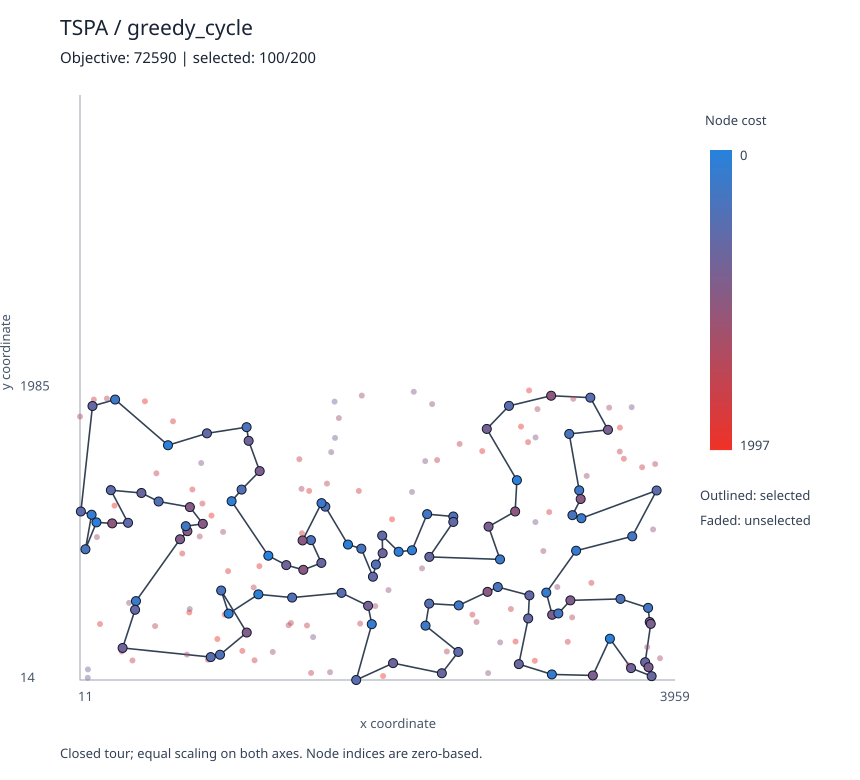
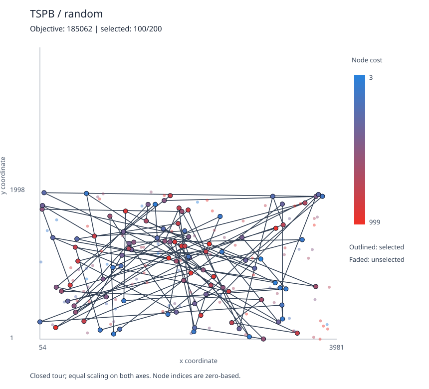
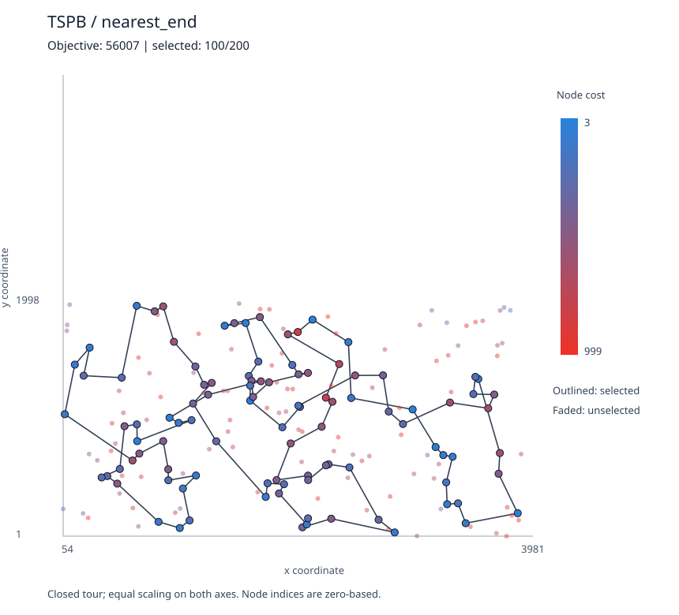
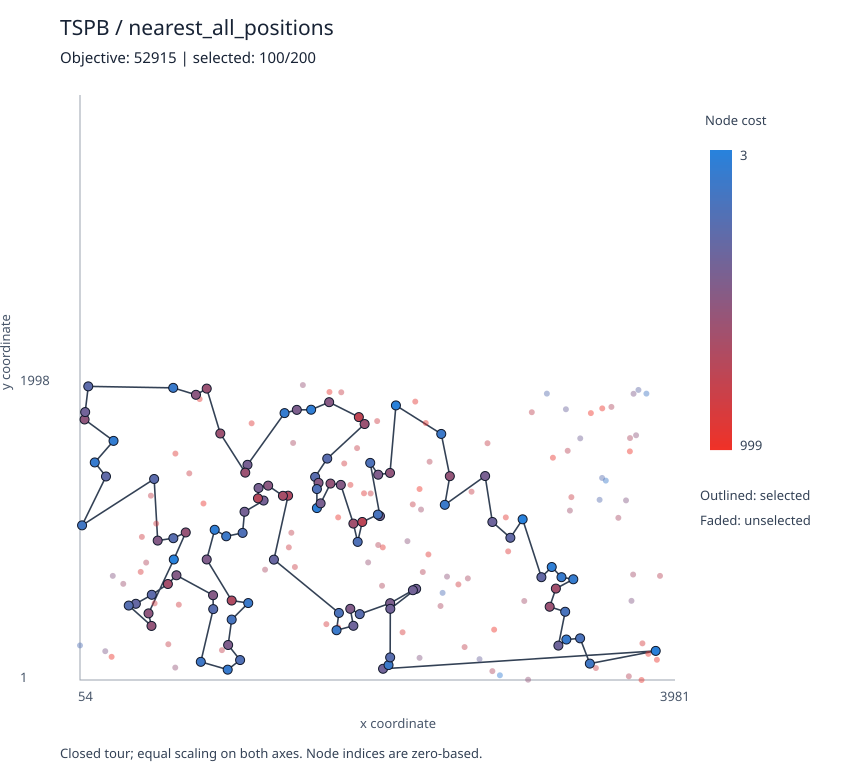
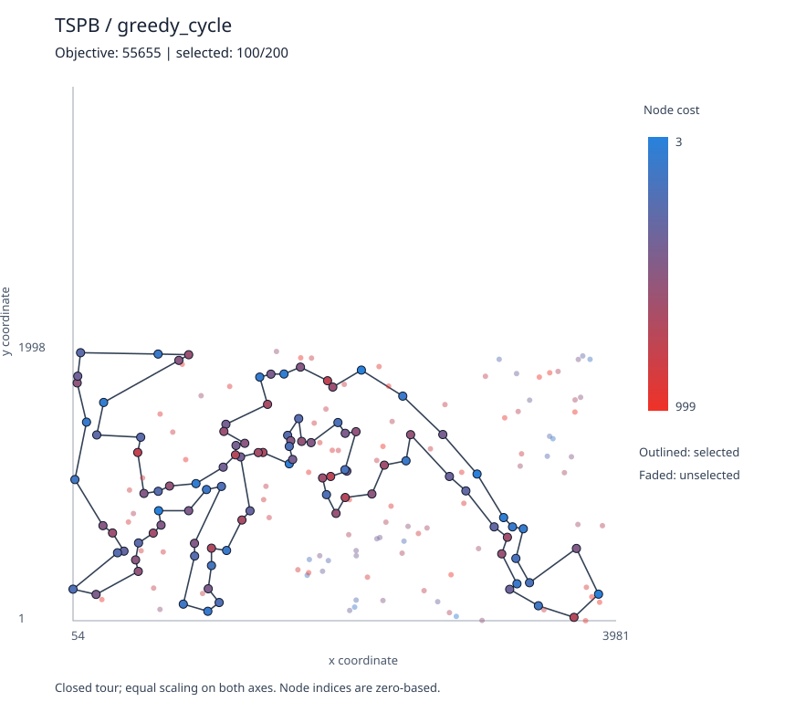

# Assignment 1 — Greedy heuristics

**Students:**  
Baris Surmelioglu - 152048  
Ozan Polat - 150918

**Course:** Evolutionary Computation, Poznań University of Technology  
**Language:** C++17 (standard library only)  
**Instances:** TSPA and TSPB, 200 nodes each  
**Experiment:** 200 solutions per method per instance; 1,600 solutions total  
**Random seed:** 42

## 1. Problem description

Each row of an input file is `x;y;cost`; its row number is its zero-based node
index. Let V contain n nodes and let k = ceil(n/2). We select exactly k distinct
nodes and arrange them in a Hamiltonian cycle through the selected subset.
The other nodes are not visited. Both supplied instances therefore require
exactly 100 selected nodes.

For a tour S = (s₀, …, sₖ₋₁), minimize

```text
f(S) = Σ(i=0..k−1) [c(sᵢ) + d(sᵢ, s((i+1) mod k))]
d(i,j) = floor(sqrt((xᵢ−xⱼ)² + (yᵢ−yⱼ)²) + 0.5)
```

Every selected node cost is counted once. The last-to-first edge is included.
The distance matrix is computed immediately after reading each instance. Only
the matrix and node costs are passed to optimization methods. Coordinates are
used subsequently for visualization and by the independent checker.
Distances use mathematical rounding rather than truncation or banker's rounding.
Objective values and accumulated sums use 64-bit integers.

## 2. Methods and construction conventions

The slide says “three methods” but enumerates four; all four are included.
Nearest-neighbor algorithms grow an **open path**, using the best increase in
open-path length plus selected-node costs. They close the path when construction
ends. Greedy cycle maintains a **closed cycle**, considering the closing edge
at every insertion. This conventional distinction makes the two all-position
construction methods different. All reported objectives use the same final
closed-cycle objective, regardless of construction method.

Every greedy run begins with its specified starting node. For all-position nearest
neighbor, that starting node can subsequently move inside the path but remains
selected. Greedy ties use the lowest node index, then the lowest insertion
position. If several runs achieve the same minimum, the first is saved.

### 2.1 Random solution

Shuffle all indices uniformly using Fisher–Yates, retain the first k, and use their
order as the cycle. This produces a uniformly sampled ordered subset without
repeated nodes. A fixed `std::mt19937` seed and explicit rejection sampling make
the random construction reproducible without implementation-dependent shuffle
or distribution behavior. The generator is initialized once and consumed for
TSPA before TSPB.

```text
RANDOM-SOLUTION(D, c, k, rng):
    S ← [0, 1, …, n−1]
    for i ← n−1 down to 1:
        j ← uniform integer in [0, i], using rejection sampling from rng
        swap S[i], S[j]
    return first k entries of S
```

### 2.2 Nearest neighbor — insertion at the end

At each step choose an unused node v minimizing `D[last,v] + c[v]`, then append it.
Node costs are part of the decision; “nearest” does not mean distance alone.
The closing edge is added only in the final evaluation.

```text
NEAREST-END(D, c, k, start):
    S ← [start]; mark start as used
    while length(S) < k:
        v ← unused node minimizing D[S.last,v] + c[v]
        append v to S; mark v as used
    return S as a closed cycle
```

### 2.3 Nearest neighbor — insertion at all positions

For an open path of length m, there are m+1 positions. Evaluate all unused nodes
and all positions, including the beginning, the end and internal gaps:

```text
beginning: Δ = c[v] + D[v, first]
end:       Δ = c[v] + D[last, v]
between a and b: Δ = c[v] + D[a,v] + D[v,b] − D[a,b]
```

```text
NEAREST-ALL-POSITIONS(D, c, k, start):
    S ← [start]; mark start as used
    while length(S) < k:
        best ← +∞
        for v in unused nodes, in increasing index order:
            for position ← 0 to length(S):
                Δ ← open-path insertion increase, including c[v]
                if Δ < best: save v and position; best ← Δ
        insert saved node at saved position; mark it as used
    return S as a closed cycle
```

### 2.4 Greedy cycle

Maintain a cycle and insert an unused node into the edge (a,b) with the smallest
objective increase:

```text
Δ = c[v] + D[a,v] + D[v,b] − D[a,b]
```

Initially the cycle consists of one node, with a zero-length self-edge. Thus the
second insertion minimizes `c[v] + 2D[start,v]`. A two-node cycle counts the edge
in both directions. This follows the closed-cycle objective for small instances.

```text
GREEDY-CYCLE(D, c, k, start):
    S ← [start]; mark start as used
    while length(S) < k:
        best ← +∞
        for v in unused nodes, in increasing index order:
            for position ← 0 to length(S)−1:
                a ← S[(position−1) mod length(S)]
                b ← S[position]
                Δ ← c[v] + D[a,v] + D[v,b] − D[a,b]
                if Δ < best: save v and position; best ← Δ
        insert saved node at saved position; mark it as used
    return S
```

### 2.5 Evaluation and experiment pseudocode

```text
EVALUATE(D, c, S):
    reject unless S has ceil(n/2) unique valid indices
    return sum over i of c[S[i]] + D[S[i], S[(i+1) mod length(S)]]

rng ← mt19937(42)
for instance in [TSPA, TSPB]:
    read nodes; immediately build rounded distance matrix D
    for method in [random, nearest-end, nearest-all-positions, greedy-cycle]:
        for run ← 0 to 199:
            if method is random: S ← RANDOM-SOLUTION(D,c,k,rng)
            otherwise: S ← method(D,c,k,start=run)
            value ← EVALUATE(D,c,S)
            save run, start, value; retain first best tour
        report min, max, arithmetic mean
        save best indices and plot the best closed tour
```

### 2.6 Complexity

Distance preprocessing takes O(n²) time and memory. Per construction, random
sampling takes O(n), end-only nearest neighbor O(kn), and the naive all-position
and greedy-cycle implementations O(nk²). Each greedy method is run from all n
starting nodes. Insertion decisions never recompute Euclidean distances.

## 3. Computational experiment

The original supplied files were used without editing. All greedy methods start
once from each node 0–199. The random baseline uses 200 constructions per
instance. The following values are measured outputs, not estimates. Averages
are arithmetic means; lower is better. No claim of global optimality is made.

| Instance | Method | Runs | Minimum | Maximum | Average |
| --- | --- | ---: | ---: | ---: | ---: |
| TSPA | Random solution | 200 | 240,208 | 286,886 | 262,921.230 |
| TSPA | Nearest neighbor — end | 200 | 84,362 | 90,075 | 87,476.630 |
| TSPA | Nearest neighbor — all positions | 200 | 72,328 | 77,022 | 74,346.965 |
| TSPA | Greedy cycle | 200 | 72,590 | 75,281 | 73,793.405 |
| TSPB | Random solution | 200 | 185,062 | 231,127 | 208,006.445 |
| TSPB | Nearest neighbor — end | 200 | 56,007 | 63,166 | 59,397.335 |
| TSPB | Nearest neighbor — all positions | 200 | 52,915 | 66,164 | 59,475.495 |
| TSPB | Greedy cycle | 200 | 55,655 | 63,734 | 59,649.910 |

Full run-level measurements are in [runs.csv](results/runs.csv); aggregate values
are in [summary.csv](results/summary.csv). The code was compiled with g++ using
`-std=c++17 -O2 -Wall -Wextra -Wpedantic`; no warnings were emitted. Build and run
commands are in [README.md](README.md).

## 4. Best tours and visualizations

Indices are zero-based. Each list has exactly 100 distinct nodes. The closing
edge from the final index to the first is implicit. Color represents node cost,
from blue (lower cost) to orange (higher cost); outlined nodes are selected,
faded nodes are unselected. The complete closed tour is shown, with equal
coordinate scaling on both axes. SVG files can also be opened separately and
contain node-index and node-cost tooltips.

### TSPA — Random solution

**Objective: 240,208**



```text
183, 54, 31, 156, 63, 8, 43, 17, 139, 193, 87, 160, 153, 15, 99, 64, 98, 122, 85, 142,
158, 73, 102, 191, 184, 164, 114, 69, 7, 44, 4, 199, 28, 49, 111, 166, 167, 138, 57, 165,
3, 78, 159, 36, 48, 154, 128, 181, 45, 51, 30, 82, 110, 190, 94, 66, 67, 58, 141, 192,
25, 115, 126, 12, 147, 144, 123, 116, 186, 119, 120, 100, 127, 105, 14, 83, 121, 22, 68, 198,
179, 109, 130, 117, 118, 84, 124, 21, 20, 137, 77, 108, 2, 35, 40, 196, 96, 145, 133, 88
```

### TSPA — Nearest neighbor — end

**Objective: 84,362**



```text
54, 9, 33, 36, 177, 67, 144, 53, 135, 58, 134, 176, 174, 106, 89, 107, 57, 182, 151, 93,
50, 3, 1, 164, 178, 29, 136, 186, 184, 47, 159, 130, 153, 78, 88, 193, 170, 146, 75, 64,
150, 42, 113, 43, 85, 142, 8, 131, 84, 158, 192, 181, 114, 141, 180, 132, 76, 80, 48, 31,
63, 149, 168, 97, 127, 187, 30, 123, 152, 108, 60, 116, 49, 11, 119, 160, 83, 90, 51, 16,
35, 87, 45, 140, 52, 179, 185, 28, 102, 156, 157, 71, 91, 38, 100, 4, 112, 139, 115, 5
```

### TSPA — Nearest neighbor — all positions

**Objective: 72,328**



```text
104, 129, 69, 127, 97, 168, 116, 149, 63, 11, 49, 160, 83, 123, 100, 152, 108, 60, 31, 48,
80, 91, 157, 71, 4, 76, 132, 180, 28, 102, 185, 35, 156, 51, 16, 67, 144, 140, 53, 179,
52, 177, 36, 33, 9, 54, 131, 174, 8, 164, 186, 136, 163, 29, 101, 178, 1, 169, 3, 50,
147, 47, 93, 106, 42, 89, 113, 130, 159, 146, 170, 153, 193, 78, 88, 107, 64, 57, 182, 151,
150, 176, 72, 134, 84, 58, 158, 192, 181, 114, 135, 73, 45, 87, 141, 187, 30, 189, 2, 171
```

### TSPA — Greedy cycle

**Objective: 72,590**



```text
116, 149, 168, 63, 11, 49, 60, 108, 152, 100, 90, 123, 83, 160, 97, 127, 69, 171, 2, 189,
30, 187, 141, 87, 45, 73, 135, 114, 181, 192, 158, 58, 84, 134, 72, 176, 150, 151, 182, 57,
64, 107, 88, 78, 193, 153, 170, 146, 159, 130, 113, 89, 42, 106, 93, 47, 147, 50, 3, 169,
1, 178, 101, 29, 163, 136, 186, 164, 142, 8, 174, 131, 54, 9, 33, 36, 177, 52, 179, 53,
140, 144, 67, 16, 51, 156, 35, 185, 102, 28, 180, 132, 76, 4, 71, 157, 91, 80, 48, 31
```

### TSPB — Random solution

**Objective: 185,062**



```text
116, 35, 85, 72, 15, 146, 46, 108, 94, 126, 117, 192, 120, 63, 198, 102, 13, 156, 171, 11,
133, 96, 178, 155, 1, 153, 20, 70, 45, 134, 50, 21, 54, 104, 90, 40, 195, 127, 138, 175,
181, 66, 184, 18, 190, 99, 32, 36, 137, 109, 22, 29, 114, 183, 176, 122, 158, 166, 3, 95,
179, 17, 8, 43, 87, 34, 12, 103, 150, 163, 9, 98, 91, 38, 75, 57, 140, 119, 129, 81,
37, 27, 56, 0, 130, 164, 48, 105, 162, 76, 74, 128, 145, 47, 197, 30, 51, 55, 169, 97
```

### TSPB — Nearest neighbor — end

**Objective: 56,007**



```text
32, 89, 57, 76, 54, 127, 129, 90, 153, 20, 14, 2, 110, 118, 56, 114, 196, 10, 148, 143,
78, 192, 162, 104, 185, 184, 3, 151, 69, 172, 133, 120, 96, 121, 198, 48, 72, 46, 86, 117,
160, 136, 8, 21, 154, 140, 47, 170, 125, 177, 6, 132, 29, 197, 175, 134, 45, 60, 40, 71,
155, 97, 115, 180, 65, 28, 149, 145, 158, 116, 147, 42, 50, 130, 30, 183, 38, 64, 85, 59,
167, 51, 87, 179, 82, 88, 171, 99, 67, 24, 34, 181, 152, 73, 98, 27, 135, 75, 79, 156
```

### TSPB — Nearest neighbor — all positions

**Objective: 52,915**



```text
110, 2, 14, 20, 74, 153, 182, 52, 90, 129, 127, 80, 54, 192, 162, 104, 76, 185, 57, 89,
86, 46, 72, 3, 184, 173, 151, 122, 117, 8, 160, 69, 172, 136, 133, 120, 156, 43, 48, 96,
198, 121, 130, 191, 50, 42, 147, 116, 37, 146, 13, 149, 28, 145, 65, 158, 177, 125, 26, 170,
197, 36, 132, 29, 6, 180, 115, 155, 71, 175, 134, 45, 157, 60, 40, 141, 97, 154, 140, 47,
38, 21, 176, 30, 183, 189, 168, 64, 59, 85, 51, 73, 167, 152, 34, 24, 181, 179, 87, 82
```

### TSPB — Greedy cycle

**Objective: 55,655**



```text
36, 197, 6, 180, 115, 170, 97, 140, 47, 155, 71, 175, 134, 45, 157, 60, 141, 40, 33, 64,
21, 189, 168, 69, 160, 172, 136, 133, 120, 8, 117, 72, 46, 86, 184, 3, 173, 122, 151, 98,
111, 27, 135, 76, 185, 162, 192, 80, 52, 182, 20, 74, 2, 93, 110, 118, 14, 153, 90, 129,
127, 54, 104, 57, 89, 156, 43, 48, 96, 198, 121, 63, 130, 191, 183, 30, 176, 38, 154, 26,
125, 177, 138, 158, 145, 149, 147, 42, 116, 37, 146, 13, 28, 65, 178, 103, 29, 132, 1, 174
```

The same lists are available in machine-readable
[best_solutions.txt](results/best_solutions.txt).

## 5. Solution checking and tests

### 5.1 Verification with the instructor-provided Excel solution checker

The instructor's **`Solution checker.xlsx`** contains a separate `TSPA` and
`TSPB` worksheet. Both sheets' node coordinates and costs were compared
against the supplied CSV data; all 200 rows per instance matched exactly.
For each of our eight best tours, the 100 zero-based node indices were placed
in cells `F3:F102` of the corresponding worksheet. Cell `F103=F3` closes the
tour, `I2` sums selected-node costs, `J2` sums mathematically rounded
Euclidean edge lengths, and `K2=I2+J2` is the objective.

The spreadsheet calculations were performed programmatically using the
formulas from the supplied workbook. During import, Excel's shared-formula
groups required expanding the existing `LOOKUP` and
`INT(SQRT(…)+0.5)` formulas in memory before recalculation. This
normalization preserves the spreadsheet's calculation rules and does **not**
change the instructor's original Excel file. This was a programmatic
evaluation of the instructor-provided checker, not manual execution in the
Microsoft Excel application.

| Instance | Method | Travel distance (J2) | Node costs (I2) | Objective (K2) | Check |
| --- | --- | ---: | ---: | ---: | :---: |
| TSPA | Random solution | 137,315 | 102,893 | 240,208 | PASS |
| TSPA | Nearest neighbor — end | 31,319 | 53,043 | 84,362 | PASS |
| TSPA | Nearest neighbor — all positions | 21,816 | 50,512 | 72,328 | PASS |
| TSPA | Greedy cycle | 21,570 | 51,020 | 72,590 | PASS |
| TSPB | Random solution | 138,109 | 46,953 | 185,062 | PASS |
| TSPB | Nearest neighbor — end | 24,632 | 31,375 | 56,007 | PASS |
| TSPB | Nearest neighbor — all positions | 20,068 | 32,847 | 52,915 | PASS |
| TSPB | Greedy cycle | 19,634 | 36,021 | 55,655 | PASS |

**All eight best tours match the instructor's spreadsheet calculation rules.**
The machine-readable record is
[instructor_checker_validation.csv](results/instructor_checker_validation.csv).

The original Excel template calculates an objective but does not guarantee that
the selected indices are distinct. Therefore, we separately checked that each
tour contains **exactly 100 unique valid indices**.

### 5.2 Independent C++ checker

All eight best solutions also passed the included independent C++ checker.
It reads the original coordinates, recalculates rounded distances with a
separate implementation, checks cardinality, uniqueness and index range,
includes the closing edge, and compares the recalculated objective to the
claimed value. It does not reuse the heuristics or their evaluation function.

Recorded output ([checker_output.txt](results/checker_output.txt)):

```text
PASS TSPA random nodes=100 distance=137315 node_cost=102893 total=240208
PASS TSPA nearest_end nodes=100 distance=31319 node_cost=53043 total=84362
PASS TSPA nearest_all_positions nodes=100 distance=21816 node_cost=50512 total=72328
PASS TSPA greedy_cycle nodes=100 distance=21570 node_cost=51020 total=72590
PASS TSPB random nodes=100 distance=138109 node_cost=46953 total=185062
PASS TSPB nearest_end nodes=100 distance=24632 node_cost=31375 total=56007
PASS TSPB nearest_all_positions nodes=100 distance=20068 node_cost=32847 total=52915
PASS TSPB greedy_cycle nodes=100 distance=19634 node_cost=36021 total=55655
All 8 best solutions independently verified.
```

The C++ test executable passed checks for mathematical rounding, matrix symmetry,
closed-cycle objective, insertion deltas against full reevaluation, node-cost
awareness, matrix-only inputs, odd/even instance sizes (including one and two
nodes), retained starts, seed reproducibility, and rejection of malformed tours.
The 1,600 saved runs were also checked for 200 records per instance/method, every
greedy start 0–199, and consistency of all reported minima, maxima and averages.

## 6. Source code and reproduction

- [Repository source directory](https://github.com/BarisAI/PUT-evolutionary-computation/tree/main/Assignment%201/src)
- [Optimization algorithms](src/heuristics.hpp)
- [Input, distance matrix and objective](src/problem.hpp)
- [Experiment runner and C++ SVG plotting](src/main.cpp)
- [Independent solution checker](src/checker.cpp)
- [C++ tests](src/tests.cpp)
- [Build and run instructions](README.md)

The main implementation, checker, tests and plotting are all C++17. No Python,
third-party optimization library, or external plotting dependency is required.

## 7. Conclusions

1. All greedy methods substantially outperform random construction on both
   instances. For example, all-position nearest neighbor reduces the best
   objective relative to the best random sample by approximately **69.89% on
   TSPA** and **71.41% on TSPB**.
2. **All-position nearest neighbor achieves the lowest observed objective on
   both instances:** 72,328 for TSPA and 52,915 for TSPB. Allowing insertions
   inside a path can produce much better best-case solutions than appending
   nodes only at its end.
3. The best run and average run identify different strengths. On TSPA, greedy
   cycle has the lowest mean (73,793.405), versus 74,346.965 for all-position
   nearest neighbor. Its range is also narrower (2,691 versus 4,694). On TSPB,
   end-only nearest neighbor has the lowest mean (59,397.335), despite a worse
   best solution than all-position nearest neighbor. No method dominates all
   statistical measures on both instances.
4. Including the closing edge during every insertion is useful but does not
   guarantee the best final total. On TSPB the best greedy-cycle tour has shorter
   travel (19,634 versus 20,068 for all-position nearest neighbor), but greater
   selected-node cost (36,021 versus 32,847), giving a worse total. This
   illustrates the tradeoff between route length and selected-node costs.
5. Results depend on the starting node. Testing every start is worthwhile for
   these 200-node instances. These are constructive heuristics, with no local
   search or proof of global optimality; the reported minimum means the best
   solution observed in this experiment.
