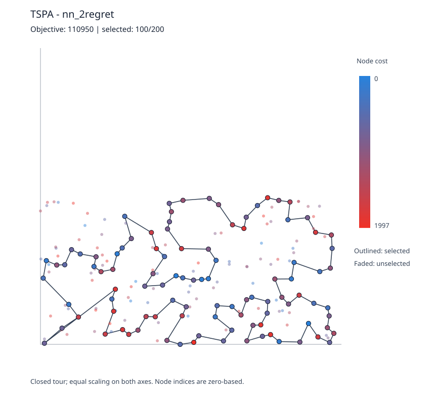
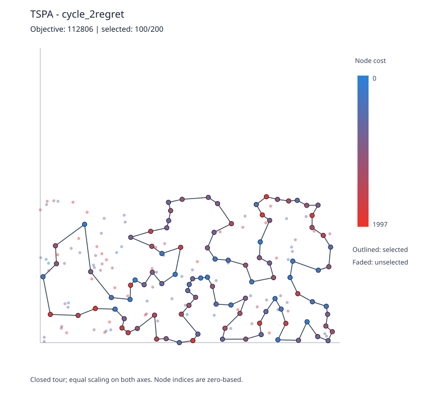
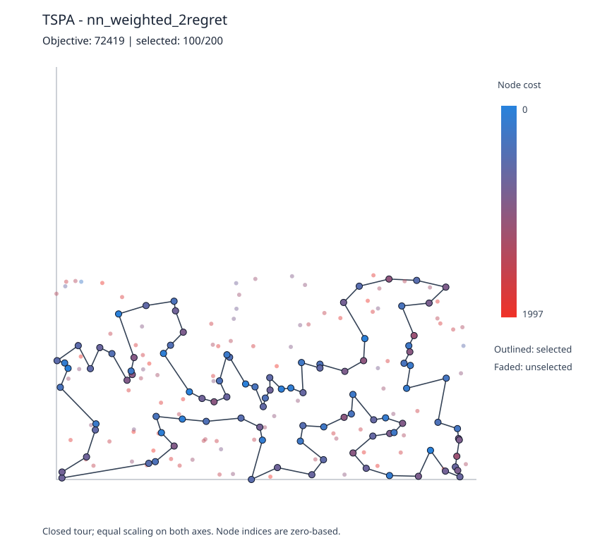
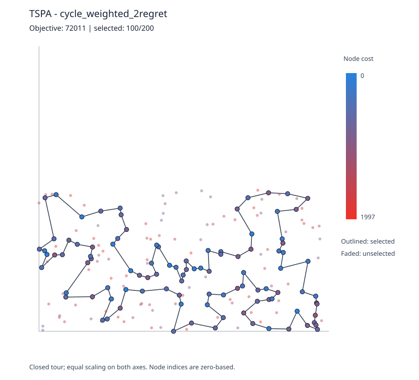
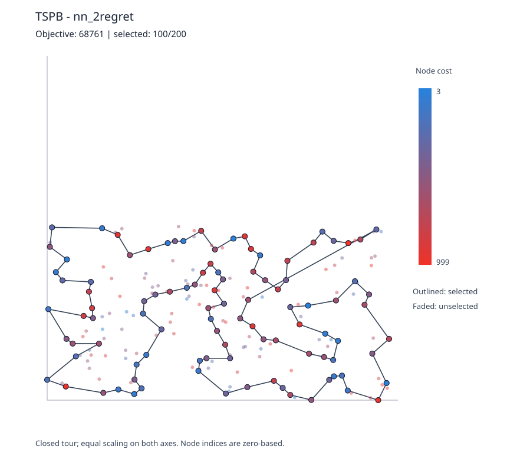
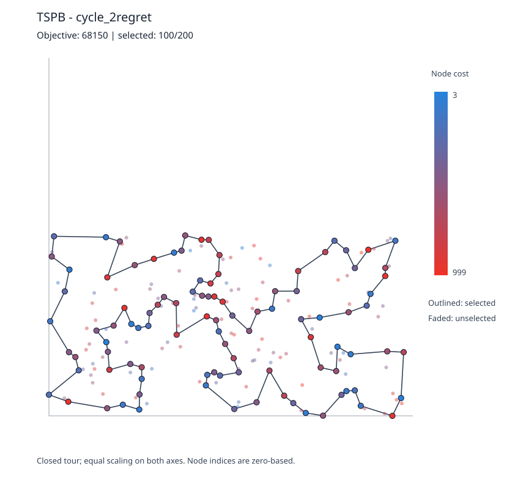
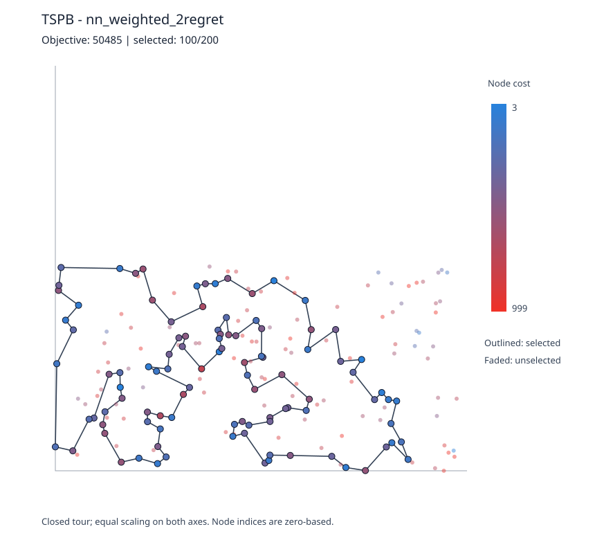
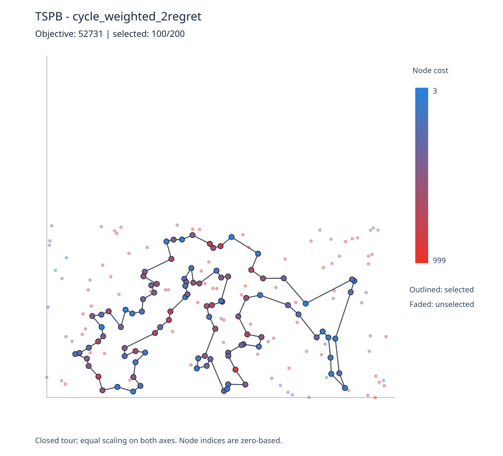

# Assignment 2 — Greedy Regret Heuristics

**Students:**  
Baris Surmelioglu - 152048  
Ozan Polat - 150918

**Course:** Evolutionary Computation, Poznań University of Technology  
**Language:** C++17 (standard library only)  
**Instances:** TSPA and TSPB, 200 nodes each  
**Experiment:** 200 solutions per new method per instance, 1,600 new solutions  
**Default weights:** 0.5 and 0.5

## 1. Problem description

The problem remains the same as in Assignment 1. Each row of the input file has `x;y;cost`. We select exactly `k = ceil(n/2)` different nodes and visit each selected node once in a Hamiltonian cycle. For the supplied 200-node data sets, this means choosing 100 nodes.

The objective is to minimize the total length of the closed path plus the sum of the selected-node costs:

```text
f(S) = sum(i=0..k-1) [c(S[i]) + D[S[i], S[(i+1) mod k]]]
D[i,j] = floor(sqrt((x[i]-x[j])^2 + (y[i]-y[j])^2) + 0.5)
```

The rounded Euclidean distance matrix is calculated immediately after reading the instance. Algorithms use only the distance matrix and node costs; coordinates are used later for plotting and independent checking.

## 2. Methods and pseudocode

The assignment asks for two criteria applied to both the extended nearest-neighbor and greedy-cycle approaches from Assignment 1. Therefore, four variants are implemented.

### 2.1 Insertion cost and 2-regret

For each unused node `v`, find the cheapest and second-cheapest insertion **positions** in the partial solution, taking node cost into account.

```text
best(v)   = minimum insertion cost of v
second(v) = second-smallest insertion cost of v
regret(v) = second(v) - best(v)
```

The nearest-neighbor extension uses an **open path** with insertion at the start, end, or any interior gap:

```text
At start:       delta = c[v] + D[v, first]
At end:         delta = c[v] + D[last, v]
Between a,b:    delta = c[v] + D[a,v] + D[v,b] - D[a,b]
```

Greedy cycle maintains a **closed cycle** throughout construction. For insertion on edge (a,b):

```text
delta = c[v] + D[a,v] + D[v,b] - D[a,b]
```

A one-node closed cycle has only one insertion position, so the second-best delta is set equal to the best delta and its regret is zero. For the open path, we include the closing edge at the final evaluation. All reported objectives include that edge.

### 2.2 Greedy 2-regret method

Choose the node with the largest regret, then insert it in its cheapest position. If several nodes have the same regret, choose the smaller best insertion cost, then the smaller node index.

```text
TWO-REGRET(start, basis):
    S <- [start]
    while |S| < ceil(n/2):
        for every unused node v:
            calculate insertion costs over all permitted positions
            best[v], second[v] <- two smallest insertion costs
            regret[v] <- second[v] - best[v]
        v <- node maximizing regret[v]
             (ties: smaller best[v], then smaller index)
        insert v at its cheapest position
    return S
```

We execute this separately for open-path nearest neighbor and closed-cycle greedy insertion.

### 2.3 Weighted 2-regret method

The second requested criterion combines 2-regret and the best objective change, using equal weights by default:

```text
score(v) = 0.5 * (second(v) - best(v)) - 0.5 * best(v)
```

The minus sign means that a smaller cost increase is preferred, while larger regret is preferred. Both terms are measured in objective-cost units. The program also permits other nonnegative weights, but all reported experiments use equal 0.5/0.5 weights.

```text
WEIGHTED-TWO-REGRET(start, basis, wr=0.5, wc=0.5):
    S <- [start]
    while |S| < ceil(n/2):
        for every unused node v:
            calculate best[v] and second[v] insertion costs
            regret[v] <- second[v] - best[v]
            score[v] <- wr * regret[v] - wc * best[v]
        v <- node maximizing score[v]
             (ties: smaller best[v], then smaller index)
        insert v at its cheapest position
    return S
```

This criterion is used on both the open path and the closed cycle.

### 2.4 Experiment setup and complexity

```text
for instance in [TSPA, TSPB]:
    load nodes, then build integer distance matrix
    for each of the four new variants:
        for start in 0..199:
            create a tour starting at start
            evaluate full closed-cycle objective
            record its objective and retain the best tour
        output min, max, average, and best-tour plot
```

All methods are deterministic. The distance matrix requires `O(n²)` time and memory. The straightforward implementation of each regret construction requires `O(n*k²)` time per run. No local search is included.

## 3. Computational experiment

Each new method was tested from every starting node (0–199). The results of the four methods from Assignment 1 are also included, as requested. Lower values are better.

| Instance | Assignment | Method | Runs | Minimum | Maximum | Average |
| --- | ---: | --- | ---: | ---: | ---: | ---: |
| TSPA | 1 | Random solution | 200 | 240,208 | 286,886 | 262,921.230 |
| TSPA | 1 | Nearest neighbor — end | 200 | 84,362 | 90,075 | 87,476.630 |
| TSPA | 1 | Nearest neighbor — all positions | 200 | 72,328 | 77,022 | 74,346.965 |
| TSPA | 1 | Greedy cycle | 200 | 72,590 | 75,281 | 73,793.405 |
| TSPA | 2 | Nearest neighbor + 2-regret | 200 | 110,950 | 135,771 | 121,360.290 |
| TSPA | 2 | Greedy cycle + 2-regret | 200 | 112,806 | 128,089 | 120,378.765 |
| TSPA | 2 | Nearest neighbor + weighted 2-regret | 200 | 72,419 | 78,504 | 75,549.360 |
| TSPA | 2 | Greedy cycle + weighted 2-regret | 200 | 72,011 | 75,532 | 73,353.485 |
| TSPB | 1 | Random solution | 200 | 185,062 | 231,127 | 208,006.445 |
| TSPB | 1 | Nearest neighbor — end | 200 | 56,007 | 63,166 | 59,397.335 |
| TSPB | 1 | Nearest neighbor — all positions | 200 | 52,915 | 66,164 | 59,475.495 |
| TSPB | 1 | Greedy cycle | 200 | 55,655 | 63,734 | 59,649.910 |
| TSPB | 2 | Nearest neighbor + 2-regret | 200 | 68,761 | 79,756 | 73,649.840 |
| TSPB | 2 | Greedy cycle + 2-regret | 200 | 68,150 | 77,274 | 72,484.840 |
| TSPB | 2 | Nearest neighbor + weighted 2-regret | 200 | 50,485 | 61,406 | 55,698.940 |
| TSPB | 2 | Greedy cycle + weighted 2-regret | 200 | 52,731 | 63,370 | 57,863.290 |

All 1,600 new run-level objective values are in [runs.csv](results/runs.csv). The new results are in [summary.csv](results/summary.csv) and all previous/new summary values in [comparison_summary.csv](results/comparison_summary.csv).

## 4. Best tours and 2D visualizations

Every visualization includes all 200 nodes and the best closed cycle through 100 selected nodes. Node costs are shown using blue-to-orange colors; dark outlines mark selected nodes and faded dots mark excluded nodes. The lists below contain zero-based node indices and do not repeat the final closing node.

### TSPA — Nearest neighbor + 2-regret

**Objective: 110,950**



```text
104, 69, 120, 97, 168, 149, 11, 49, 108, 152, 100, 123, 148, 162, 132, 76, 4, 157, 18, 173,
16, 156, 28, 185, 67, 144, 179, 177, 36, 33, 143, 190, 139, 112, 5, 115, 175, 39, 154, 34,
109, 186, 136, 197, 163, 19, 178, 101, 155, 21, 147, 37, 47, 50, 93, 81, 43, 113, 117, 130,
159, 170, 75, 26, 78, 122, 107, 64, 57, 105, 182, 111, 138, 165, 151, 150, 176, 72, 65, 134,
84, 58, 158, 192, 181, 118, 114, 25, 121, 73, 45, 70, 96, 10, 183, 166, 32, 40, 30, 23
```

### TSPA — Greedy cycle + 2-regret

**Objective: 112,806**



```text
166, 183, 10, 70, 22, 25, 114, 118, 181, 121, 61, 41, 140, 53, 179, 177, 36, 99, 84, 134,
72, 65, 20, 192, 111, 182, 165, 151, 106, 89, 124, 57, 64, 107, 88, 78, 26, 75, 170, 159,
130, 117, 93, 50, 47, 37, 147, 6, 46, 86, 55, 17, 29, 19, 163, 197, 136, 195, 184, 164,
142, 85, 81, 174, 194, 9, 33, 143, 62, 34, 154, 39, 175, 115, 5, 112, 139, 18, 4, 196,
51, 190, 67, 185, 156, 28, 180, 191, 141, 30, 160, 80, 82, 11, 168, 188, 120, 125, 187, 189
```

### TSPA — Nearest neighbor + weighted 2-regret

**Objective: 72,419**



```text
171, 2, 189, 187, 30, 141, 87, 45, 73, 135, 114, 181, 192, 158, 58, 84, 134, 72, 176, 174,
150, 106, 113, 89, 42, 151, 138, 182, 57, 64, 107, 88, 78, 193, 153, 75, 170, 146, 159, 130,
47, 93, 50, 3, 169, 1, 59, 178, 101, 55, 29, 163, 136, 186, 164, 142, 8, 9, 54, 33,
131, 36, 177, 52, 179, 53, 140, 144, 67, 16, 51, 35, 185, 102, 28, 180, 132, 76, 4, 71,
157, 91, 80, 100, 123, 83, 160, 152, 108, 49, 60, 116, 149, 63, 168, 97, 127, 69, 129, 104
```

### TSPA — Greedy cycle + weighted 2-regret

**Objective: 72,011**



```text
60, 116, 149, 63, 168, 11, 49, 108, 152, 100, 123, 83, 160, 97, 127, 161, 30, 187, 171, 2,
189, 141, 87, 45, 73, 135, 114, 181, 192, 158, 58, 84, 134, 72, 176, 174, 150, 106, 113, 89,
42, 151, 138, 182, 57, 64, 107, 88, 78, 193, 153, 75, 170, 146, 159, 130, 47, 93, 50, 3,
169, 1, 178, 101, 55, 29, 163, 136, 186, 164, 142, 8, 9, 54, 33, 131, 36, 177, 52, 179,
53, 140, 144, 67, 16, 51, 35, 185, 102, 28, 180, 132, 76, 4, 71, 157, 91, 80, 48, 31
```

### TSPB — Nearest neighbor + 2-regret

**Objective: 68,761**



```text
94, 169, 199, 70, 190, 194, 77, 104, 144, 185, 79, 57, 83, 44, 89, 156, 164, 96, 198, 121,
195, 50, 7, 116, 37, 13, 149, 28, 145, 158, 138, 55, 177, 53, 65, 178, 103, 180, 132, 1,
108, 62, 175, 134, 45, 157, 60, 40, 64, 47, 38, 21, 168, 172, 8, 92, 166, 72, 46, 109,
3, 122, 151, 98, 25, 181, 73, 59, 85, 82, 88, 163, 99, 39, 17, 74, 20, 14, 2, 23,
110, 118, 131, 143, 148, 196, 78, 54, 162, 106, 127, 90, 153, 182, 150, 84, 66, 35, 27, 135
```

### TSPB — Greedy cycle + 2-regret

**Objective: 68,150**



```text
167, 181, 25, 98, 151, 122, 128, 4, 168, 183, 176, 38, 47, 140, 154, 161, 26, 177, 170, 115,
113, 155, 141, 60, 157, 134, 175, 62, 108, 1, 132, 103, 178, 65, 145, 149, 13, 37, 116, 147,
123, 50, 195, 121, 198, 58, 16, 164, 43, 166, 92, 120, 133, 8, 117, 95, 109, 3, 27, 135,
76, 185, 104, 77, 194, 190, 70, 187, 165, 105, 139, 193, 114, 10, 78, 54, 162, 106, 150, 182,
127, 90, 56, 131, 110, 23, 2, 14, 20, 74, 17, 171, 99, 163, 31, 88, 82, 85, 59, 73
```

### TSPB — Nearest neighbor + weighted 2-regret

**Objective: 50,485**



```text
65, 145, 28, 149, 13, 146, 37, 116, 147, 42, 50, 130, 63, 121, 198, 96, 48, 156, 89, 57,
185, 76, 104, 162, 54, 192, 80, 127, 129, 90, 153, 14, 2, 20, 74, 17, 171, 99, 88, 179,
87, 82, 51, 85, 59, 73, 167, 181, 152, 34, 24, 67, 66, 27, 98, 151, 122, 3, 184, 46,
72, 117, 8, 120, 133, 136, 172, 160, 69, 124, 21, 183, 30, 38, 47, 154, 140, 64, 33, 40,
141, 155, 71, 60, 157, 45, 134, 175, 62, 36, 197, 6, 115, 170, 125, 177, 29, 132, 174, 1
```

### TSPB — Greedy cycle + weighted 2-regret

**Objective: 52,731**



```text
36, 197, 132, 29, 6, 180, 115, 170, 177, 125, 26, 97, 154, 140, 47, 38, 21, 30, 183, 191,
130, 63, 121, 198, 96, 48, 43, 156, 32, 89, 57, 79, 185, 104, 54, 196, 114, 10, 90, 14,
2, 20, 153, 129, 127, 80, 192, 162, 76, 135, 27, 11, 66, 67, 24, 34, 152, 181, 126, 88,
179, 87, 82, 167, 51, 85, 59, 73, 98, 151, 122, 173, 3, 184, 86, 46, 72, 117, 8, 120,
133, 136, 172, 160, 69, 124, 4, 64, 33, 155, 71, 141, 40, 60, 157, 45, 134, 175, 62, 91
```

These tours are also available as plain-text lists in [best_solutions.txt](results/best_solutions.txt).

## 5. Solution checking and tests

All eight new best tours passed an independent C++ checker, which recalculates rounded Euclidean distances directly from CSV coordinates, verifies that each tour has 100 unique valid node indices, checks the closing edge and compares the total with the reported objective. Its output is stored in [checker_output.txt](results/checker_output.txt).

The instructor-provided `Solution checker.xlsx` was also used as a calculation reference. We checked that the TSPA and TSPB worksheets contain the same 200 nodes as the original CSV files. The Excel rules are: `F103 = F3` (close tour), `I2 = SUM(I3:I102)` (selected-node costs), `J2 = SUM(J3:J102)` (integer-rounded distances) and `K2 = I2 + J2` (objective). We evaluated all eight new tours programmatically according to those spreadsheet formulas. **All eight agree.** This is a programmatic check of the original Excel formulas, not a claim of manual recalculation in Microsoft Excel.

| Instance | Method | Distance (J2) | Node costs (I2) | Objective (K2) | Status |
| --- | --- | ---: | ---: | ---: | :---: |
| TSPA | Nearest neighbor + 2-regret | 21,279 | 89,671 | 110,950 | PASS |
| TSPA | Greedy cycle + 2-regret | 21,429 | 91,377 | 112,806 | PASS |
| TSPA | Nearest neighbor + weighted 2-regret | 20,127 | 52,292 | 72,419 | PASS |
| TSPA | Greedy cycle + weighted 2-regret | 20,248 | 51,763 | 72,011 | PASS |
| TSPB | Nearest neighbor + 2-regret | 22,801 | 45,960 | 68,761 | PASS |
| TSPB | Greedy cycle + 2-regret | 21,400 | 46,750 | 68,150 | PASS |
| TSPB | Nearest neighbor + weighted 2-regret | 18,835 | 31,650 | 50,485 | PASS |
| TSPB | Greedy cycle + weighted 2-regret | 16,365 | 36,366 | 52,731 | PASS |

A machine-readable record is in [instructor_checker_validation.csv](results/instructor_checker_validation.csv). The spreadsheet alone does not guarantee unique indices, so the independent C++ checker also checks uniqueness and cardinality.

C++ unit tests cover insertion deltas against recomputation, first/second-best insertion positions, both construction bases, special one-node cases, odd/even instance sizes, weight handling and valid tours. All test checks passed, and the program compiled in C++17 with compiler warnings enabled.

## 6. Source code

- [Complete Assignment 2 C++ source](https://github.com/BarisAI/PUT-evolutionary-computation/tree/main/Assignment%202/src)
- [Regret heuristic implementation](src/regret.hpp)
- [Experiment runner and SVG plots](src/main.cpp)
- [Independent checker](src/checker.cpp)
- [Unit tests](src/tests.cpp)
- [Instructions for building and reproducing results](README.md)
- [Original instance loader and objective](../Assignment%201/src/problem.hpp)

## 7. Conclusions

1. Adding the **best insertion cost** to the weighted selection criterion significantly improved the results compared with using only 2-regret. Pure regret frequently selected expensive nodes with a large difference between insertion positions.
2. The best **TSPA** solution was found by **greedy cycle + weighted 2-regret**, with objective **72,011**. The previous best in Assignment 1 was **72,328**, an improvement of **317 (0.44%)**.
3. The best **TSPB** solution was found by **nearest neighbor + weighted 2-regret**, with objective **50,485**. The previous best was **52,915**, an improvement of **2,430 (4.59%)**.
4. No single new variant gave the best result on both instances. The closed/open construction approach matters, even when the selection criterion is otherwise identical.
5. These are constructive heuristics and the recorded minima are only the best of 200 starting-node trials. They are not proven global optima.
