# Assignment 3 - Local Search

**Students:**  
Baris Surmelioglu - 152048  
Ozan Polat - 150918  

**Course:** Evolutionary Computation, Poznan University of Technology  
**Implementation:** C++17; TSPA and TSPB, 200 nodes each  
**Experiment:** 8 local-search combinations x 200 starts x 2 instances = 3,200 runs  
**Random seed:** fixed and documented for repeatability

## 1. Problem description

We use exactly the same weighted partial traveling-salesperson problem as in Assignments 1 and 2. Each solution contains exactly 100 distinct nodes of a 200-node instance, visited in a closed cycle. We minimize rounded travel length plus the sum of selected-node costs. The distance matrix is built once from coordinates, and all optimization uses only that matrix and the node costs.

```text
objective = sum over all selected nodes (cost[node] + D[node,next_node])
D[i,j]  = floor(hypot(x[i]-x[j], y[i]-y[j]) + 0.5)
```

## 2. Local search implementation

### 2.1 Move neighborhoods and delta formulas

The total neighborhood is the UNION of one intra-route move type and inter-route node replacement. Both move classes participate in the *same* search scan. We use two intra-route alternatives, creating eight methods from the three binary options listed in the assignment.

- **Selected-node swap (intra-route):** swap positions i and j without changing the set of selected nodes. Delta is computed from the set of up to four affected cycle edges, counting each edge once (also works for adjacent and wrap-around swaps). No node costs change.
- **2-opt (intra-route):** remove edges (a,b) and (c,d), reconnect (a,c) and (b,d), and reverse the segment between the two removed edges. With symmetric distance: `delta = D[a,c]+D[b,d]-D[a,b]-D[c,d]`. Trivial adjacent-edge moves are omitted.
- **Selected/unselected replacement (inter-route):** replace a selected node `old` at one position with an unselected node `new`:

```text
delta = cost[new]-cost[old]
      + D[prev,new] + D[new,next] - D[prev,old] - D[old,next]
```

All three delta functions run in constant time: we never construct and score a complete neighboring solution inside a search scan. We also do not use delta caches from prior iterations or restricted candidate moves.

### 2.2 Steepest improvement

Steepest evaluates the delta of every possible intra-route and inter-route move, chooses the most negative delta from the whole neighborhood, and applies exactly that move. It terminates when no negative delta remains.

```text
STEEPEST(initial, intra_type):
    tour = initial
    repeat:
        best_delta = 0; best_move = none
        for move in ALL intra_type swaps/2-opt + ALL selected/unselected replacements:
            delta = calculate_delta(tour, move)
            if delta < best_delta: best_delta, best_move = delta, move
        if best_move is none: stop
        apply(best_move); objective += best_delta
```

### 2.3 Basic greedy: randomized first improvement

Greedy implements the simple **first improving move** algorithm. A single pool contains *all* intra-route and inter-route moves. In each iteration, an **online Fisher-Yates random permutation** visits a uniformly randomized prefix of that pool: just before checking the next move, we randomly select one as-yet-unvisited move and swap it into the current position. The delta is calculated **only when that move is visited**, and scanning stops immediately on the first negative delta. We do not calculate all deltas before randomization. No old deltas or candidate-list optimizations are used.

```text
GREEDY(initial, intra_type, rng):
    tour = initial
    repeat:
        pool = all intra_type + inter-route move descriptions
        for i = 0 .. pool.size-1:
            j = uniform integer [i, pool.size-1]
            swap(pool[i], pool[j])
            delta = calculate_delta(tour, pool[i])  # evaluated now, not earlier
            if delta < 0: apply(pool[i]); objective += delta; break
        if no improving move was found: stop
```

### 2.4 Starting solutions and experiment design

- **Random start:** the Fisher-Yates random generator from Assignment 1; the same 200 randomly generated initial tours per instance are supplied to all random-start combinations.
- **Constructed start:** for each start node 0..199, we use the best previously tested constructive heuristic **for that instance**: TSPA = weighted greedy cycle from Assignment 2, TSPB = weighted all-position NN from Assignment 2. The same 200 constructed tours per instance are shared across the four relevant local-search combinations.
- Each of the 8 combinations runs 200 times for both TSPA and TSPB. Local Search stops at a complete local optimum. A run never accepts a non-improving move.
- Runtime uses `std::chrono::steady_clock` in milliseconds; the main comparison is **end-to-end generation plus local search**. The separate local-search time is recorded for new methods. Previous eight methods are re-executed in the same C++17 executable and optimized build for a fairer runtime comparison. Short times are system-dependent.

## 3. Computational experiment - objective values

The table follows the requested format: **average (minimum - maximum)** for each instance. Results for all eight earlier methods are included.

| Assignment | Method | TSPA avg (min - max) | TSPB avg (min - max) |
|:---:|---|---:|---:|
| 1 | Random solution | 262,921.230 (240,208 - 286,886) | 208,006.445 (185,062 - 231,127) |
| 1 | Nearest neighbor - end | 87,476.630 (84,362 - 90,075) | 59,397.335 (56,007 - 63,166) |
| 1 | Nearest neighbor - all positions | 74,346.965 (72,328 - 77,022) | 59,475.495 (52,915 - 66,164) |
| 1 | Greedy cycle | 73,793.405 (72,590 - 75,281) | 59,649.910 (55,655 - 63,734) |
| 2 | NN - 2-regret | 121,360.290 (110,950 - 135,771) | 73,649.840 (68,761 - 79,756) |
| 2 | Cycle - 2-regret | 120,378.765 (112,806 - 128,089) | 72,484.840 (68,150 - 77,274) |
| 2 | NN - weighted 2-regret | 75,549.360 (72,419 - 78,504) | 55,698.940 (50,485 - 61,406) |
| 2 | Cycle - weighted 2-regret | 73,353.485 (72,011 - 75,532) | 57,863.290 (52,731 - 63,370) |
| 3 | Steepest / node swap / random | 89,822.500 (81,543 - 98,230) | 66,408.020 (59,519 - 73,679) |
| 3 | Steepest / 2-opt / random | 76,160.405 (73,763 - 79,710) | 52,595.635 (50,659 - 54,962) |
| 3 | Steepest / node swap / constructed | 73,021.685 (71,955 - 74,861) | 54,292.935 (49,978 - 61,265) |
| 3 | Steepest / 2-opt / constructed | 73,003.775 (71,955 - 74,861) | 53,091.990 (49,346 - 60,354) |
| 3 | Greedy / node swap / random | 87,578.270 (81,822 - 99,063) | 63,830.900 (57,293 - 70,072) |
| 3 | Greedy / 2-opt / random | 76,214.665 (73,873 - 78,418) | 52,858.875 (50,536 - 56,575) |
| 3 | Greedy / node swap / constructed | 73,023.590 (71,955 - 74,877) | 54,279.830 (49,978 - 61,265) |
| 3 | Greedy / 2-opt / constructed | 72,981.475 (71,955 - 74,861) | 53,193.085 (49,581 - 60,415) |

Full records: [runs.csv](results/runs.csv) for the 3,200 new experiments; [previous_runs.csv](results/previous_runs.csv) for the 3,200 old-method remeasurements; [objective_summary.csv](results/objective_summary.csv), [comparison_objectives.csv](results/comparison_objectives.csv).

## 4. Computational experiment - running times

**Average end-to-end milliseconds per run**, including construction of the starting solution for Assignment 3 (same data, same machine and compiler). For constructed starts, the measured constructor cost is included; it often dominates runtime. Earlier methods were re-executed in this same environment, not copied from an older report.

| Assignment | Method | TSPA mean ms | TSPB mean ms |
|:---:|---|---:|---:|
| 1 | Random solution | 0.003 | 0.001 |
| 1 | Nearest neighbor - end | 0.076 | 0.058 |
| 1 | Nearest neighbor - all positions | 1.251 | 1.054 |
| 1 | Greedy cycle | 2.632 | 2.548 |
| 2 | NN - 2-regret | 1.573 | 1.539 |
| 2 | Cycle - 2-regret | 2.438 | 2.259 |
| 2 | NN - weighted 2-regret | 1.575 | 1.525 |
| 2 | Cycle - weighted 2-regret | 2.238 | 2.093 |
| 3 | Steepest / node swap / random | 26.389 | 24.758 |
| 3 | Steepest / 2-opt / random | 10.208 | 9.394 |
| 3 | Steepest / node swap / constructed | 3.013 | 3.502 |
| 3 | Steepest / 2-opt / constructed | 2.612 | 2.742 |
| 3 | Greedy / node swap / random | 4.105 | 3.562 |
| 3 | Greedy / 2-opt / random | 2.413 | 2.086 |
| 3 | Greedy / node swap / constructed | 3.308 | 2.999 |
| 3 | Greedy / 2-opt / constructed | 2.845 | 2.758 |

For the new methods we also provide local-search-only timings in [runtime_summary.csv](results/runtime_summary.csv), along with the number of tested deltas for each run in [runs.csv](results/runs.csv).

## 5. Best solutions, node lists and 2D plots

Each plot shows all 200 nodes and the closed tour visiting the selected 100 nodes. Node color represents cost (blue = lower, orange = higher); outlined nodes are selected, faint nodes are unselected. The polyline is explicitly closed. Node indices start at zero.

### TSPA - Steepest / node swap / random

**Best objective: 81,543**

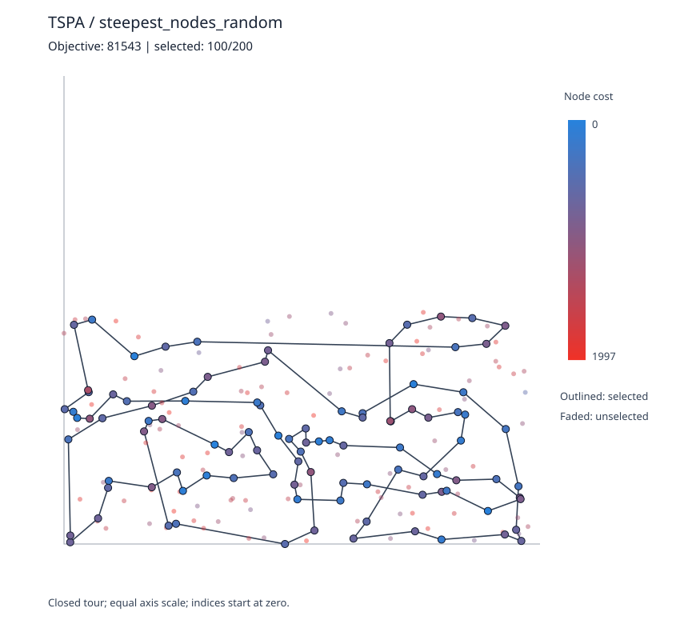

**Tour (100 zero-based node indices):**

```text
85, 142, 8, 194, 186, 136, 163, 29, 55, 101, 178, 157, 91, 80, 48, 31, 82, 60, 116, 149,
63, 11, 108, 152, 132, 51, 16, 67, 140, 73, 135, 58, 84, 134, 151, 42, 89, 107, 170, 146,
130, 113, 106, 174, 131, 36, 177, 179, 52, 144, 53, 41, 181, 114, 2, 171, 160, 123, 90, 180,
28, 35, 185, 45, 87, 141, 187, 30, 161, 97, 127, 69, 104, 129, 168, 49, 100, 76, 4, 139,
112, 33, 54, 9, 164, 1, 47, 159, 153, 78, 88, 57, 182, 192, 158, 176, 150, 93, 50, 3
```

### TSPA - Steepest / 2-opt / random

**Best objective: 73,763**

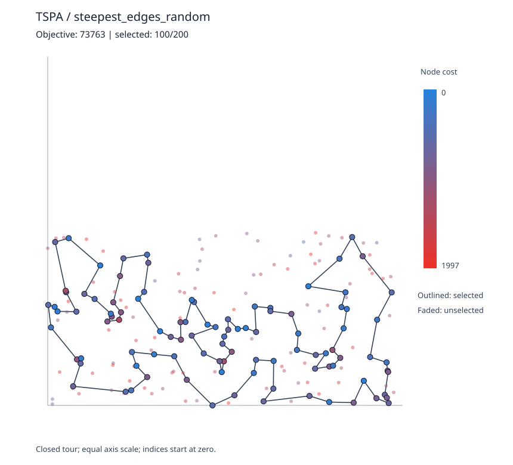

**Tour (100 zero-based node indices):**

```text
41, 140, 53, 179, 52, 177, 36, 131, 33, 9, 54, 8, 174, 176, 150, 106, 151, 42, 89, 113,
43, 93, 50, 3, 1, 164, 178, 29, 101, 147, 47, 130, 159, 146, 170, 153, 193, 78, 88, 107,
64, 57, 182, 192, 158, 134, 84, 58, 181, 114, 98, 87, 141, 30, 187, 189, 2, 171, 69, 127,
97, 95, 168, 116, 149, 63, 49, 60, 82, 31, 48, 80, 108, 152, 123, 83, 160, 148, 90, 100,
38, 91, 157, 71, 76, 132, 180, 28, 102, 156, 35, 51, 16, 67, 144, 185, 45, 73, 135, 61
```

### TSPA - Steepest / node swap / constructed

**Best objective: 71,955**

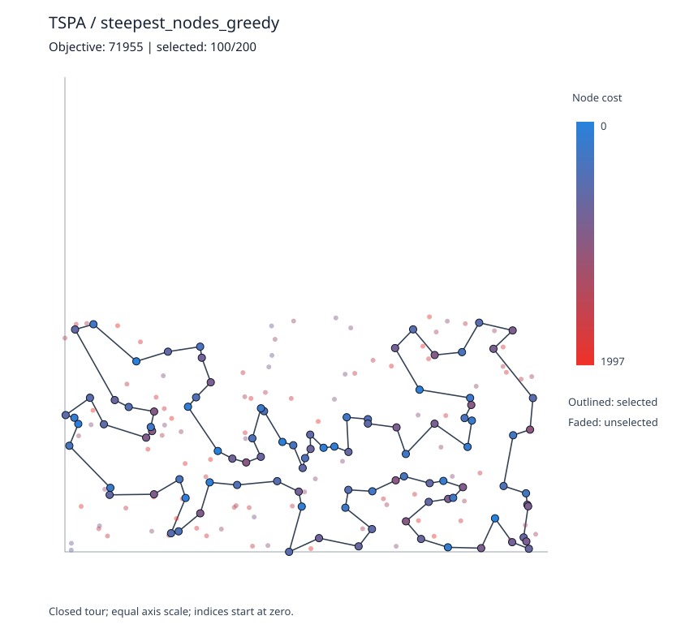

**Tour (100 zero-based node indices):**

```text
55, 29, 178, 184, 136, 186, 164, 1, 169, 3, 50, 93, 85, 174, 8, 54, 9, 33, 131, 36,
177, 52, 179, 53, 140, 144, 67, 16, 51, 35, 185, 102, 28, 180, 132, 76, 4, 71, 157, 91,
80, 48, 31, 108, 152, 100, 123, 83, 160, 49, 60, 116, 149, 63, 168, 97, 127, 161, 30, 187,
171, 2, 189, 141, 87, 45, 73, 135, 114, 181, 192, 158, 58, 84, 134, 72, 176, 150, 106, 113,
89, 42, 151, 138, 182, 57, 64, 107, 88, 78, 193, 153, 170, 146, 159, 130, 47, 37, 147, 101
```

### TSPA - Steepest / 2-opt / constructed

**Best objective: 71,955**

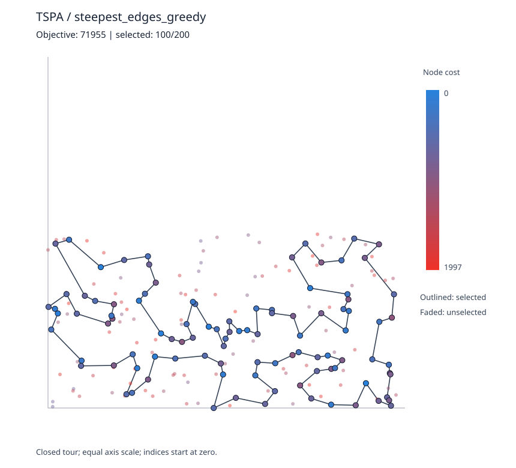

**Tour (100 zero-based node indices):**

```text
101, 147, 37, 47, 130, 159, 146, 170, 153, 193, 78, 88, 107, 64, 57, 182, 138, 151, 42, 89,
113, 106, 150, 176, 72, 134, 84, 58, 158, 192, 181, 114, 135, 73, 45, 87, 141, 189, 2, 171,
187, 30, 161, 127, 97, 168, 63, 149, 116, 60, 49, 160, 83, 123, 100, 152, 108, 31, 48, 80,
91, 157, 71, 4, 76, 132, 180, 28, 102, 185, 35, 51, 16, 67, 144, 140, 53, 179, 52, 177,
36, 131, 33, 9, 54, 8, 174, 85, 93, 50, 3, 169, 1, 164, 186, 136, 184, 178, 29, 55
```

### TSPA - Greedy / node swap / random

**Best objective: 81,822**

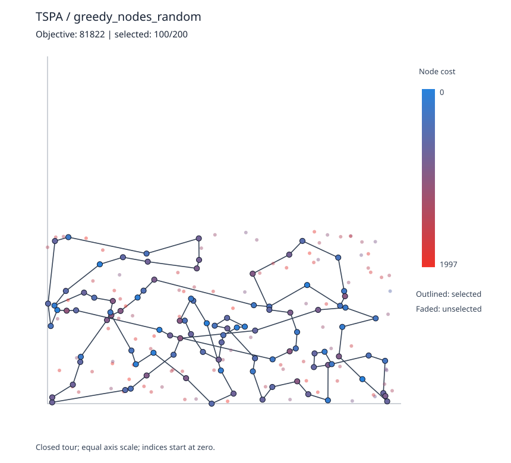

**Tour (100 zero-based node indices):**

```text
157, 115, 112, 139, 71, 91, 80, 60, 149, 108, 152, 100, 123, 160, 97, 127, 69, 129, 104, 171,
2, 189, 87, 102, 131, 85, 50, 47, 93, 113, 107, 78, 193, 153, 159, 130, 89, 106, 150, 151,
42, 57, 182, 138, 158, 192, 58, 84, 179, 144, 52, 36, 177, 53, 140, 73, 45, 185, 35, 156,
51, 16, 67, 135, 181, 114, 98, 141, 187, 30, 83, 90, 132, 76, 4, 33, 9, 164, 3, 169,
1, 178, 136, 186, 62, 54, 8, 174, 176, 72, 134, 28, 180, 49, 11, 63, 168, 116, 31, 48
```

### TSPA - Greedy / 2-opt / random

**Best objective: 73,873**

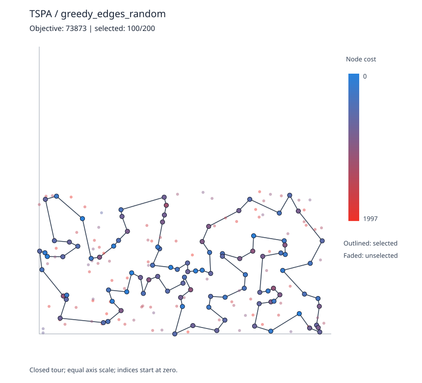

**Tour (100 zero-based node indices):**

```text
115, 5, 112, 139, 51, 16, 35, 67, 144, 52, 179, 177, 36, 131, 33, 143, 62, 186, 136, 178,
29, 101, 147, 47, 93, 130, 159, 170, 153, 193, 78, 88, 107, 57, 182, 151, 42, 89, 113, 43,
106, 150, 85, 3, 50, 169, 1, 164, 142, 8, 9, 54, 174, 176, 134, 84, 58, 158, 192, 181,
114, 135, 73, 41, 53, 140, 45, 185, 102, 87, 28, 180, 141, 30, 187, 189, 2, 171, 69, 127,
97, 95, 168, 116, 149, 63, 49, 152, 108, 60, 31, 48, 80, 123, 90, 132, 76, 4, 71, 157
```

### TSPA - Greedy / node swap / constructed

**Best objective: 71,955**


**Tour (100 zero-based node indices):**

```text
55, 29, 178, 184, 136, 186, 164, 1, 169, 3, 50, 93, 85, 174, 8, 54, 9, 33, 131, 36,
177, 52, 179, 53, 140, 144, 67, 16, 51, 35, 185, 102, 28, 180, 132, 76, 4, 71, 157, 91,
80, 48, 31, 108, 152, 100, 123, 83, 160, 49, 60, 116, 149, 63, 168, 97, 127, 161, 30, 187,
171, 2, 189, 141, 87, 45, 73, 135, 114, 181, 192, 158, 58, 84, 134, 72, 176, 150, 106, 113,
89, 42, 151, 138, 182, 57, 64, 107, 88, 78, 193, 153, 170, 146, 159, 130, 47, 37, 147, 101
```

### TSPA - Greedy / 2-opt / constructed

**Best objective: 71,955**

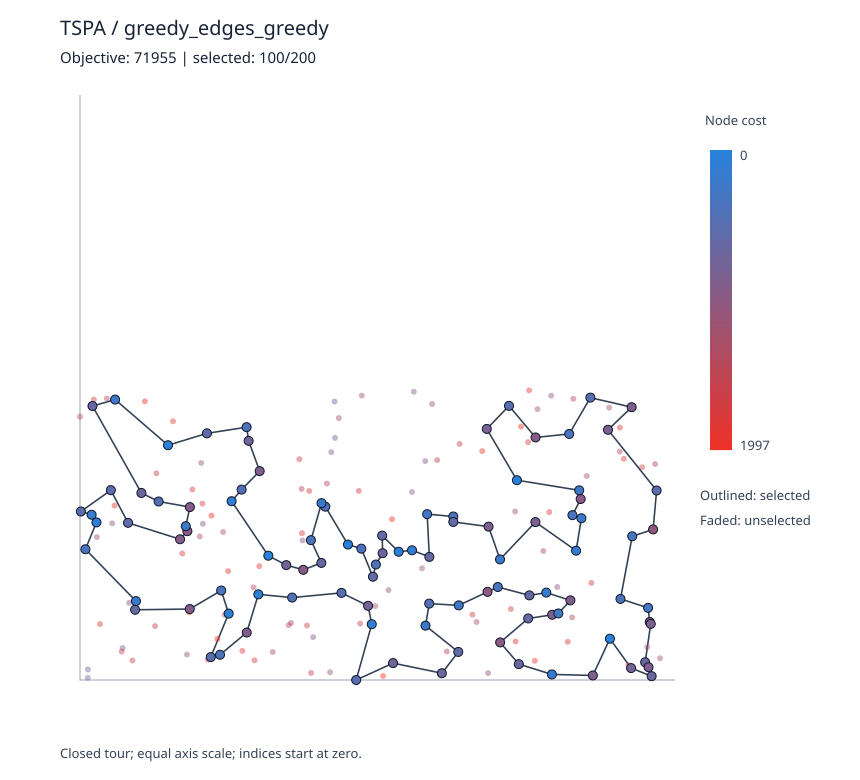

**Tour (100 zero-based node indices):**

```text
101, 147, 37, 47, 130, 159, 146, 170, 153, 193, 78, 88, 107, 64, 57, 182, 138, 151, 42, 89,
113, 106, 150, 176, 72, 134, 84, 58, 158, 192, 181, 114, 135, 73, 45, 87, 141, 189, 2, 171,
187, 30, 161, 127, 97, 168, 63, 149, 116, 60, 49, 160, 83, 123, 100, 152, 108, 31, 48, 80,
91, 157, 71, 4, 76, 132, 180, 28, 102, 185, 35, 51, 16, 67, 144, 140, 53, 179, 52, 177,
36, 131, 33, 9, 54, 8, 174, 85, 93, 50, 3, 169, 1, 164, 186, 136, 184, 178, 29, 55
```

### TSPB - Steepest / node swap / random

**Best objective: 59,519**

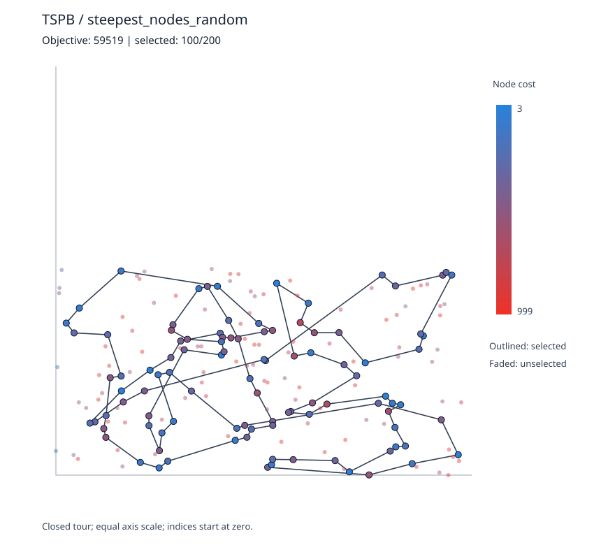

**Tour (100 zero-based node indices):**

```text
183, 191, 130, 121, 198, 120, 117, 151, 98, 152, 181, 167, 51, 85, 45, 134, 175, 36, 197, 6,
177, 125, 158, 145, 28, 149, 116, 96, 72, 86, 46, 8, 136, 133, 30, 38, 154, 170, 132, 29,
115, 97, 184, 3, 190, 70, 81, 94, 105, 196, 114, 10, 54, 104, 185, 79, 57, 89, 135, 76,
162, 192, 66, 24, 34, 67, 84, 127, 129, 90, 52, 153, 14, 20, 74, 171, 99, 88, 179, 87,
82, 17, 2, 110, 118, 80, 73, 59, 64, 47, 140, 40, 60, 157, 71, 155, 21, 69, 160, 172
```

### TSPB - Steepest / 2-opt / random

**Best objective: 50,659**

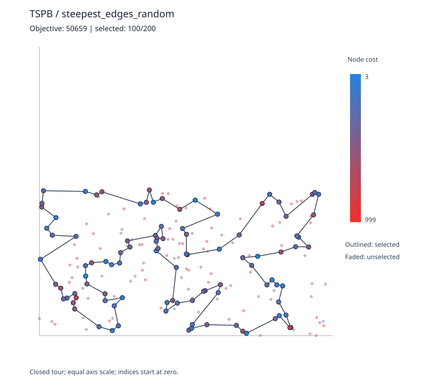

**Tour (100 zero-based node indices):**

```text
58, 96, 48, 156, 89, 57, 72, 46, 184, 3, 76, 104, 194, 190, 70, 187, 81, 94, 105, 61,
196, 114, 148, 10, 78, 54, 162, 192, 80, 127, 129, 90, 153, 14, 2, 188, 20, 74, 171, 39,
99, 88, 87, 82, 179, 67, 66, 24, 34, 181, 167, 85, 59, 73, 151, 69, 160, 172, 136, 8,
120, 133, 30, 21, 38, 47, 140, 154, 26, 125, 170, 115, 155, 71, 40, 60, 45, 134, 175, 36,
197, 5, 6, 29, 132, 103, 178, 65, 158, 145, 28, 149, 13, 146, 37, 116, 147, 42, 121, 198
```

### TSPB - Steepest / node swap / constructed

**Best objective: 49,978**


**Tour (100 zero-based node indices):**

```text
65, 145, 28, 149, 13, 146, 37, 116, 147, 42, 50, 191, 130, 121, 198, 96, 48, 156, 89, 57,
185, 76, 162, 54, 192, 80, 127, 129, 90, 153, 14, 2, 20, 74, 17, 171, 99, 88, 179, 87,
82, 51, 85, 59, 73, 167, 181, 152, 34, 24, 67, 66, 27, 98, 151, 122, 3, 184, 46, 72,
117, 8, 120, 133, 136, 172, 160, 69, 189, 21, 183, 30, 38, 154, 140, 47, 64, 33, 40, 141,
155, 71, 60, 157, 45, 134, 175, 62, 36, 197, 6, 115, 170, 125, 177, 178, 29, 132, 174, 1
```

### TSPB - Steepest / 2-opt / constructed

**Best objective: 49,346**

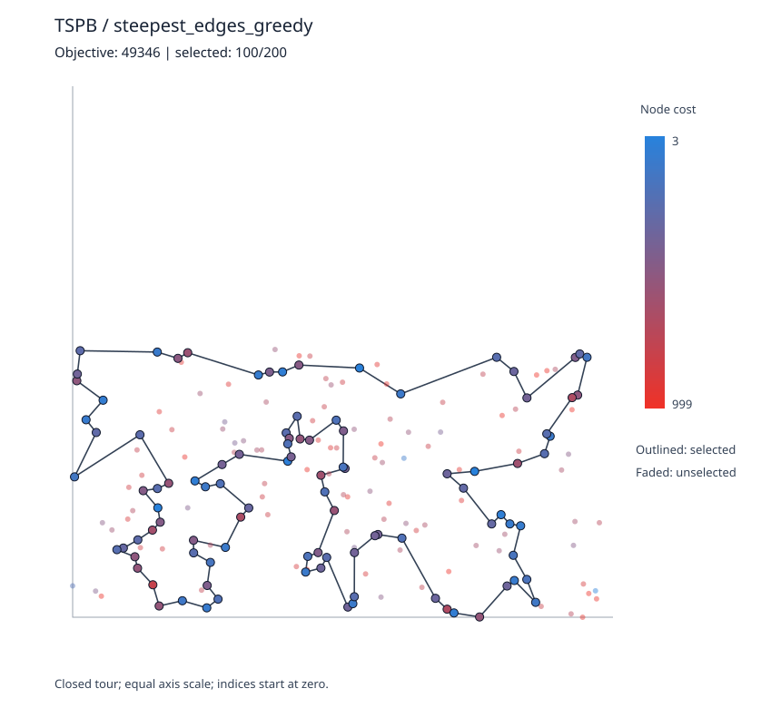

**Tour (100 zero-based node indices):**

```text
65, 145, 28, 149, 13, 146, 37, 116, 147, 42, 121, 198, 96, 48, 89, 57, 190, 70, 187, 81,
94, 105, 61, 139, 196, 114, 10, 78, 54, 162, 192, 80, 127, 129, 90, 153, 14, 2, 20, 74,
17, 171, 39, 99, 67, 24, 34, 181, 179, 87, 82, 167, 51, 85, 59, 73, 98, 151, 122, 3,
184, 46, 72, 117, 8, 120, 133, 136, 172, 160, 69, 21, 38, 154, 140, 47, 64, 33, 40, 155,
71, 60, 157, 45, 134, 175, 62, 91, 36, 197, 132, 29, 6, 180, 115, 170, 177, 125, 26, 158
```

### TSPB - Greedy / node swap / random

**Best objective: 57,293**

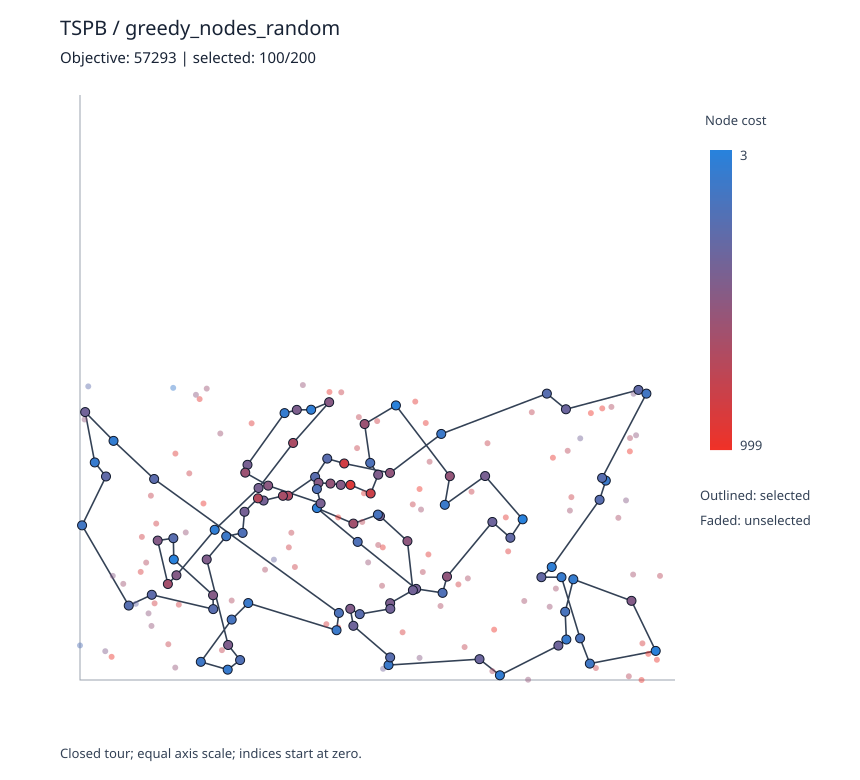

**Tour (100 zero-based node indices):**

```text
60, 40, 85, 59, 158, 149, 146, 28, 145, 65, 132, 6, 71, 155, 170, 125, 177, 180, 115, 154,
30, 63, 48, 96, 198, 121, 130, 191, 183, 160, 172, 136, 8, 117, 95, 137, 46, 72, 156, 89,
185, 76, 104, 54, 192, 162, 66, 67, 24, 151, 69, 122, 184, 3, 27, 34, 152, 181, 167, 73,
51, 179, 87, 99, 171, 74, 20, 153, 90, 118, 110, 2, 14, 129, 80, 127, 10, 114, 196, 105,
94, 70, 190, 57, 86, 92, 120, 133, 168, 189, 21, 176, 38, 47, 140, 97, 157, 45, 134, 175
```

### TSPB - Greedy / 2-opt / random

**Best objective: 50,536**

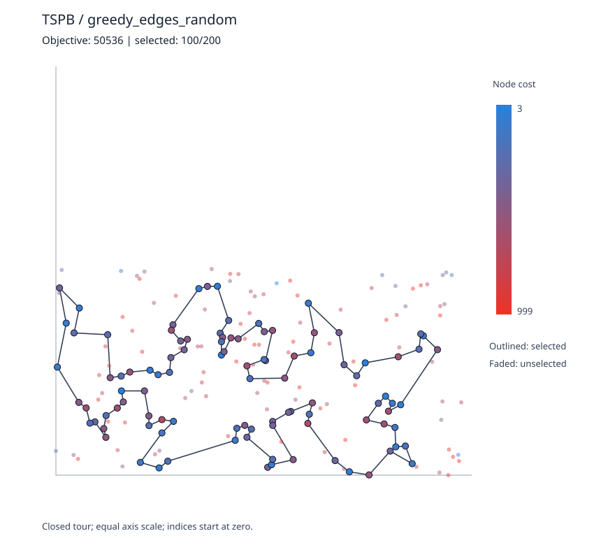

**Tour (100 zero-based node indices):**

```text
31, 99, 171, 17, 74, 2, 14, 20, 153, 182, 150, 80, 127, 129, 52, 90, 148, 114, 196, 10,
78, 54, 192, 162, 104, 57, 185, 76, 135, 27, 151, 122, 184, 3, 86, 46, 72, 117, 8, 160,
69, 172, 136, 133, 120, 96, 198, 121, 130, 191, 30, 183, 21, 38, 47, 140, 154, 26, 125, 177,
158, 145, 149, 146, 28, 65, 178, 103, 132, 29, 36, 197, 6, 180, 115, 170, 97, 155, 71, 141,
40, 60, 175, 134, 45, 85, 59, 73, 167, 51, 179, 82, 87, 88, 181, 152, 34, 24, 66, 67
```

### TSPB - Greedy / node swap / constructed

**Best objective: 49,978**

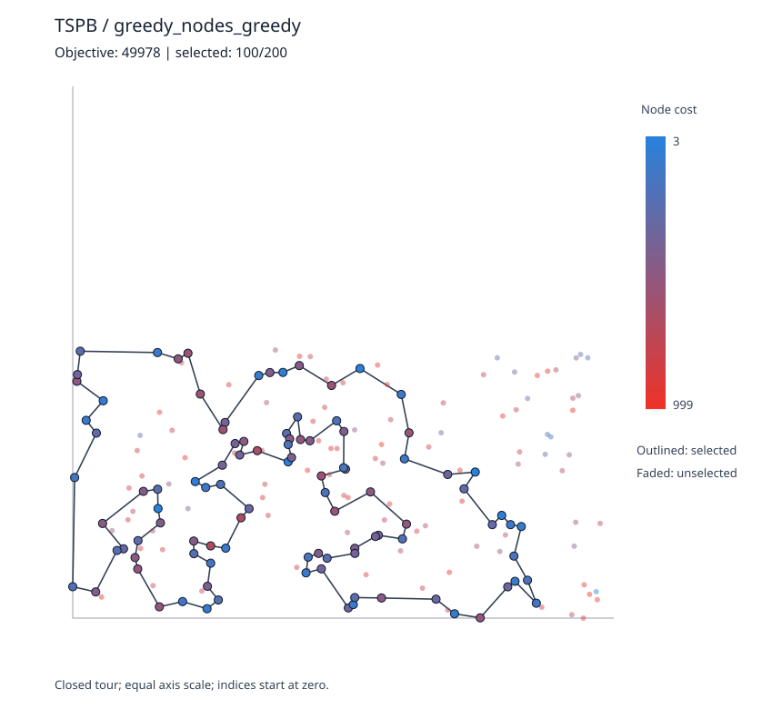

**Tour (100 zero-based node indices):**

```text
65, 145, 28, 149, 13, 146, 37, 116, 147, 42, 50, 191, 130, 121, 198, 96, 48, 156, 89, 57,
185, 76, 162, 54, 192, 80, 127, 129, 90, 153, 14, 2, 20, 74, 17, 171, 99, 88, 179, 87,
82, 51, 85, 59, 73, 167, 181, 152, 34, 24, 67, 66, 27, 98, 151, 122, 3, 184, 46, 72,
117, 8, 120, 133, 136, 172, 160, 69, 189, 21, 183, 30, 38, 154, 140, 47, 64, 33, 40, 141,
155, 71, 60, 157, 45, 134, 175, 62, 36, 197, 6, 115, 170, 125, 177, 178, 29, 132, 174, 1
```

### TSPB - Greedy / 2-opt / constructed

**Best objective: 49,581**

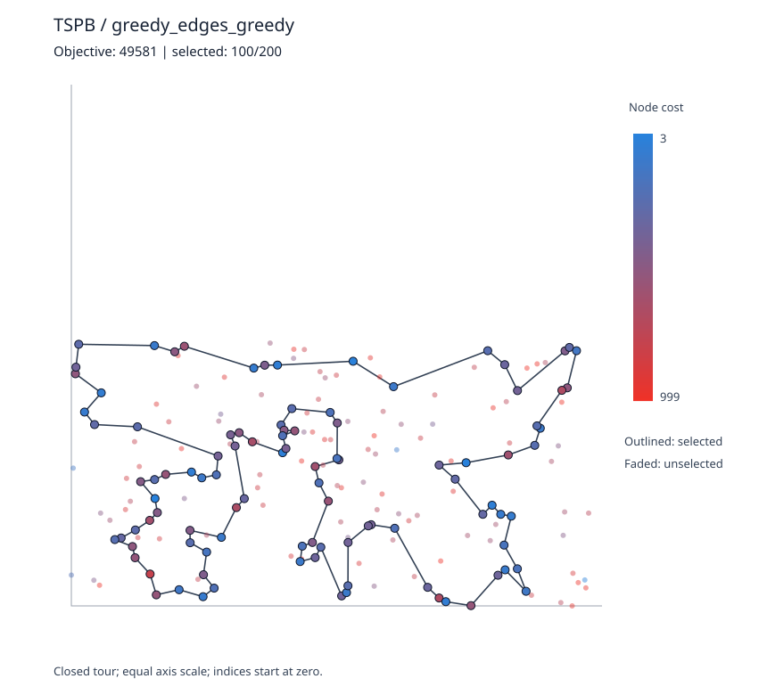

**Tour (100 zero-based node indices):**

```text
30, 183, 189, 69, 160, 172, 8, 136, 133, 120, 72, 46, 184, 3, 122, 151, 98, 73, 59, 85,
51, 167, 82, 87, 179, 181, 34, 24, 67, 99, 39, 171, 17, 74, 20, 2, 14, 153, 90, 129,
127, 80, 192, 162, 54, 78, 10, 114, 196, 139, 61, 105, 94, 81, 187, 70, 190, 57, 89, 96,
198, 121, 42, 147, 116, 37, 146, 13, 149, 28, 145, 158, 38, 47, 140, 154, 26, 125, 177, 170,
115, 180, 6, 29, 132, 197, 36, 91, 62, 175, 134, 45, 157, 60, 71, 155, 40, 33, 64, 21
```

The same lists are in [best_solutions.txt](results/best_solutions.txt).

## 6. Verification and testing

1. **C++ unit tests:** checked all node-swap, 2-opt and selected/unselected replacement deltas against full objective re-evaluation on small tours, including adjacent/wrap swaps. Checked greedy reproducibility, feasibility, weighted node cost changes, non-increasing cost and that both variants stop when no improving move remains. Only the tests use whole-neighbor re-evaluation; optimization uses deltas.
2. **Independent checker:** all 16 best tours passed a separate C++ checker recomputing rounded Euclidean distances directly from coordinates and verifying 100 unique valid node indices, closed tour and reported objective. See [checker_output.txt](results/checker_output.txt).
3. **Instructor Excel formula cross-check:** compared all 200 coordinates and costs from each instructor `Solution checker.xlsx` worksheet against the CSV instances. Verified all 16 tours against the spreadsheet rules for selected-node cost (`I2`), mathematically rounded travel distance (`J2`) and their sum (`K2`); all 16 match. This is programmatic application of the workbook formulas, not a claim of manual Excel execution. See [instructor_excel_validation.csv](results/instructor_excel_validation.csv).
4. **Experimental consistency:** checked all 3,200 new run records, all summary means/minima/maxima, and independently re-executed 3,200 runs from the previous 8 methods. The old objective values reproduce the original Assignment 1 and 2 reports.

## 7. Source code

- [Assignment 3 source directory](https://github.com/BarisAI/PUT-evolutionary-computation/tree/main/Assignment%203/src)
- [Local-search delta and first/steepest improvement](src/local_search.hpp)
- [Experiment runner and 2D SVG generator](src/main.cpp)
- [Unit tests](src/tests.cpp)
- [Independent checker](src/checker.cpp)
- [Build instructions](README.md)
- [Previous methods reused without modification](../Assignment%202/src/regret.hpp)

## 8. Conclusions

1. **Greedy first improvement is usually faster for random starts.** For example, on TSPA with node swap its mean runtime is 4.105 ms compared to 26.389 ms for Steepest, and on TSPB with 2-opt it is 2.086 ms compared to 9.394 ms. The speed advantage is not universal: constructed starts are already good, and starting-solution generation often takes most of the time.
2. **Best objective on TSPA was 71,955** (obtained by multiple greedy-start variants), improving the previous best result of 72,011 from Assignment 2 by 56 (about 0.08%).
3. **Best objective on TSPB was 49,346** using Steepest + 2-opt with a greedy-constructed start, improving Assignment 2's 50,485 by 1,139 (about 2.26%).
4. **Greedy is not guaranteed to have the best final objective.** Randomized first improvement may take a different path toward a local optimum; 2-opt often performs better than swapping two selected nodes on the random starts. A lower minimum and a lower average are not the same criterion.
5. Starting quality matters. Greedy-constructed starts typically need fewer improvements and produce the strongest final solutions, while random starts offer more room for improvement and a larger runtime difference between the strategies.
