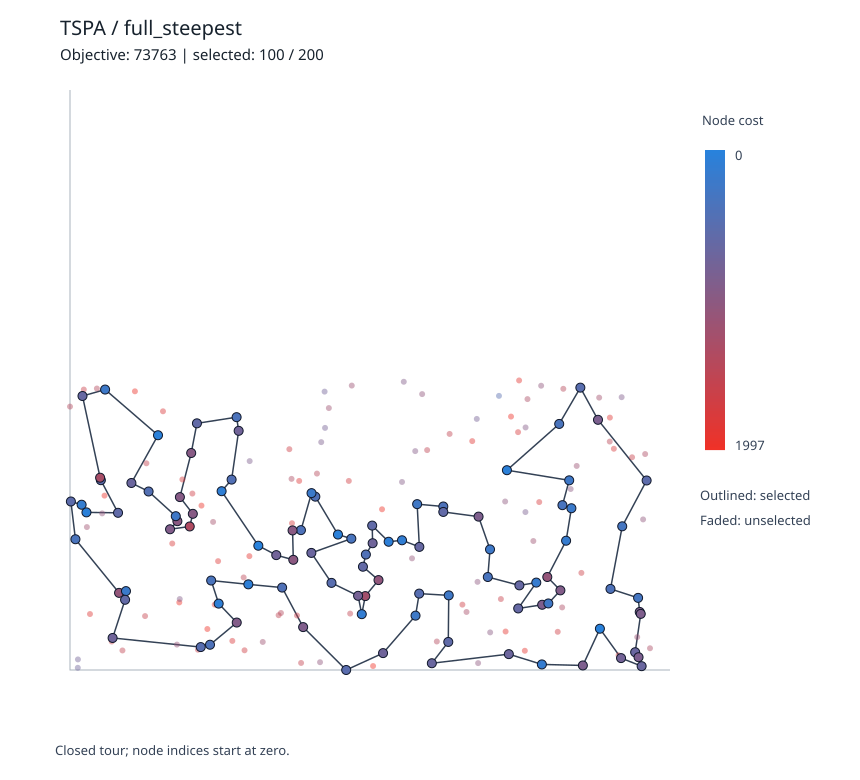
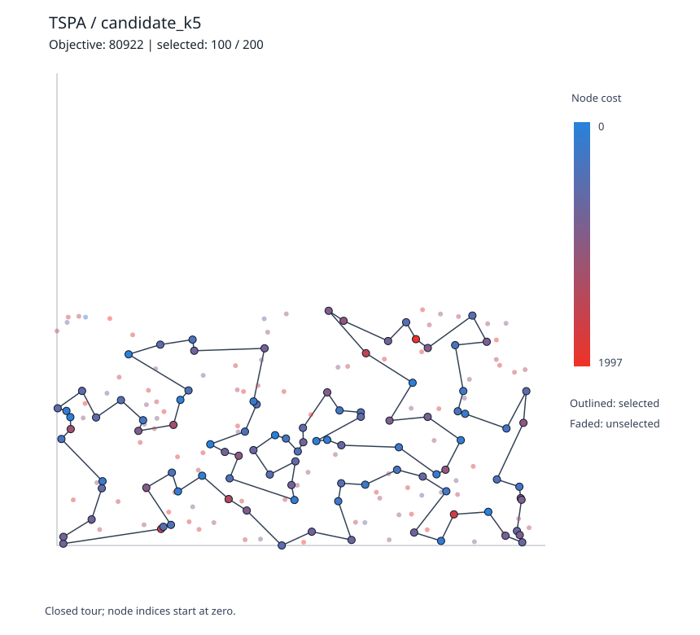
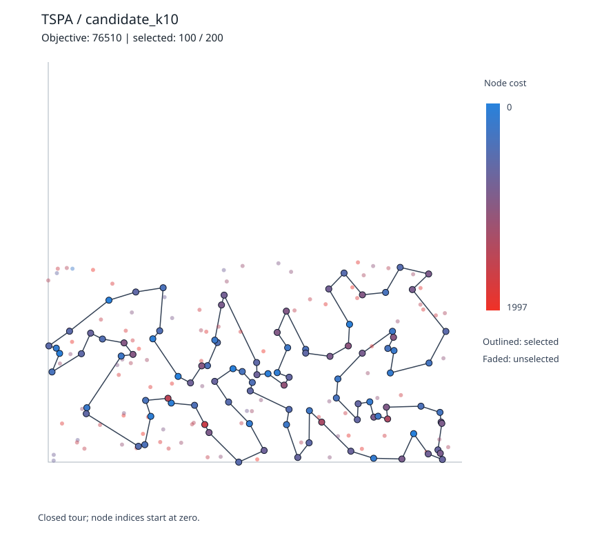
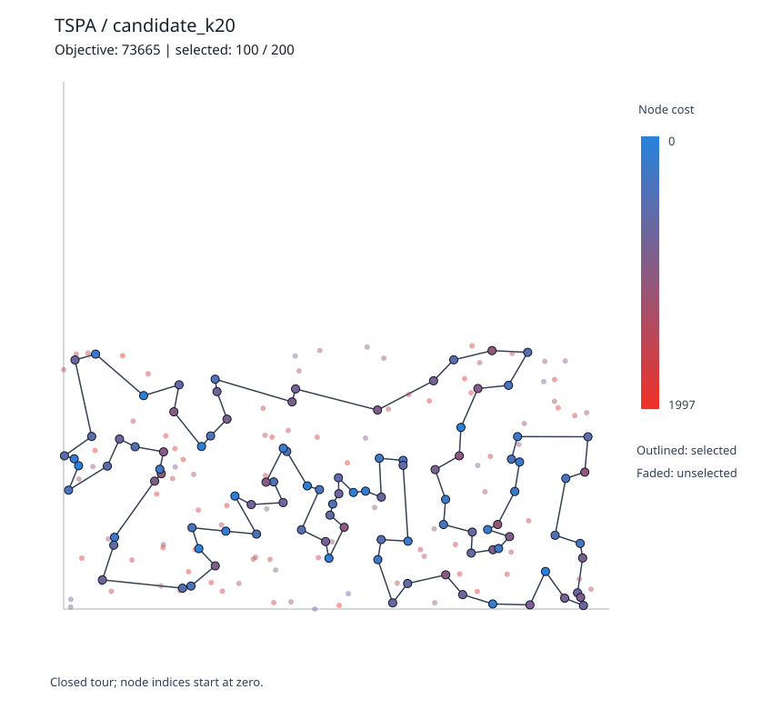
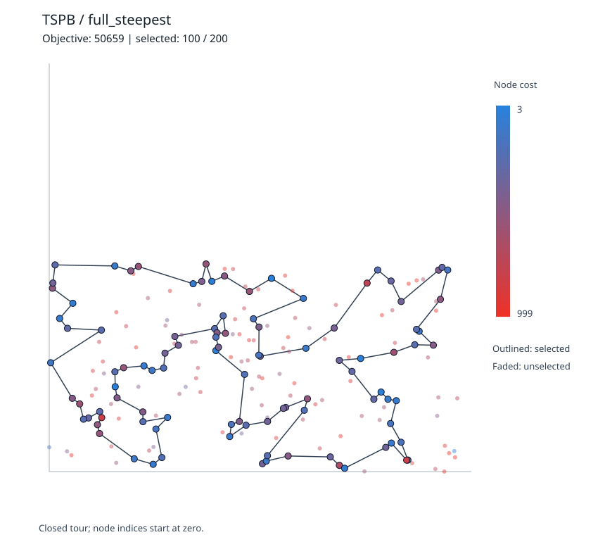
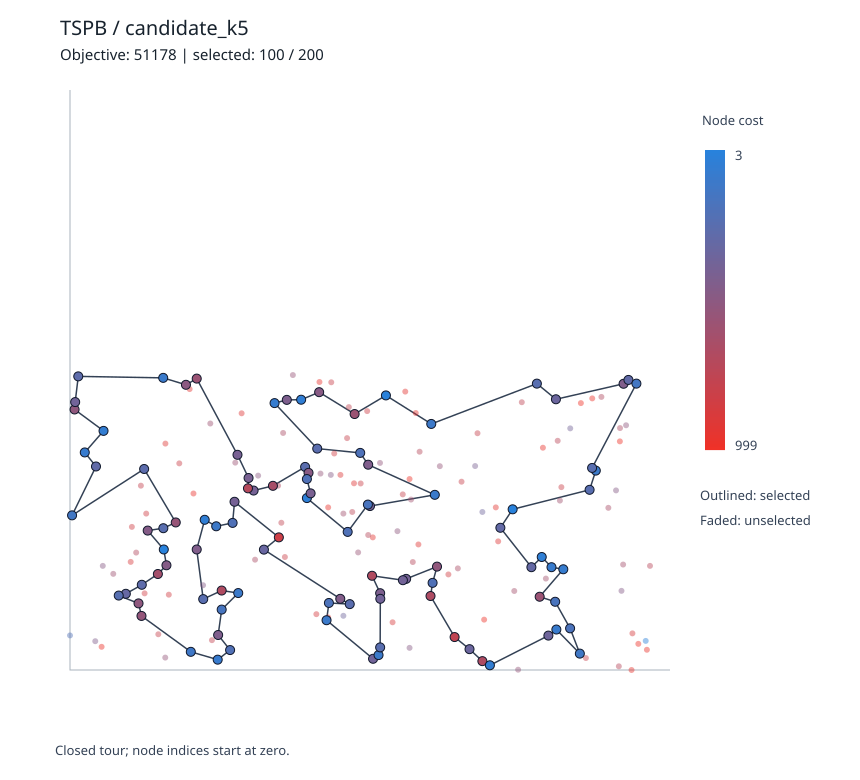
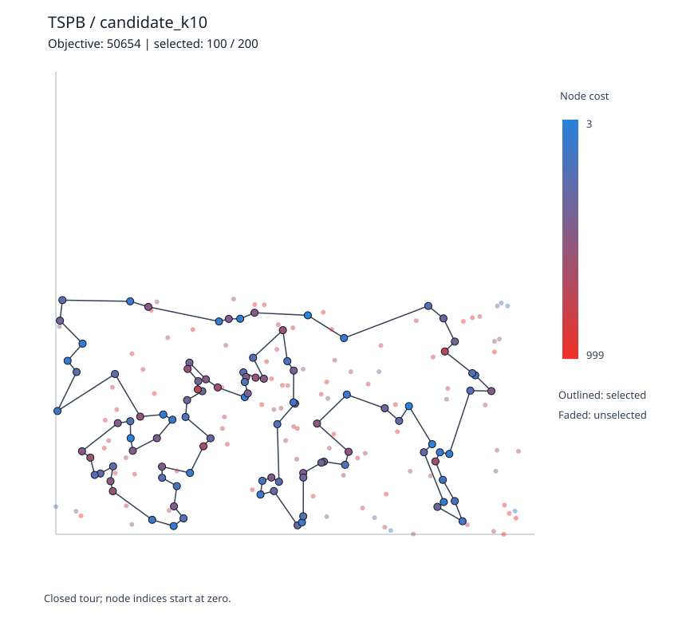
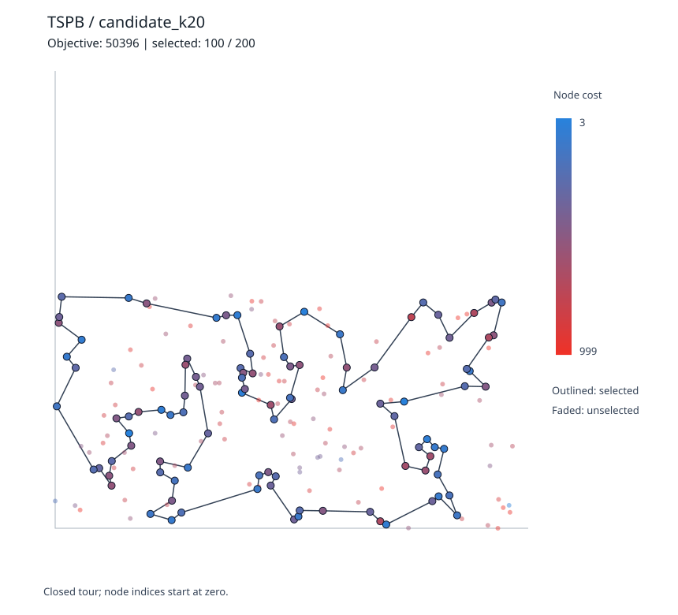

# Assignment 4 - Candidate Moves in Local Search

**Students:**  
Baris Surmelioglu - 152048  
Ozan Polat - 150918

**Course:** Evolutionary Computation, Poznan University of Technology  
**Language:** C++17 (standard library only)  
**Data:** original TSPA / TSPB, 200 nodes each  
**Experiment:** four methods x 200 identical starting solutions x two instances = 1,600 runs  
**Random starting seed:** 42  
**Primary candidate-list size:** K = 10; additional comparisons at K = 5 and 20

## 1. Short problem recap

The objective is the same as before: select 100 of the 200 nodes, visit them in a closed tour, and minimize the sum of **rounded** Euclidean edge lengths and the costs of selected nodes. We construct the distance matrix only once and optimization methods access only that matrix and the node costs.

```text
f(tour) = sum(cost[tour[i]] + D[tour[i], tour[(i+1) mod 100]])
D[u,v] = floor(sqrt((x[u]-x[v])^2 + (y[u]-y[v])^2) + 0.5)
```

## 2. Implementation details and pseudocode

### 2.1 Baseline and search neighbourhood

We use **Steepest Local Search with 2-opt intra-route moves and selected/unselected replacement inter-route moves**. This is the strong random-start neighbourhood from Assignment 3. We use the same two move kinds for all new methods; only their enumeration differs. The baseline enumerates the entire neighbourhood. Each iteration chooses the move with the **most negative** delta across both move kinds and stops when no improving move remains.

For 100 selected and 100 unselected nodes the full neighbourhood consists of **4,850 valid 2-opt moves** and **10,000 replacements**, or **14,850 moves per scan**.

### 2.2 Edge deltas (without recalculating whole tours)

A 2-opt move removes (a,b) and (c,d), adds (a,c) and (b,d), and reverses the segment between the removed edges. Its incremental objective change is:

```text
delta_2opt = D[a,c] + D[b,d] - D[a,b] - D[c,d]
```

A replacement changes a selected node `old` at position `i` to an unselected node `new`, with neighbours `left` and `right`:

```text
delta_replace = cost[new] - cost[old]
              + D[left,new] + D[new,right]
              - D[left,old] - D[old,right]
```

Both calculations are O(1) after distance-matrix preprocessing. Neighbouring full solutions are never constructed to calculate deltas during optimization. Tests may independently recalculate the full objective to verify correctness.

### 2.3 Candidate lists: 10 nearest nodes by distance + node cost

For each vertex `u`, rank every other vertex `v` by **D[u,v] + cost[v]**, breaking equal scores by lower vertex index. Keep the first K vertices. This creates a **directed** nearest-neighbour list: membership of `v` in `near[u]` does not imply membership of `u` in `near[v]`. We follow the assignment's proposed iteration over selected `u` and their own candidate lists, rather than scanning all moves.

```text
BUILD-CANDIDATES(D, cost, K):
    for u = 0 .. n-1:
        choices = all vertices v where v != u
        sort choices by (D[u,v] + cost[v], v) ascending
        near[u] = first K vertices from choices
    return near
```

Candidate lists are precomputed once per instance and K. No coordinate lookup is performed in the search.

### 2.4 How we generate the two candidate moves for each candidate edge

**Intra-route:** If both endpoints `u` and `v` are selected, inserting the candidate edge `(u,v)` via 2-opt is possible with **two cut pairs**. Using `position[u] = i` and `position[v] = j`:

```text
Option A: 2-opt cut edges after positions i and j
          -> introduced edge (tour[i], tour[j]) = (u,v)
Option B: 2-opt cut edges before positions i and j
          -> introduced edge (tour[i], tour[j]) = (u,v)
          as the other newly connected boundary pair
Normalize the cut order and skip adjacent cuts and full-tour reversal.
```

More precisely, the two cut-index pairs are `(i,j)` and `((i-1) mod m, (j-1) mod m)`. Each generates a 2-opt move only if its cut edges are distinct/nonadjacent.

**Inter-route:** If `u` is selected and `v` is not, only replacing a node **adjacent to u** introduces the candidate edge `(u,v)`. We therefore generate two replacements: replace the predecessor of `u` with `v`, or replace its successor with `v`. We do **not** simply replace `u` with a close unselected node, because that would not guarantee a newly introduced candidate edge.

```text
ENUMERATE-CANDIDATE-MOVES(tour, near):
    position[v] = current tour position, or -1 if outside tour
    outside_index[v] = index of v in unselected list, or -1
    seen_moves = empty set / boolean marker array
    moves = []
    for each selected u in tour order:
        i = position[u]
        for each v in near[u]:
            if v is selected:
                EMIT-UNIQUE-VALID-2OPT(i, position[v])
                EMIT-UNIQUE-VALID-2OPT((i-1) mod m,
                                       (position[v]-1) mod m)
            else:
                EMIT-UNIQUE-REPLACE((i-1) mod m, v)
                EMIT-UNIQUE-REPLACE((i+1) mod m, v)
    return moves
```

Every move in this list creates at least one edge from a selected vertex to one of its K nearest candidates. Repeated moves from different candidate edges are deduplicated **before** evaluating deltas. Thus the algorithm never enumerates the full neighbourhood just to test candidate membership.

### 2.5 Steepest search pseudocode

```text
CANDIDATE-STEEPEST(initial_tour, K):
    candidates = BUILD-CANDIDATES(D, cost, K)  # once per instance
    tour = initial_tour
    current_objective = EVALUATE(tour)           # only once initially
    repeat:
        moves = ENUMERATE-CANDIDATE-MOVES(tour, candidates)
        best_delta = 0; best_move = none
        for move in moves:
            delta = FAST-DELTA(tour, move)
            if delta < best_delta:
                best_delta = delta; best_move = move
        if best_move == none: stop
        APPLY(best_move, tour)
        current_objective += best_delta
    return tour, current_objective

FULL-STEEPEST(initial_tour):
    same procedure, but enumerate ALL valid 2-opt cuts and
    ALL selected/unselected replacements in each iteration
```

**Termination:** only strictly improving moves are accepted, so the procedure stops at a candidate-neighbourhood local optimum. This need not be a full-neighbourhood local optimum for K < n-1. All used moves are recalculated from the current solution; we do not use delta memory from previous iterations.

### 2.6 Experiment design, reproducibility and expected complexity

The 200 random starts are generated by the Assignment 1 Fisher-Yates procedure using seed 42, TSPA first, then TSPB. **Exactly the same starting tours are reused for all four methods**, making quality comparisons paired. We run the full Steepest baseline and candidate Steepest with K = 5, 10 and 20. K = 10 is the required default; K = 5/20 are optional sensitivity checks.

After a one-time O(n² log n) sorting step to form candidate lists (or a partial-select equivalent), each candidate-neighbourhood scan generates at most O(mK) move descriptors, compared with O(m² + m(n-m)) for the full scan, where m is the number of selected nodes. Move deltas are O(1). Candidate enumeration and deduplication incur an overhead that is included in runtime measurements.

We time Local Search with `std::chrono::steady_clock` and separately record candidate-list preprocessing. The runtime table includes (1) measured mean Local Search time, and (2) the same time plus **preprocessing amortized over 200 runs**. Random-start generation, identical across all variants, and file/plot writing are excluded to isolate the search mechanism. Exact timings depend on the execution environment.

## 3. Computational results - objective values

Lower is better. Every cell is average (minimum - maximum). The full baseline reproduces Assignment 3's random-start Steepest + 2-opt objective statistics exactly.

| Method | TSPA: mean (min - max) | TSPB: mean (min - max) |
| --- | ---: | ---: |
| Full Steepest (Assignment 3 baseline) | 76,160.405 (73,763 - 79,710) | 52,595.635 (50,659 - 54,962) |
| Candidate Steepest (K=5) | 86,385.665 (80,922 - 93,524) | 53,943.600 (51,178 - 57,432) |
| Candidate Steepest (K=10) | 80,283.185 (76,510 - 85,673) | 52,670.240 (50,654 - 55,382) |
| Candidate Steepest (K=20) | 76,501.820 (73,665 - 80,234) | 52,545.460 (50,396 - 54,923) |

**Interpretation:** With K=10, the candidate restriction gives much faster search at the cost of higher mean objective on TSPA; on TSPB the mean objective is close to the baseline. K=20 generally recovers solution quality, sometimes even finding a better *individual* minimum than the unrestricted run because the move restriction changes which local optimum the search reaches. A better minimum is not the same as a better average.

## 4. Computational results - running times

Mean time in milliseconds per run, rounded to three decimals. "Including setup" adds the once-per-instance candidate-list preparation divided by 200.

| Method | TSPA search ms | TSPB search ms | TSPA including setup ms | TSPB including setup ms |
| --- | ---: | ---: | ---: | ---: |
| Full Steepest (Assignment 3 baseline) | 8.341 | 9.017 | 8.341 | 9.017 |
| Candidate Steepest (K=5) | 1.030 | 1.120 | 1.038 | 1.129 |
| Candidate Steepest (K=10) | 1.979 | 2.141 | 1.988 | 2.149 |
| Candidate Steepest (K=20) | 3.897 | 3.860 | 3.913 | 3.869 |

We also count the actual number of objective **delta evaluations**. These counts are independent of timer noise and demonstrate whether the candidate strategy really avoids enumerating all possible moves:

| Method | TSPA mean delta checks | TSPB mean delta checks |
| --- | ---: | ---: |
| Full Steepest (Assignment 3 baseline) | 1,986,930 | 1,994,800 |
| Candidate Steepest (K=5) | 80,843 | 78,206 |
| Candidate Steepest (K=10) | 155,923 | 156,337 |
| Candidate Steepest (K=20) | 294,060 | 296,276 |

For TSPA, K=10 was **4.20x faster** including amortized preprocessing than the full Steepest search, while its mean objective was **5.41% higher** (worse).
For TSPB, K=10 was **4.20x faster** including amortized preprocessing than the full Steepest search, while its mean objective was **0.14% higher** (worse).

The recorded `runs.csv` contains the objective, move count, delta-evaluation count and search time for **every one of the 1,600 runs**. `summary.csv` is independently calculated from those measurements.

## 5. Best solutions and 2D plots

Each plot shows the closed cycle through exactly 100 selected nodes. The other 100 nodes are faint. Node colors represent cost (blue lower, orange higher), dark outlines identify selected nodes. Node indices start at zero; the closing node is not duplicated in the output list.

### TSPA - Full Steepest (Assignment 3 baseline)

**Best objective: 73,763**



**Best tour (100 zero-based node indices):**

```text
41, 140, 53, 179, 52, 177, 36, 131, 33, 9, 54, 8, 174, 176, 150, 106, 151, 42, 89, 113,
43, 93, 50, 3, 1, 164, 178, 29, 101, 147, 47, 130, 159, 146, 170, 153, 193, 78, 88, 107,
64, 57, 182, 192, 158, 134, 84, 58, 181, 114, 98, 87, 141, 30, 187, 189, 2, 171, 69, 127,
97, 95, 168, 116, 149, 63, 49, 60, 82, 31, 48, 80, 108, 152, 123, 83, 160, 148, 90, 100,
38, 91, 157, 71, 76, 132, 180, 28, 102, 156, 35, 51, 16, 67, 144, 185, 45, 73, 135, 61
```

### TSPA - Candidate Steepest (K=5)

**Best objective: 80,922**



**Best tour (100 zero-based node indices):**

```text
153, 193, 78, 88, 107, 124, 57, 182, 89, 150, 176, 134, 84, 58, 192, 181, 114, 98, 27, 141,
187, 30, 161, 2, 171, 32, 104, 129, 69, 127, 97, 168, 119, 63, 149, 116, 60, 49, 152, 123,
160, 162, 132, 76, 80, 91, 157, 71, 112, 51, 16, 35, 180, 28, 102, 87, 135, 73, 140, 45,
185, 67, 144, 53, 179, 52, 143, 33, 9, 54, 177, 36, 131, 174, 106, 43, 93, 85, 8, 164,
34, 39, 154, 186, 136, 195, 184, 29, 101, 178, 1, 3, 50, 47, 147, 37, 130, 159, 146, 170
```

### TSPA - Candidate Steepest (K=10)

**Best objective: 76,510**



**Best tour (100 zero-based node indices):**

```text
142, 164, 186, 136, 184, 178, 29, 55, 101, 147, 47, 93, 50, 3, 169, 1, 85, 174, 176, 151,
150, 106, 42, 89, 103, 113, 130, 159, 146, 170, 153, 193, 78, 88, 107, 64, 57, 182, 65, 134,
158, 192, 58, 84, 140, 53, 144, 67, 185, 45, 135, 181, 114, 98, 70, 87, 141, 145, 30, 187,
2, 171, 127, 97, 123, 90, 100, 152, 108, 49, 168, 63, 149, 116, 60, 80, 91, 157, 76, 132,
180, 28, 156, 35, 16, 51, 139, 112, 52, 179, 177, 99, 131, 36, 33, 143, 62, 9, 54, 8
```

### TSPA - Candidate Steepest (K=20)

**Best objective: 73,665**



**Best tour (100 zero-based node indices):**

```text
174, 176, 150, 151, 42, 89, 113, 106, 43, 93, 50, 3, 1, 147, 37, 47, 130, 159, 170, 153,
193, 78, 88, 107, 64, 57, 182, 138, 158, 192, 58, 84, 134, 54, 9, 33, 131, 36, 177, 52,
179, 53, 140, 41, 135, 73, 45, 144, 67, 16, 51, 156, 35, 185, 28, 180, 87, 141, 30, 187,
189, 2, 171, 69, 127, 97, 160, 83, 123, 100, 152, 108, 49, 168, 63, 149, 116, 60, 31, 48,
80, 91, 38, 132, 76, 4, 71, 157, 139, 112, 62, 186, 136, 163, 29, 178, 184, 164, 142, 8
```

### TSPB - Full Steepest (Assignment 3 baseline)

**Best objective: 50,659**



**Best tour (100 zero-based node indices):**

```text
58, 96, 48, 156, 89, 57, 72, 46, 184, 3, 76, 104, 194, 190, 70, 187, 81, 94, 105, 61,
196, 114, 148, 10, 78, 54, 162, 192, 80, 127, 129, 90, 153, 14, 2, 188, 20, 74, 171, 39,
99, 88, 87, 82, 179, 67, 66, 24, 34, 181, 167, 85, 59, 73, 151, 69, 160, 172, 136, 8,
120, 133, 30, 21, 38, 47, 140, 154, 26, 125, 170, 115, 155, 71, 40, 60, 45, 134, 175, 36,
197, 5, 6, 29, 132, 103, 178, 65, 158, 145, 28, 149, 13, 146, 37, 116, 147, 42, 121, 198
```

### TSPB - Candidate Steepest (K=5)

**Best objective: 51,178**



**Best tour (100 zero-based node indices):**

```text
121, 198, 96, 48, 156, 89, 57, 190, 70, 81, 94, 105, 196, 114, 10, 54, 192, 80, 127, 129,
90, 182, 153, 14, 2, 20, 74, 171, 39, 99, 163, 31, 67, 66, 24, 34, 25, 152, 181, 179,
87, 82, 85, 59, 167, 73, 64, 4, 38, 47, 140, 154, 97, 71, 141, 40, 60, 157, 45, 134,
175, 36, 197, 132, 29, 6, 180, 115, 170, 177, 125, 26, 158, 65, 145, 28, 149, 13, 146, 37,
116, 147, 42, 130, 30, 176, 21, 189, 133, 136, 172, 160, 69, 151, 184, 3, 76, 46, 72, 120
```

### TSPB - Candidate Steepest (K=10)

**Best objective: 50,654**



**Best tour (100 zero-based node indices):**

```text
80, 127, 54, 192, 162, 76, 27, 66, 67, 24, 34, 152, 181, 179, 87, 82, 51, 85, 59, 73,
167, 151, 3, 184, 46, 72, 156, 120, 117, 8, 133, 136, 172, 160, 69, 189, 183, 130, 191, 30,
176, 21, 38, 47, 64, 33, 40, 155, 71, 60, 157, 45, 134, 175, 36, 197, 6, 29, 132, 103,
178, 177, 125, 170, 115, 97, 140, 154, 26, 158, 65, 145, 28, 149, 146, 37, 116, 147, 121, 198,
96, 48, 89, 57, 190, 70, 187, 18, 196, 114, 148, 10, 90, 129, 52, 153, 14, 2, 74, 20
```

### TSPB - Candidate Steepest (K=20)

**Best objective: 50,396**



**Best tour (100 zero-based node indices):**

```text
153, 90, 129, 127, 80, 52, 182, 150, 192, 162, 54, 10, 148, 114, 196, 139, 61, 105, 94, 81,
169, 187, 70, 190, 194, 104, 76, 185, 57, 89, 156, 72, 46, 86, 184, 3, 151, 122, 69, 160,
172, 136, 133, 8, 120, 96, 198, 121, 147, 116, 37, 146, 13, 149, 28, 145, 65, 132, 29, 36,
197, 6, 115, 170, 177, 125, 26, 154, 140, 47, 38, 191, 130, 30, 21, 64, 40, 155, 71, 60,
157, 175, 134, 45, 85, 59, 73, 167, 51, 82, 87, 179, 88, 99, 39, 171, 74, 20, 2, 14
```

## 6. Independent verification and testing

1. **Delta correctness:** C++ unit tests applied 2-opt and replacement moves on random small tours, verifying every delta by recomputing the complete objective in tests only. This includes odd and even node counts.
2. **Candidate eligibility:** for every generated move, the test checked that one newly created edge belongs to a selected vertex's candidate list. Tests covered both possible cut-pairs and both possible replacements, invalid 2-opt cuts and duplicate descriptors.
3. **Full-K completeness:** with K = n-1, the set of generated candidate moves exactly equals the unrestricted neighbourhood. Steepest may choose a different equal-scoring move because of enumeration order, but both are valid complete neighbourhood searches.
4. **Search validity:** every accepted move improves the objective, the accumulated objective equals independent full recalculation on the final tour, and no improving candidate move remains when search ends.
5. **Independent tour checker:** `src/checker.cpp` recalculates rounded edge lengths directly from the original coordinates, verifies cardinality and distinct valid indices, and checks the returned objective. All eight best tours passed. Results: [checker_output.txt](results/checker_output.txt).
6. **Instructor Excel formula cross-check:** the original Solution checker.xlsx contains the same 200 original nodes as each CSV. For every best tour, we independently computed the selected-node sum corresponding to I2, rounded edge sum corresponding to J2, and total K2 = I2 + J2. All eight match, recorded in [instructor_formula_check.csv](results/instructor_formula_check.csv). This is a programmatic application of the workbook rules, not a claim that the workbook was manually recalculated inside Microsoft Excel.
7. **Statistical integrity:** every min, max and arithmetic mean in this report was checked against the 200 corresponding rows in runs.csv. The unrestricted baseline matches the values in Assignment 3 exactly: TSPA mean 76,160.405 and TSPB mean 52,595.635.

## 7. Source code and reproduction

- [Candidate enumeration, deltas and Steepest](src/candidate_search.hpp)
- [Experiment, CSV output and SVG plots](src/main.cpp)
- [Comprehensive C++ test cases](src/tests.cpp)
- [Independent objective and cardinality checker](src/checker.cpp)
- [CMake project](CMakeLists.txt)
- [README instructions](README.md)
- [Original source data](../Assignment%201/data)

## 8. Conclusions

1. Candidate-list enumeration greatly reduces the number of delta evaluations and measured search time. It is not sufficient to enumerate all moves and filter them; the correct runtime improvement comes from generating only admissible moves from each selected node's nearest-neighbour list.
2. K=10 offers a clear speed-quality compromise: more than fourfold mean speedup on both TSPA and TSPB, with the larger average quality penalty on TSPA.
3. Increasing K improves neighbourhood coverage and often solution quality, while making the search slower. K=5 is fastest but has the poorest mean objective. K=20 nearly recovers unrestricted search quality in these experiments.
4. The restriction changes the improvement path and local optima: some K=20 best solutions have a lower objective than the best observed unrestricted baseline, which does not imply that the restricted neighbourhood dominates the full neighbourhood.
5. All variants were compared using exactly the same random starting tours, consistent integer-rounded edge costs and independently validated best tours. No global optimality claim is made.
