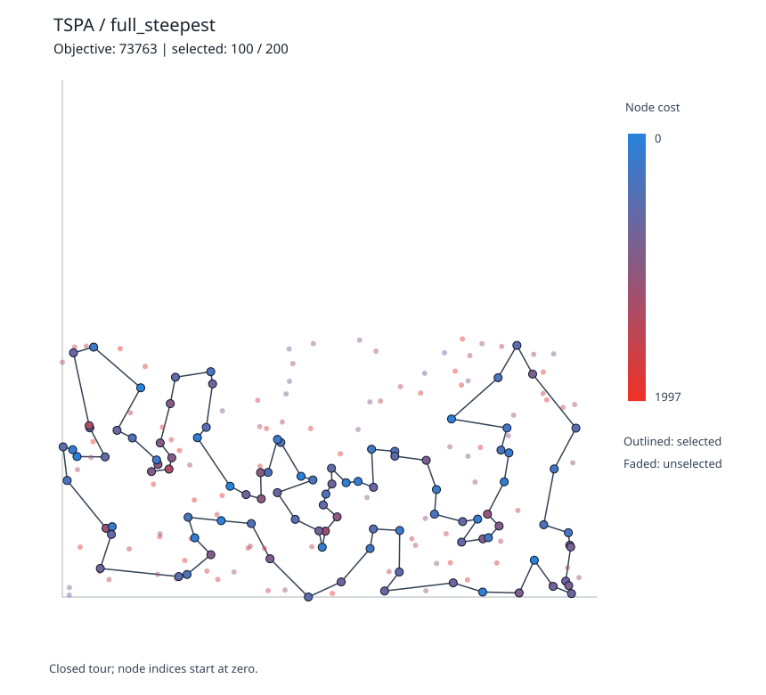
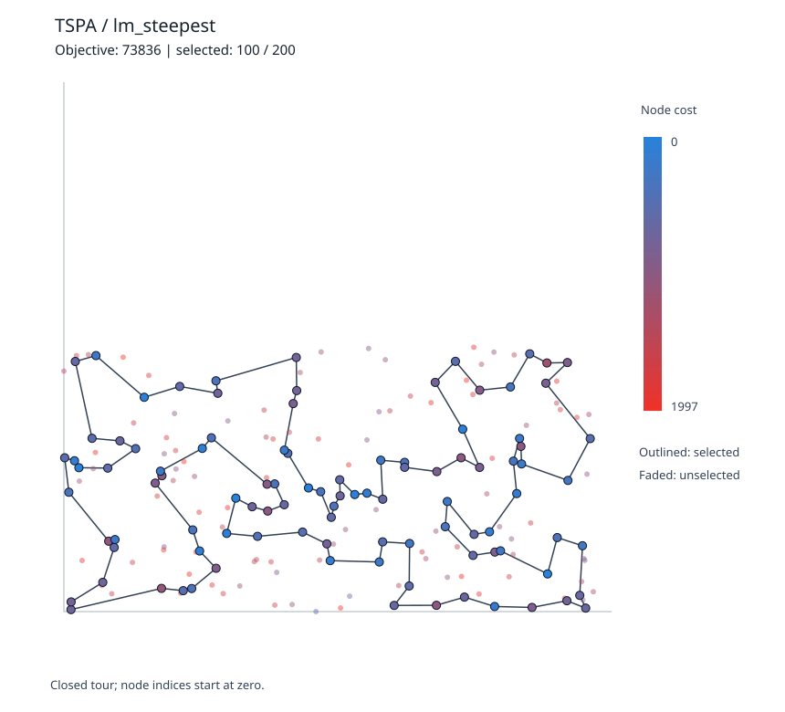
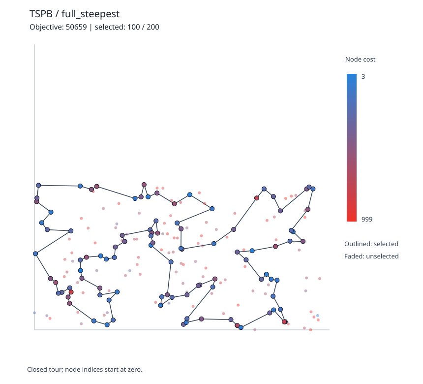
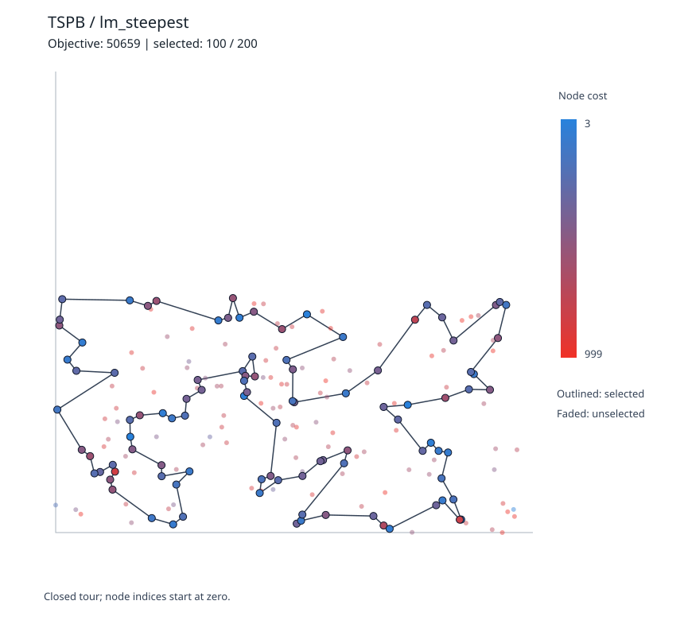

# Assignment 5 - Reusing Move Evaluations in Local Search

**Students:**  
Baris Surmelioglu - 152048  
Ozan Polat - 150918

**Course:** Evolutionary Computation - Poznan University of Technology  
**Implementation:** C++17  
**Data:** TSPA and TSPB (200 nodes each)  
**Experiment:** 200 random starts per method per instance (800 runs total)

## 1. Short problem summary

We continue the same weighted partial traveling-salesperson problem as before. A solution visits 100 different nodes in a closed tour. The objective is the sum of mathematically rounded travel distances plus the cost of every selected node. Only the precomputed distance matrix and node costs are accessed during search.

The comparison uses the strongest **random-start** neighborhood from Assignment 3: 2-opt (intra-route) together with selected/unselected node replacement (inter-route). Assignment 5 does **not** use candidate moves from Assignment 4.

## 2. Implementation details and pseudocode

### 2.1 Move deltas

For a 2-opt move we cut two nonadjacent tour edges `(a,b)` and `(c,d)` and reconnect them as `(a,c)` and `(b,d)` in the currently feasible tour direction:

```text
delta_2opt = D[a,c] + D[b,d] - D[a,b] - D[c,d]
```

A saved move stores **undirected identities of both removed edges**, the chosen reconnection, and the delta. This is essential: storing only position indices would be incorrect after the tour changes. For every disjoint pair of cut edges, we evaluate both possible reconnections, including the one whose edges are relatively inverted and cannot yet be applied. We keep any improving move, even if it is temporarily inapplicable.

For selected/unselected replacement we store the selected node `old`, outside node `new`, and the two neighbors of `old` (their order does not matter because distances are symmetric):

```text
delta_replace = cost[new] - cost[old]
              + D[left,new] + D[new,right]
              - D[left,old] - D[old,right]
```

Each formula takes constant time. A stored delta is unchanged as long as its defining removed edges and the same reconnection remain valid. We never evaluate a complete neighboring tour during the search.

### 2.2 Full Steepest baseline

This is the same random-start 2-opt + node-replacement approach used in Assignment 3. On each iteration, the baseline calculates every current delta and chooses the most negative one from the **combined** neighborhood.

```text
FULL-STEEPEST(initial_tour):
    tour = initial_tour
    total = evaluate(tour)
    repeat:
        best_delta = 0; best_move = NONE
        for every valid 2-opt move:
            delta = 2opt_delta(move)
            if delta < best_delta: best_delta, best_move = delta, move
        for each selected position i and each unselected node v:
            delta = replacement_delta(i, v)
            if delta < best_delta: best_delta, best_move = delta, move
        if best_move == NONE: return tour, total
        apply(best_move); total += best_delta
```

With 100 selected and 100 unselected nodes, one baseline scan examines **4,850 valid 2-opt moves and 10,000 replacement moves (14,850 in total)**. Full enumeration is repeated after each accepted move.

### 2.3 Initializing the list of improving moves (LM)

LM is a priority queue ordered by ascending delta: the most negative value is checked first. Each move is identified by the *edges/nodes defining the move*, not by its original positions. Inverted 2-opt reconnections are stored so they may become applicable after another 2-opt reversal.

```text
INITIALIZE-LM(tour):
    LM = empty priority queue, most negative delta first
    for each pair of disjoint tour edges e1 and e2:
        for each of TWO possible reconnections:
            delta = delta_for_fixed_edge_pair(e1, e2, reconnection)
            if delta < 0:
                LM.push(edge-ID move, reconnection, delta)
    for each selected node old and each outside node new:
        left, right = current neighbors of old
        delta = delta_replace(old, new, left, right)
        if delta < 0:
            LM.push(node-ID replacement, left, right, delta)
    return LM
```

### 2.4 Three validity cases for a saved 2-opt move

At every LM inspection we find the two saved **removed edges** in the *current* tour and check their relative traversal direction.

1. **At least one removed edge no longer exists:** the move is invalid; discard it permanently from the queue.
2. **Both edges still exist but one is relatively reversed:** the stored reconnection does not currently give a valid 2-opt tour. Keep the saved move for a later iteration, do not apply it now, and inspect the next LM entry.
3. **Both edges exist with the saved relative direction, or both are reversed:** the stored reconnection is applicable. We apply the move and use its saved delta without recalculating it.

An inter-route replacement remains applicable only while `old` is selected, `new` is unselected, and both saved incident edges still connect `old` with its original two neighbors. Otherwise that record is removed. Reversing both incident directions leaves the replacement valid.

```text
CHECK-SAVED-MOVE(move, current_tour):
    if move.type == REPLACEMENT:
        if old not selected or new already selected: return INVALID
        if current neighbors(old) != saved neighbors(old): return INVALID
        return APPLICABLE
    else:  # 2-opt edge exchange
        if a saved removed edge is missing: return INVALID
        if actual reconnection != saved reconnection:
            return DEFERRED  # one edge relatively inverted
        return APPLICABLE  # same orientation or both reversed
```

### 2.5 Incremental LM update after accepting a move

We avoid calculating the entire neighborhood after each change. Instead, we evaluate *newly defined* deltas:

- **2-opt:** find the two newly added tour edges, pair each with existing tour edges (both reconnection options), and check replacements for the selected vertices whose incident edges changed. Internal reversed edges keep their undirected identities, so their fixed-edge deltas remain reusable.
- **Selected/unselected replacement:** evaluate new 2-opt pairs involving newly added edges; examine replacements at vertices with changed incident edges; also evaluate inserting the newly excluded node into any selected position.

Entries are checked lazily when they reach the top of LM. Multiple copies of a move can exist if it was rediscovered, but applying one invalidates the other copies; they are removed by the same validity test. This avoids expensive global duplicate bookkeeping.

```text
UPDATE-LM(old_tour, new_tour, performed_move):
    new_edges = edges(new_tour) - edges(old_tour)
    for each new edge e and each other current edge f:
        evaluate and add improving fixed-edge moves for both reconnections
    affected = endpoints(new_edges)
    for selected node u in affected:
        evaluate and add improving replacements u -> every outside node
    if performed_move was REPLACEMENT:
        old = node that just became unselected
        for selected node u:
            evaluate and add improving replacement u -> old
```

### 2.6 Main LM search pseudocode

```text
STEEPEST-WITH-LM(initial_tour):
    tour = initial_tour; objective = evaluate(tour)
    LM = INITIALIZE-LM(tour)
    repeat:
        accepted_move = NONE
        while LM is not empty:
            m = LM.pop_best()   # saved negative delta, do not recalculate
            status = CHECK-SAVED-MOVE(m, tour)
            if status == INVALID: discard m; continue
            if status == DEFERRED: set m aside; continue
            accepted_move = m; break
        put all DEFERRED moves back into LM
        if accepted_move == NONE:
            evaluate current full neighborhood once to refresh LM
            if still no applicable improving move: return tour, objective
            else: continue checking LM
        old_tour = tour
        apply(accepted_move, tour)
        objective += accepted_move.saved_delta
        UPDATE-LM(old_tour, tour, accepted_move)
```

The final full refresh is an additional safety check: the algorithm terminates at a local optimum of the **complete** 2-opt + replacement neighborhood, not only at a local optimum of a restricted candidate list. Our code handles the refresh and rechecks the queue immediately. All new moves are evaluated only when created; saved delta values are reused when accepted.

### 2.7 Complexity and experiment setup

The full search examines `O(k^2 + k(n-k))` moves *per iteration* for `k` selected nodes. LM initially evaluates the complete set, then usually examines only changes involving newly inserted edges or replacement adjacency. Finding a saved move still requires priority-queue management and validity checks, so fewer delta evaluations do **not** guarantee the same proportional reduction in elapsed time.

We used the Assignment 1 Fisher-Yates generator with `std::mt19937` seed **42**, TSPA first and TSPB second. All 200 random starting tours for an instance were shared by both methods. Both methods use identical rounded distance matrices and the same stopping criterion. Search-only time was measured with `std::chrono::steady_clock` on the same executable and compiler settings. Input parsing, random-start generation, graph creation and file output are excluded from these measurements.

## 3. Objective function results

Every table cell is **average (minimum - maximum)**; lower is better.

| Method | TSPA mean (min - max) | TSPB mean (min - max) |
|---|---:|---:|
| Full Steepest (baseline) | 76,160.405 (73,763 - 79,710) | 52,595.635 (50,659 - 54,962) |
| Steepest + LM (Assignment 5) | 76,137.685 (73,836 - 79,710) | 52,591.930 (50,659 - 54,962) |

The LM method gives a slightly better mean on both instances, but it does not always find the best **individual** result. For TSPA, Full Steepest's minimum is 73,763 while LM's minimum is 73,836. For TSPB, both methods achieve 50,659. The different iteration and tie order can lead to different local optima even when the neighborhood and initial tours are the same.

## 4. Running times and delta evaluations

**Average search-only milliseconds per run:**

| Method | TSPA mean ms | TSPB mean ms |
|---|---:|---:|
| Full Steepest | 9.623 | 9.655 |
| Steepest + LM | 3.813 | 3.745 |

**Average number of objective delta calculations per run:**

| Method | TSPA evaluations | TSPB evaluations |
|---|---:|---:|
| Full Steepest | 1,986,930.000 | 1,994,800.500 |
| Steepest + LM | 144,160.660 | 144,527.080 |

For **TSPA**, reusing LM moves was **2.52 times faster**, and performed **13.78 times fewer new delta calculations**, on average in this experiment.
For **TSPB**, reusing LM moves was **2.58 times faster**, and performed **13.80 times fewer new delta calculations**, on average in this experiment.

The time speedup is smaller than the reduction in delta calculations because LM must maintain a priority queue, check edge validity, and temporarily defer relatively inverted moves. The timing results depend on hardware and system load; the delta counts are deterministic.

### Evidence that stored moves are actually reused

The LM run records also contain the number of invalidated saved moves, deferred moves, accepted 2-opt/replacements, and final full refreshes. Only newly generated proposals count as a new delta calculation. This directly distinguishes the LM algorithm from an ordinary steepest scan that simply re-evaluates all positions after every accepted move.

## 5. Best solutions and 2D graphs

Each graph shows all 200 vertices, the closed path through the 100 chosen vertices and node costs encoded by color. Dark outlines mark selected vertices; the other vertices are faded. Solutions use **zero-based** indices, with the closing vertex not repeated.

### TSPA - Full Steepest baseline

**Best objective: 73,763**



**Best tour (100 indices):**

```text
41, 140, 53, 179, 52, 177, 36, 131, 33, 9, 54, 8, 174, 176, 150, 106, 151, 42, 89, 113,
43, 93, 50, 3, 1, 164, 178, 29, 101, 147, 47, 130, 159, 146, 170, 153, 193, 78, 88, 107,
64, 57, 182, 192, 158, 134, 84, 58, 181, 114, 98, 87, 141, 30, 187, 189, 2, 171, 69, 127,
97, 95, 168, 116, 149, 63, 49, 60, 82, 31, 48, 80, 108, 152, 123, 83, 160, 148, 90, 100,
38, 91, 157, 71, 76, 132, 180, 28, 102, 156, 35, 51, 16, 67, 144, 185, 45, 73, 135, 61
```

### TSPA - Steepest with List of Improving Moves

**Best objective: 73,836**



**Best tour (100 indices):**

```text
50, 47, 147, 101, 55, 17, 29, 178, 184, 136, 186, 164, 85, 142, 8, 54, 9, 33, 131, 36,
177, 52, 179, 53, 140, 144, 67, 16, 51, 139, 112, 115, 157, 71, 91, 80, 48, 31, 60, 108,
152, 49, 63, 149, 116, 168, 95, 97, 127, 69, 129, 104, 92, 171, 2, 189, 187, 30, 160, 83,
123, 132, 76, 156, 35, 185, 102, 28, 180, 141, 87, 45, 73, 135, 58, 84, 134, 158, 192, 111,
182, 57, 64, 88, 78, 153, 159, 130, 107, 89, 42, 151, 176, 174, 150, 106, 93, 3, 1, 169
```

### TSPB - Full Steepest baseline

**Best objective: 50,659**



**Best tour (100 indices):**

```text
58, 96, 48, 156, 89, 57, 72, 46, 184, 3, 76, 104, 194, 190, 70, 187, 81, 94, 105, 61,
196, 114, 148, 10, 78, 54, 162, 192, 80, 127, 129, 90, 153, 14, 2, 188, 20, 74, 171, 39,
99, 88, 87, 82, 179, 67, 66, 24, 34, 181, 167, 85, 59, 73, 151, 69, 160, 172, 136, 8,
120, 133, 30, 21, 38, 47, 140, 154, 26, 125, 170, 115, 155, 71, 40, 60, 45, 134, 175, 36,
197, 5, 6, 29, 132, 103, 178, 65, 158, 145, 28, 149, 13, 146, 37, 116, 147, 42, 121, 198
```

### TSPB - Steepest with List of Improving Moves

**Best objective: 50,659**



**Best tour (100 indices):**

```text
58, 96, 48, 156, 89, 57, 72, 46, 184, 3, 76, 104, 194, 190, 70, 187, 81, 94, 105, 61,
196, 114, 148, 10, 78, 54, 162, 192, 80, 127, 129, 90, 153, 14, 2, 188, 20, 74, 171, 39,
99, 88, 87, 82, 179, 67, 66, 24, 34, 181, 167, 85, 59, 73, 151, 69, 160, 172, 136, 8,
120, 133, 30, 21, 38, 47, 140, 154, 26, 125, 170, 115, 155, 71, 40, 60, 45, 134, 175, 36,
197, 5, 6, 29, 132, 103, 178, 65, 158, 145, 28, 149, 13, 146, 37, 116, 147, 42, 121, 198
```

The same tours are stored in [best_solutions.txt](results/best_solutions.txt).

## 6. Testing and verification

1. **2-opt relative orientation:** unit tests check every disjoint edge pair in 80 randomized small tours. Exactly one reconnection is immediately applicable; the relatively inverted version remains deferred. A specific reversal example checks that one inverted edge changes applicability without deleting the saved edge identities.
2. **Delta accuracy:** for every applicable 2-opt and every replacement in the small instances, each saved delta equals the objective difference computed by a full independent tour evaluation (used in tests only). Adjacent and wrap-around cases are handled.
3. **Feasibility and termination:** tests include odd/even problem sizes and the one-node cycle. Every LM result retains the correct number of distinct vertices, never worsens the initial objective and is independently checked to be a local optimum of the **full** neighborhood.
4. **Independent C++ checker:** both full and LM best tours from each dataset (4 total) passed the independent checker. It reads original coordinates, recalculates mathematical rounding and the closing edge, and verifies 100 unique valid indices. Results are in [checker_output.txt](results/checker_output.txt).
5. **Instructor Excel formula reference:** the 200 node rows on each original instructor worksheet were compared against the original CSV input. The selected-node total `I2`, rounded travel sum `J2`, and `K2 = I2 + J2` were independently recalculated for all four best tours. All match. This is programmatic validation of the spreadsheet's formulas, **not** a claim that Microsoft Excel manually recalculated the workbook. Values are in [instructor_formula_check.csv](results/instructor_formula_check.csv).
6. **Statistics and baseline:** all 800 run-level results were checked against summary minima, maxima, and arithmetic means. Full Steepest reproduces Assignment 3's original random-start 2-opt baseline exactly: TSPA average **76,160.405**, TSPB average **52,595.635**.

## 7. Source code and reproduction

- [LM implementation with edge validity checks](src/lm_search.hpp)
- [Experiment runner and SVG plots](src/main.cpp)
- [C++ unit tests](src/tests.cpp)
- [Independent checker](src/checker.cpp)
- [Run-level measurements](results/runs.csv)
- [Summary results](results/summary.csv)
- [README with build and reproduction instructions](README.md)
- [Unmodified original data](../Assignment%201/data)

## 8. Conclusions

Our saved-improvement implementation follows the three possible states for a stored 2-opt move: invalid removed edges (discard), opposite relative orientation (defer), and matching orientation (apply). This detail was important because storing only position-based moves would become incorrect after reversing route segments.

Reusing move evaluations reduced newly calculated deltas by about an order of magnitude while also improving measured running time. The final local optimum may differ from the baseline, although both use the same complete neighborhood and random starting tours. LM also brings bookkeeping costs for the queue and edge-validity tests, which is why wall-clock improvement is less dramatic than the drop in delta evaluations.

The best results were validated independently; no claim of global optimality is made.
