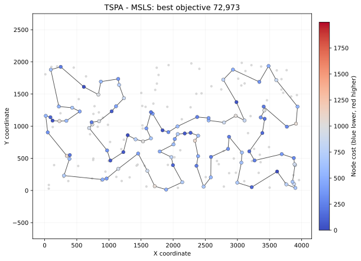
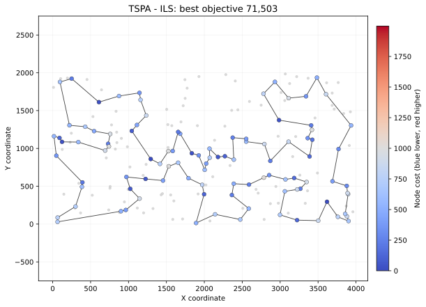
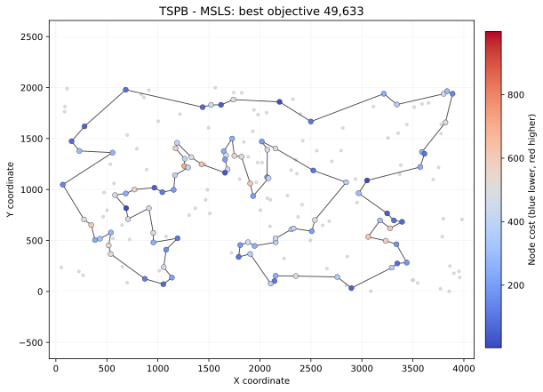
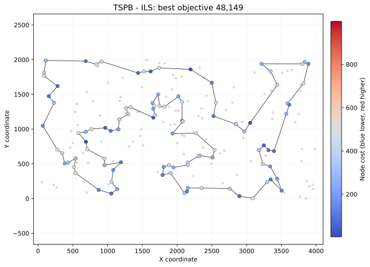

# Assignment 6 - Multiple Start Local Search (MSLS) and Iterated Local Search (ILS)

**Students:** Baris Surmelioglu - 152048  
Ozan Polat - 150918  
**Course:** Evolutionary Computation, Poznan University of Technology  
**Language:** C++17  
**Instances:** original TSPA and TSPB, 200 vertices each; 100 selected  
**Experiment:** 20 MSLS + 20 ILS runs per instance (80 top-level trials)  
**MSLS repetitions:** exactly 400 full basic Steepest Local Search calls per trial  

## 1. Reused local search and experimental design

We reused **unrestricted Steepest Local Search with 2-opt intra-route changes and selected/unselected replacement** from Assignment 3. Each basic LS moves until no negative delta remains in the combined neighborhood. The 2-opt and replacement delta formulas are identical to those used in previous assignments, with a single rounded-distance matrix. We did not use candidate moves or delta-memory LM from Assignments 4/5, to keep the comparison of MSLS and ILS based on the same simple LS.

For a 100-node tour, a full scan tests **4,850 legal 2-opt pairs + 10,000 selected/unselected replacements = 14,850 moves**. Delta calculations update the objective without evaluating a complete neighboring tour.

```text
2OPT-DELTA(a,b,c,d) = D[a,c] + D[b,d] - D[a,b] - D[c,d]
REPLACE-DELTA(old,new,left,right) = cost[new] - cost[old]
    + D[left,new] + D[new,right] - D[left,old] - D[old,right]
```

**Basic LS pseudocode**

```text
STEEPEST(tour):
    total <- objective(tour)
    repeat:
        bestDelta <- 0; bestMove <- NONE
        for each pair (i,j) of non-adjacent tour edges:
            d <- 2OPT-DELTA(tour[i], tour[i+1], tour[j], tour[j+1])
            if d < bestDelta: remember (i,j), d
        for each selected position i and each unused node v:
            d <- REPLACE-DELTA(tour[i],v,left(i),right(i))
            if d < bestDelta: remember (i,v), d
        if bestMove = NONE: return (tour,total)
        apply bestMove; total <- total + bestDelta
```

## 2. MSLS implementation and pseudocode

In each of the 20 top-level MSLS trials, we start from **400 independently shuffled random tours** using the existing Assignment 1 Fisher-Yates generator. We run unrestricted Steepest to completion on each, retain the lowest-cost complete local optimum and measure the elapsed time of the whole trial. The output from a single MSLS trial is the **best of the 400 final LS solutions**, not the mean of those 400 solutions.

```text
MSLS(seed):
    rng <- MT19937(seed)
    best <- NONE; bestValue <- +infinity
    startTimer()
    repeat i = 1..400:
        initial <- RANDOM-TOUR(rng)     # 100 unique selected nodes
        (x,fx) <- STEEPEST(initial)    # full 2-opt + replacement
        if fx < bestValue:
            best <- x; bestValue <- fx
    elapsed <- stopTimer()
    return (best,bestValue,elapsed,ls_runs=400)
```

After executing all 20 MSLS trials for an instance, we set **ILS budget = arithmetic mean of those 20 measured MSLS wall times** for that instance. We use this actual measured value, not a hard-coded timeout or a previous assignment runtime estimate.

## 3. ILS perturbation, acceptance, and pseudocode

Each ILS trial begins with **one fresh random tour**, immediately improved to a local optimum with the same STEEPEST procedure. Then we repeatedly perturb and re-optimize the current solution until the instance-specific MSLS mean-time budget expires. We always keep a separate best-so-far solution.

**Our perturbation (exactly specified):** replace **four distinct selected positions** with **four distinct previously unselected vertices** (sample both sets without replacement). Then choose three cut positions `a<b<c`, ensuring at least five vertices in each of four segments, and reorder the segments from `A|B|C|D` to `A|C|B|D`. This is a double-bridge-style nonlocal rearrangement, followed by a full Steepest repair. The selected vertex count remains exactly 100.

**Acceptance:** accept any candidate whose objective is no worse than the current one. Otherwise accept it with probability **0.12**, allowing occasional uphill moves. The overall best is kept regardless of acceptance. After **80** perturbation attempts without a new overall best, reset the current tour to the best-known tour (the stored best never worsens).

```text
PERTURB(current,rng):
    select 4 distinct tour positions and 4 distinct outside nodes
    replace the 4 selected vertices with the 4 outside vertices
    sample cut indices a < b < c (segment length >= 5 each)
    split into A=[0,a), B=[a,b), C=[b,c), D=[c,end)
    reorder route as A + C + B + D
    return changed tour

ILS(seed,budgetMS):
    rng <- MT19937(seed)
    current <- STEEPEST(RANDOM-TOUR(rng))
    best <- current
    calls <- 1; stagnant <- 0
    startTimer()  # actual implementation starts before first LS
    while elapsedMS < budgetMS:
        candidate <- STEEPEST(PERTURB(current.tour,rng))
        calls <- calls + 1
        if candidate.value < best.value:
            best <- candidate; stagnant <- 0
        else:
            stagnant <- stagnant + 1
        if candidate.value <= current.value or rand(rng) < 0.12:
            current <- candidate
        if stagnant >= 80:
            current <- best; stagnant <- 0
    return (best,calls,elapsedMS)
```

The real timer starts **before generating and optimizing the initial random tour**. The stopping condition is checked before each new LS call, so the final LS may finish slightly after the time threshold. We report both target budgets and actual elapsed times. The ILS LS-call count includes the initial optimization.

**Seeds and replication:** MSLS seed = `2026600 + datasetIndex*100000 + trial*97 + 11`; ILS seed = `2026800 + datasetIndex*100000 + trial*97 + 29`. Dataset index is 0 for TSPA and 1 for TSPB; trial is 0..19. The two methods have independent random streams.

## 4. Computational results - final objective (lower is better)

Each number below summarizes **20 top-level trials**, not individual basic LS outcomes.

| Method | TSPA average (min - max) | TSPB average (min - max) |
|---|---:|---:|
| MSLS | 73,563.200 (72,973 - 73,996) | 50,182.800 (49,633 - 50,644) |
| ILS | 71,650.550 (71,503 - 71,835) | 48,265.450 (48,149 - 48,510) |

### Previous best construction and basic LS references

| Previous assignment / algorithm | TSPA best | TSPB best |
|---|---:|---:|
| Assignment 2: best construction (weighted regret) | 72,011 | 50,485 |
| Assignment 3: best local search (greedy starting tour) | 71,955 | 49,346 |

These earlier results used different start protocols and experimental sizes; they are included as requested references, **not** as paired 20-trial comparisons.

## 5. Running times and number of basic local-search calls

| Method | TSPA mean elapsed (ms) | TSPB mean elapsed (ms) |
|---|---:|---:|
| MSLS | 3,715.397 | 3,858.479 |
| ILS | 3,716.266 | 3,860.040 |

**ILS time budgets, derived from MSLS means:**

| Instance | MSLS mean time (ms) | ILS time budget (ms) |
|---|---:|---:|
| TSPA | 3,715.397 | 3,715.397 |
| TSPB | 3,858.479 | 3,858.479 |

**Number of basic Steepest runs per top-level trial (required ILS table):**

| Method | TSPA avg (min - max) | TSPB avg (min - max) |
|---|---:|---:|
| MSLS | 400.000 (400 - 400) | 400.000 (400 - 400) |
| ILS | 5,415.300 (4645 - 5732) | 5,546.400 (4473 - 5871) |

A perturbed tour generally starts much closer to a local optimum than a new random tour. Therefore ILS can complete many more relatively short Steepest calls within approximately the same total time. More LS calls by itself does not imply better quality, so we also compare the measured objectives.

## 6. Two-dimensional best tours and node index lists

All plots include all 200 nodes (unselected nodes faint gray), the complete closed cycle through 100 chosen nodes, and selected-node cost shown by a blue-to-red color scale. The closing node is intentionally not repeated in the lists. Indices start at 0.

### TSPA - MSLS: best objective 72,973



**Best 100 node indices (zero-based):**

```text
35, 185, 102, 28, 180, 141, 187, 30, 160, 83, 123, 90, 132, 76, 4, 71, 157, 91, 38, 80
48, 31, 60, 108, 152, 49, 11, 63, 149, 116, 168, 95, 97, 127, 69, 171, 2, 189, 87, 98
25, 114, 181, 135, 73, 45, 140, 53, 179, 177, 36, 131, 99, 84, 58, 192, 158, 134, 176, 174
150, 151, 182, 57, 107, 88, 78, 193, 153, 170, 146, 159, 130, 89, 106, 93, 50, 3, 169, 1
47, 37, 147, 101, 29, 178, 136, 186, 164, 85, 142, 8, 54, 9, 33, 52, 144, 67, 16, 51
```

### TSPA - ILS: best objective 71,503



**Best 100 node indices (zero-based):**

```text
91, 80, 48, 31, 60, 108, 152, 100, 123, 83, 160, 49, 63, 149, 116, 168, 97, 127, 69, 129
104, 171, 2, 189, 187, 30, 141, 87, 102, 185, 45, 73, 135, 114, 181, 192, 158, 58, 84, 134
72, 176, 150, 106, 113, 89, 42, 151, 182, 57, 64, 107, 88, 78, 193, 153, 170, 146, 159, 130
47, 147, 101, 29, 178, 184, 136, 186, 164, 1, 169, 3, 50, 93, 85, 174, 8, 54, 9, 33
131, 36, 177, 52, 179, 53, 140, 144, 67, 16, 51, 35, 156, 28, 180, 132, 76, 4, 71, 157
```

### TSPB - MSLS: best objective 49,633



**Best 100 node indices (zero-based):**

```text
30, 176, 21, 38, 47, 140, 154, 26, 125, 177, 170, 115, 97, 155, 71, 40, 60, 157, 45, 134
175, 36, 197, 6, 29, 132, 103, 178, 65, 158, 145, 28, 149, 116, 121, 198, 96, 48, 89, 57
190, 70, 81, 94, 105, 61, 196, 114, 10, 54, 192, 127, 129, 90, 52, 80, 150, 182, 153, 14
20, 74, 171, 99, 88, 179, 87, 82, 51, 85, 59, 73, 167, 181, 152, 34, 24, 67, 66, 162
76, 86, 72, 46, 184, 3, 151, 122, 117, 8, 120, 133, 136, 172, 160, 69, 189, 183, 130, 191
```

### TSPB - ILS: best objective 48,149



**Best 100 node indices (zero-based):**

```text
51, 82, 87, 179, 88, 99, 171, 17, 74, 20, 2, 14, 153, 182, 80, 127, 129, 90, 10, 114
196, 61, 105, 94, 81, 190, 70, 187, 54, 192, 162, 76, 185, 57, 89, 48, 96, 198, 121, 42
147, 116, 37, 146, 13, 149, 28, 145, 65, 178, 103, 132, 29, 6, 197, 36, 175, 134, 45, 157
60, 40, 71, 155, 115, 170, 177, 125, 26, 154, 140, 47, 38, 21, 30, 183, 69, 160, 172, 136
133, 120, 8, 117, 72, 46, 184, 3, 151, 27, 66, 67, 24, 34, 152, 181, 167, 73, 59, 85
```

## 7. Testing and independent checking

1. **Unit tests:** the basic Steepest solution is checked against independent objective evaluation; no negative-delta 2-opt or replacement move remains at termination. Tests cover both odd and even input sizes.
2. **Perturbation:** tests confirm each kick keeps the exact required number of unique selected nodes and changes exactly four selected vertices (where enough outside nodes exist); the double-bridge stage changes only the ordering. Input solutions remain unchanged.
3. **MSLS and ILS rules:** tests verify the requested restart count, ILS time budget, LS call accounting, monotonically improving best-so-far records, and that final objectives equal independent recalculation.
4. **Experiment integrity:** all 80 recorded trials were checked against their summary minima, maxima, arithmetic means, and average runtimes. All 40 MSLS top-level runs contain exactly 400 LS calls; each of the 40 ILS trials uses the corresponding measured MSLS mean-time budget.
5. **Independent checker:** the standalone `src/checker.cpp` recalculates the entire route length and node-cost sum directly from the original CSV coordinates (mathematical rounding); verifies 100 unique valid indices, closure and total objective; and tests unrestricted local optimality of all four best tours.
6. **Instructor spreadsheet reference:** both TSPA and TSPB original Excel checker worksheets contain exactly the same node indices, coordinates and vertex costs as the CSV inputs. We independently recomputed `I2 = sum(selected costs)`, `J2 = sum(rounded closed edges)`, and `K2 = I2 + J2` for all four best tours; this checks the spreadsheet calculation rules programmatically, not manual Microsoft Excel recalculation.

## 8. Conclusions

Both algorithms use the exact same unrestricted basic Steepest search, and the same data sets. Their only high-level difference is how they explore initial conditions: MSLS repeatedly starts independently from random tours, while ILS repeatedly perturbs and improves one evolving search state, preserving a best-so-far record.

Across 20 trials, ILS reduced the mean objective by **1,912.650 (2.60%) on TSPA** and **1,917.350 (3.82%) on TSPB** relative to time-matched MSLS. The best ILS tours (71,503 on TSPA and 48,149 on TSPB) also improved on the best previous local-search examples from Assignment 3 (71,955 and 49,346). With nearly equal measured time, ILS averaged **5,415.3** local-search calls on TSPA and **5,546.4** on TSPB, versus exactly **400** random-start calls in each MSLS trial; perturbations of local optima are usually much faster to reoptimize than fully random tours. This is a heuristic comparison, not a claim of globally optimal solutions.

**Source code:** [C++ implementation](src/msls_ils.hpp), [experiment runner](src/main.cpp), [tests](src/tests.cpp), [checker](src/checker.cpp), [results](results/runs.csv).
