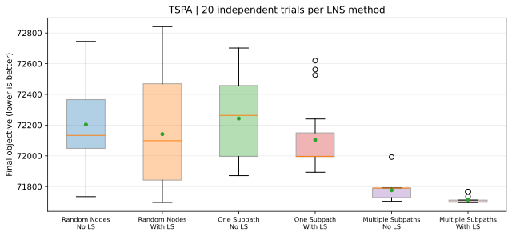
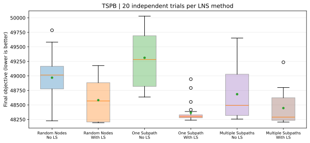
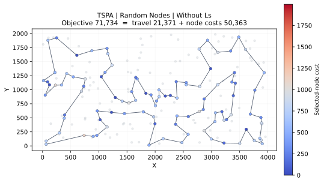
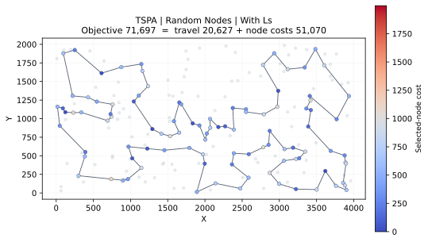
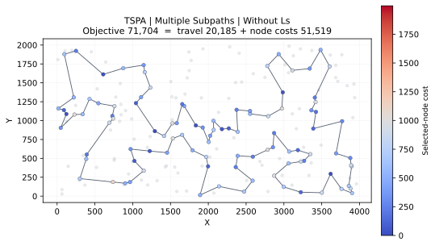
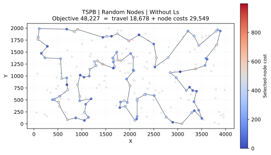
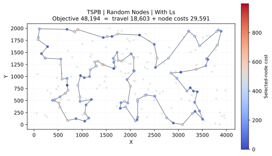
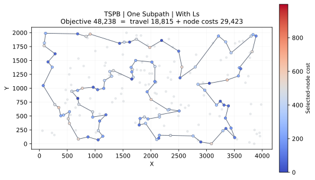
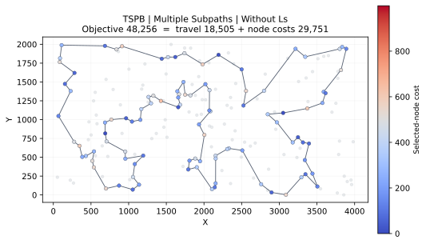

# Assignment 7 - Large Neighborhood Search (LNS)

**Students:** Baris Surmelioglu - 152048  
Ozan Polat - 150918  
**Course:** Evolutionary Computation, Poznan University of Technology  
**Language:** C++17; original TSPA and TSPB (200 nodes; select 100)  
**Experiment:** 3 destroy operators x 2 post-repair variants x 20 trials x 2 instances = **240 complete trials**.  
**Destroy fraction:** 30% of the **100 currently selected nodes = 30 removed**, leaving 70.  
**Time:** measured mean MSLS elapsed time per instance from Assignment 6.

## 1. Problem and implementation decisions

The closed-tour objective is **minimized**: the sum of rounded Euclidean distances over the entire closed cycle, plus selected-node costs. Only 100 distinct vertices may be selected; all survivors of the destroy stage must stay selected during repair. The last-to-first closing edge is included.

The lecturer's reminder pseudocode prints `If f(y) > f(x)`; this conflicts with the problem's minimization direction. We explicitly implement **`if f(y) < f(x): accept(y)`**. Accepting `>` would repeatedly prefer worse objectives. This is a deliberate correction of an evident inequality inconsistency, not an undisclosed change of the optimization problem.

We use the **unrestricted basic Steepest search with 2-opt for intra-route improvements and selected/unselected node replacement for inter-route improvements**, selecting the most negative delta from the *combined* neighborhood. This is the stronger 2-opt-based search observed in previous random-start experiments. The local search is always applied **once to the initial random solution**. Afterwards, the six LNS versions differ only in their destroy operator and whether a full Steepest call follows each repair.

```text
2OPT-DELTA(a,b,c,d) = D[a,c] + D[b,d] - D[a,b] - D[c,d]
REPLACE-DELTA(old,new,left,right) = cost[new] - cost[old]
                                     + D[left,new] + D[new,right]
                                     - D[left,old] - D[old,right]
```

For 100 selected and 100 unselected vertices, a complete Steepest scan includes **4,850 legal 2-opt moves and 10,000 replacements**. These deltas are constant-time, and the complete neighboring route is not reconstructed during evaluation.

## 2. The three destroy operators (used separately)

All operators remove **exactly 30 of the 100 selected nodes**, retaining the cyclic order of the other 70. The removed vertices rejoin the outside-candidate pool and are not forbidden from being reinserted during repair.

**Random nodes:** sample 30 different *positions* uniformly by partial Fisher-Yates (no replacement). This spreads the damage across the tour, exposing many different insertion opportunities.

**One random subpath:** choose a uniformly random starting position and remove 30 consecutive selected positions modulo tour length; the segment is allowed to cross the last-to-first boundary. This retains a large uninterrupted part of the current tour but destroys one contiguous region.

**Three to five random subpaths:** sample a count `q` uniformly from `{3,4,5}`. Partition 30 removed positions into `q` random lengths, with each length >=3; partition the 70 surviving positions into `q` random positive gaps (each >=1). Interleave a removed block and a retained gap around the cycle, starting from a random rotation. This guarantees **exactly q separated non-overlapping circular subpaths** and exactly 30 removed nodes, without retries or accidental overlaps.

```text
DESTROY(tour,kind,rng):
    m = 100; k = 30
    if kind == RANDOM_NODES:
        removed_positions = sample_without_replacement(0..m-1,k)
    if kind == ONE_SUBPATH:
        start = random_integer(0,m-1)
        removed_positions = {(start+j) mod m : j=0..k-1}
    if kind == MULTIPLE_SUBPATHS:
        q = random_integer(3,5)
        lengths = random_positive_partition(k,q,min_per_part=3)
        gaps = random_positive_partition(m-k,q,min_per_part=1)
        rotate cycle randomly; alternate removed lengths and retained gaps
    return survivors in their original cyclic order, exactly 70 nodes
```

## 3. Repair operator: best weighted 2-regret construction

The prior construction results select **weighted 2-regret in Greedy Cycle form for TSPA** and **weighted 2-regret with open-path all-position insertion for TSPB**. These are the strongest respective instance-specific constructors by their recorded best scores (and also by the best mean among their construction variants). We adapt the *same insertion scoring rule* to a partially preserved 70-node solution rather than starting from one node.

For each currently unused vertex `v`, examine every legal insertion position, including its node cost. Let `delta1` and `delta2` be its two smallest insertion increases, and `regret(v) = delta2 - delta1`. We maximize

```text
score(v) = 0.5 * regret(v) - 0.5 * delta1(v)
```

The term `regret` rewards inserting a vertex before its alternative placements become expensive; the negative best-insertion term discourages expensive additions. Ties are resolved by smaller `delta1`, then lower node index; position ties keep the first position. We insert the chosen vertex at its minimum-increase position, repeat 30 times, and return to exactly 100 distinct selected nodes.

For **TSPA** we keep the remaining 70 nodes in a **closed** cycle, and calculate their insertion increase against a removed cycle edge `(a,b)`:

```text
delta_cycle(v;a,b) = cost[v] + D[a,v] + D[v,b] - D[a,b]
```

For **TSPB** we use the best all-position nearest-neighbor-derived **open path** variant. Importantly, we **break the surviving cycle at one randomly chosen edge** before insertion, as required by the instruction. Insertion at the start/end has no subtracted edge; inner positions use the same edge-replacement formula. We close the path only when all 100 nodes have been restored.

```text
REPAIR(partial,basis,rng):
    S = partial.survivors  # all 70 must remain selected
    if basis == OPEN_PATH:
        cut one randomly selected closing edge by rotating S
    while size(S) < 100:
        for every vertex v not in S:
            find minimum and second-minimum insertion delta across all positions
            score(v) = (delta2 - delta1 - delta1)/2
        choose maximum score, break ties by minimum delta then vertex ID
        insert v into its minimum-delta position
    return S (evaluate as a closed cycle)
```

## 4. Six LNS variants, acceptance and equal time budgets

For each destroy operator we independently evaluate **without** and **with** post-repair local search. Each trial begins with a *fresh random solution*, followed by unrestricted Steepest, **even in the no-post-LS variants**. Strict improving-only acceptance preserves the best incumbent and makes the final objective monotonically nonincreasing. We do not use the ILS 12% worse-acceptance mechanism here; this isolates the destroy/repair design.

```text
LNS(instance,destroy_kind,post_repair_LS,seed,budget_ms):
    rng = MT19937(seed)
    start_timer()  # counts the initial improvement too
    x = STEEPEST(RANDOM_SOLUTION(rng))
    best = x
    iterations = 0
    while elapsed_ms < budget_ms:
        partial = DESTROY(x,destroy_kind,rng)  # remove 30 of 100
        y = REPAIR(partial,selected_regret_basis(instance),rng)
        if post_repair_LS: y = STEEPEST(y)
        iterations += 1
        if objective(y) < objective(x):
            x = y; best = y
    return best,iterations,elapsed_ms
```

The stopping condition is checked **before each new complete destroy/repair/optional-LS iteration**, so a final iteration is allowed to finish slightly beyond the exact limit. The requested time budgets use actual MSLS means from the previous experiment, not invented limits:

| Instance | MSLS average elapsed / LNS budget (ms) | 30%-destroy size |
|---|---:|---:|
| TSPA | 3,715.396616 | 30 |
| TSPB | 3,858.478861 | 30 |

Each of the 12 method/instance groups contains **20 complete independent trials**, or 240 total. We use fixed seed formula `2026700 + instanceIndex*100000 + trial*101 + destroyIndex*11003 + 17` (`instanceIndex=0/1`, `trial=0..19`, `destroyIndex=0..2`). The with/without-LS pair within the same destroy/trial deliberately shares the initial seed to create the same starting local optimum; their later randomness differs because one variant performs extra search work.

## 5. Measured objective values (20 trials per method)

The following are measured **best-so-far final objectives** from independent full-budget LNS trials. Lower is better. Each result is **mean (min - max)**.

| Destroy operator | Post-repair LS | TSPA average (min - max) | TSPB average (min - max) |
|---|---|---:|---:|
| Random nodes | No | 72,203.400 (71,734 - 72,745) | 48,969.650 (48,227 - 49,786) |
| Random nodes | Yes | 72,141.450 (71,697 - 72,841) | 48,582.350 (48,194 - 49,178) |
| Single random subpath | No | 72,243.250 (71,871 - 72,702) | 49,312.300 (48,637 - 50,029) |
| Single random subpath | Yes | 72,103.400 (71,893 - 72,620) | 48,366.050 (48,238 - 48,944) |
| 3-5 random subpaths | No | 71,776.100 (71,704 - 71,992) | 48,685.200 (48,256 - 49,652) |
| 3-5 random subpaths | Yes | 71,714.500 (71,696 - 71,766) | 48,446.050 (48,205 - 49,235) |

## 6. Time, main-loop iterations and LS calls

**All iterations are completed destroy-repair cycles**, not individual Steepest moves. The no-post-LS configuration runs Steepest only once (on the initial random solution). The with-LS configuration invokes Steepest once initially, then once per completed main-loop iteration. The measured per-trial elapsed time includes that initial optimization.

| Destroy | Post-repair LS | TSPA mean ms | TSPA main loops avg (min - max) | TSPB mean ms | TSPB main loops avg (min - max) |
|---|---|---:|---:|---:|---:|
| Random nodes | No | 3,715.8 | 4,686.6 (3,997 - 4,975) | 3,858.8 | 7,087.0 (5,229 - 7,842) |
| Random nodes | Yes | 3,715.8 | 4,031.0 (2,599 - 4,490) | 3,858.9 | 5,442.4 (4,050 - 5,991) |
| Single random subpath | No | 3,715.8 | 4,753.4 (4,212 - 5,081) | 3,858.8 | 7,405.9 (6,174 - 7,693) |
| Single random subpath | Yes | 3,715.9 | 4,067.3 (3,575 - 4,314) | 3,859.0 | 4,714.1 (4,250 - 5,117) |
| 3-5 random subpaths | No | 3,715.8 | 4,628.5 (4,138 - 4,884) | 3,858.7 | 7,256.9 (6,568 - 7,702) |
| 3-5 random subpaths | Yes | 3,715.8 | 4,113.5 (3,682 - 4,502) | 3,858.8 | 5,133.9 (4,221 - 5,794) |

For a fixed time budget, more iterations are possible when the chosen destroy/repair/LS pipeline is cheaper. Iteration count alone is not a quality measure: the objective table must be considered alongside it. The counter records every *completed* proposal, including rejected proposals; another counter separately records accepted improving proposals in `runs.csv`.

## 7. Reference quality (previous experiment results)

These are **previously measured reference values**, not new Assignment 7 trials. Best-solution values and averages from different experiment designs are not interchangeable.

| Reference method | TSPA best | TSPB best | Explanation |
|---|---:|---:|---|
| Weighted 2-regret construction | 72,011 | 50,485 | Weighted cycle on TSPA; weighted all-position open path on TSPB |
| Best basic Local Search | 71,955 | 49,346 | Steepest/Greedy search, 2-opt or node swap and selected/unselected replacement, using greedy initial tours |
| MSLS (400 independent Steepest starts per top-level run) | 72,973 | 49,633 | Best from 20 top-level runs per instance |
| ILS (perturb + Steepest within the MSLS budget) | 71,503 | 48,149 | Best from 20 top-level runs per instance |

## 8. Objective comparison figures

The boxplots below show all 20 final objectives for each of the six LNS configurations. The box shows the central half of the results, the horizontal line is the median, and markers display the mean. Lower values indicate better solutions.





## 9. Best tours for all twelve variants

Each graph plots the entire **closed** tour through exactly 100 distinct nodes, shows all 200 original points, and colors the selected points by selected-node cost. The 100 zero-based node indices follow the graph; the first node is **not** repeated at the end of the list. Values are recomputed from the original coordinates and include the closing edge.

### TSPA - Random nodes - without LS

**Objective:** 71,734 = **travel** 21,371 + **selected-node costs** 50,363.



**Best 100 node indices (0-based):**

```text
28, 180, 132, 76, 4, 71, 157, 91, 80, 48, 31, 60, 116, 149, 63, 168, 11, 49, 108, 152
100, 123, 160, 97, 127, 69, 129, 104, 92, 171, 2, 189, 187, 30, 141, 87, 45, 73, 135, 114
181, 192, 158, 58, 84, 134, 72, 176, 174, 85, 1, 3, 50, 93, 113, 89, 42, 106, 150, 151
138, 182, 57, 64, 107, 88, 78, 193, 153, 170, 146, 159, 130, 47, 147, 101, 29, 178, 184, 136
186, 164, 8, 54, 9, 33, 131, 36, 177, 52, 179, 53, 140, 144, 67, 16, 51, 35, 185, 102
```

### TSPA - Random nodes - with LS

**Objective:** 71,697 = **travel** 20,627 + **selected-node costs** 51,070.



**Best 100 node indices (0-based):**

```text
177, 36, 131, 33, 9, 54, 8, 142, 164, 186, 136, 184, 178, 29, 101, 147, 47, 1, 169, 3
50, 93, 130, 159, 146, 170, 153, 193, 78, 88, 107, 64, 57, 182, 138, 151, 42, 89, 113, 106
150, 174, 176, 72, 134, 84, 58, 158, 192, 181, 114, 135, 73, 45, 87, 141, 30, 187, 189, 2
171, 92, 69, 127, 97, 168, 116, 149, 63, 11, 49, 160, 83, 123, 100, 152, 108, 60, 31, 48
80, 91, 157, 71, 4, 76, 132, 180, 28, 102, 185, 35, 51, 16, 67, 144, 140, 53, 179, 52
```

### TSPA - Single random subpath - without LS

**Objective:** 71,871 = **travel** 20,069 + **selected-node costs** 51,802.


**Best 100 node indices (0-based):**

```text
60, 31, 48, 80, 91, 157, 71, 4, 76, 132, 180, 28, 102, 185, 35, 51, 16, 67, 144, 140
53, 179, 52, 177, 36, 131, 33, 9, 54, 8, 142, 164, 186, 136, 163, 29, 101, 178, 1, 169
3, 50, 93, 47, 130, 159, 146, 170, 75, 153, 193, 78, 88, 107, 64, 57, 182, 138, 151, 42
89, 113, 106, 150, 174, 176, 72, 134, 84, 58, 158, 192, 181, 114, 135, 73, 45, 87, 141, 30
187, 189, 2, 171, 92, 69, 127, 97, 160, 83, 123, 100, 152, 108, 49, 11, 168, 63, 149, 116
```

### TSPA - Single random subpath - with LS

**Objective:** 71,893 = **travel** 20,775 + **selected-node costs** 51,118.


**Best 100 node indices (0-based):**

```text
60, 108, 152, 100, 123, 83, 160, 49, 11, 63, 149, 116, 168, 97, 127, 69, 92, 171, 2, 189
187, 30, 141, 180, 28, 87, 45, 73, 135, 114, 181, 192, 158, 58, 84, 134, 72, 176, 174, 150
106, 113, 89, 42, 151, 138, 182, 57, 64, 107, 88, 78, 193, 153, 170, 146, 159, 130, 93, 50
3, 169, 1, 47, 37, 147, 101, 29, 178, 184, 136, 186, 164, 142, 8, 54, 9, 33, 131, 36
177, 52, 179, 53, 140, 144, 67, 185, 35, 16, 51, 132, 76, 4, 71, 157, 91, 80, 48, 31
```

### TSPA - 3-5 random subpaths - without LS

**Objective:** 71,704 = **travel** 20,185 + **selected-node costs** 51,519.



**Best 100 node indices (0-based):**

```text
8, 54, 9, 33, 131, 36, 177, 52, 179, 53, 140, 144, 67, 16, 51, 35, 156, 28, 180, 132
76, 4, 71, 157, 91, 80, 48, 31, 60, 116, 149, 63, 168, 11, 49, 108, 152, 100, 123, 83
160, 97, 127, 69, 92, 171, 2, 189, 187, 30, 141, 87, 102, 185, 45, 73, 135, 114, 181, 192
158, 58, 84, 134, 72, 176, 174, 150, 106, 113, 89, 42, 151, 138, 182, 57, 64, 107, 88, 78
193, 153, 170, 146, 159, 130, 47, 93, 50, 3, 169, 1, 101, 29, 178, 184, 136, 186, 164, 142
```

### TSPA - 3-5 random subpaths - with LS

**Objective:** 71,696 = **travel** 20,691 + **selected-node costs** 51,005.


**Best 100 node indices (0-based):**

```text
58, 84, 134, 72, 176, 174, 150, 106, 113, 89, 42, 151, 138, 182, 57, 64, 107, 88, 78, 193
153, 170, 146, 159, 130, 93, 50, 3, 169, 1, 47, 37, 147, 101, 29, 178, 184, 136, 186, 164
142, 8, 54, 9, 33, 131, 36, 177, 52, 179, 53, 140, 144, 67, 16, 51, 35, 185, 102, 28
180, 132, 76, 4, 71, 157, 91, 80, 48, 31, 60, 116, 149, 63, 168, 11, 49, 108, 152, 100
123, 83, 160, 97, 127, 69, 171, 2, 189, 187, 30, 141, 87, 45, 73, 135, 114, 181, 192, 158
```

### TSPB - Random nodes - without LS

**Objective:** 48,227 = **travel** 18,678 + **selected-node costs** 29,549.



**Best 100 node indices (0-based):**

```text
21, 38, 47, 140, 154, 97, 155, 71, 40, 60, 157, 45, 134, 175, 62, 36, 197, 132, 29, 6
115, 170, 125, 177, 158, 145, 28, 149, 13, 146, 37, 116, 147, 42, 121, 198, 96, 48, 156, 89
57, 185, 76, 104, 190, 70, 187, 81, 94, 105, 61, 196, 114, 10, 78, 54, 162, 192, 80, 127
129, 90, 153, 14, 2, 20, 74, 17, 171, 99, 67, 24, 34, 152, 181, 179, 87, 82, 51, 85
59, 73, 167, 98, 151, 3, 184, 46, 72, 117, 8, 120, 133, 136, 172, 160, 69, 189, 183, 30
```

### TSPB - Random nodes - with LS

**Objective:** 48,194 = **travel** 18,603 + **selected-node costs** 29,591.



**Best 100 node indices (0-based):**

```text
89, 57, 185, 76, 104, 190, 70, 187, 81, 94, 105, 61, 196, 114, 10, 78, 54, 162, 192, 80
127, 129, 90, 153, 14, 2, 20, 74, 17, 171, 99, 67, 24, 34, 152, 181, 179, 87, 82, 51
85, 59, 73, 167, 98, 151, 3, 184, 46, 72, 117, 8, 120, 133, 136, 172, 160, 69, 189, 183
30, 21, 38, 47, 140, 154, 97, 155, 71, 40, 60, 157, 45, 134, 175, 62, 36, 197, 132, 29
6, 180, 115, 170, 125, 177, 158, 145, 28, 149, 13, 146, 37, 116, 147, 42, 121, 198, 96, 48
```

### TSPB - Single random subpath - without LS

**Objective:** 48,637 = **travel** 18,483 + **selected-node costs** 30,154.


**Best 100 node indices (0-based):**

```text
60, 40, 71, 155, 97, 154, 140, 47, 38, 21, 30, 183, 189, 69, 160, 172, 136, 133, 120, 72
46, 184, 3, 151, 27, 76, 66, 67, 24, 34, 152, 181, 167, 73, 59, 85, 51, 179, 82, 87
88, 99, 171, 17, 74, 20, 2, 14, 153, 90, 129, 127, 80, 192, 162, 54, 78, 10, 114, 196
61, 105, 94, 81, 169, 187, 70, 190, 77, 57, 89, 156, 48, 96, 198, 121, 42, 147, 116, 37
146, 13, 149, 28, 145, 158, 125, 170, 115, 180, 6, 29, 132, 197, 36, 62, 175, 134, 45, 157
```

### TSPB - Single random subpath - with LS

**Objective:** 48,238 = **travel** 18,815 + **selected-node costs** 29,423.



**Best 100 node indices (0-based):**

```text
185, 76, 104, 190, 70, 187, 81, 94, 105, 61, 196, 114, 10, 78, 54, 162, 192, 80, 127, 129
90, 153, 14, 2, 20, 74, 17, 171, 99, 88, 179, 87, 82, 51, 85, 59, 73, 167, 181, 152
67, 24, 34, 98, 151, 3, 184, 46, 72, 120, 133, 136, 172, 160, 69, 183, 30, 21, 38, 47
140, 154, 26, 125, 177, 170, 115, 155, 71, 40, 60, 157, 45, 134, 175, 62, 36, 197, 6, 29
132, 103, 178, 65, 145, 28, 149, 13, 146, 37, 116, 147, 42, 121, 198, 96, 48, 156, 89, 57
```

### TSPB - 3-5 random subpaths - without LS

**Objective:** 48,256 = **travel** 18,505 + **selected-node costs** 29,751.



**Best 100 node indices (0-based):**

```text
81, 94, 105, 61, 196, 114, 10, 78, 54, 162, 192, 80, 127, 129, 90, 153, 14, 2, 20, 74
17, 171, 99, 67, 24, 34, 152, 181, 179, 87, 82, 51, 85, 59, 73, 167, 98, 151, 3, 184
46, 72, 117, 8, 120, 133, 136, 172, 160, 69, 189, 183, 30, 21, 38, 47, 140, 154, 26, 125
170, 115, 155, 71, 40, 60, 157, 45, 134, 175, 62, 36, 197, 6, 29, 132, 103, 178, 65, 145
28, 149, 13, 146, 37, 116, 147, 42, 121, 198, 96, 48, 156, 89, 57, 185, 76, 104, 190, 70
```

### TSPB - 3-5 random subpaths - with LS

**Objective:** 48,205 = **travel** 18,776 + **selected-node costs** 29,429.


**Best 100 node indices (0-based):**

```text
72, 46, 184, 3, 151, 27, 66, 67, 24, 34, 152, 181, 167, 73, 59, 85, 51, 82, 87, 179
88, 99, 171, 17, 74, 20, 2, 14, 153, 90, 129, 80, 127, 10, 114, 196, 61, 105, 94, 81
190, 70, 187, 54, 192, 162, 76, 185, 57, 89, 48, 96, 198, 121, 42, 147, 116, 37, 146, 13
149, 28, 145, 65, 178, 103, 132, 29, 6, 197, 36, 62, 175, 134, 45, 157, 60, 40, 71, 155
115, 170, 177, 125, 26, 154, 140, 47, 38, 21, 30, 183, 189, 69, 160, 172, 136, 133, 120, 117
```

## 10. Tests and verification (real executions, not hypothetical laptop claims)

We ran the following automated checks in the local Linux execution environment, compiling with `g++ -O3 -Wall -Wextra -Wpedantic`. This is **not** a claim that a student manually tested the code on a physical laptop. `README.md` and `TESTING.md` provide the exact steps for independent laptop reproduction.

1. **Unit and property tests (`assignment7_tests`):** exact 30% removal, 30 unique positions, wraparound single subpath, 3-5 disjoint nonadjacent subpaths, both weighted-regret repair bases, 100 unique valid vertices, original-survivor retention, closed tour, strict improvement, with-LS local optimality, call counters, time budget, invalid-argument errors. Randomized test cases cover different instance sizes.
2. **Real experimental run audit:** all 240 run-level tours are recalculated **independently from original CSV coordinates**, including mathematical integer rounding, node costs and the closing edge. All 12 groups have exactly 20 independent time-limited trials, with true objective minima, maxima, averages and loop-count statistics.
3. **Paired starts:** every with/without-LS pair uses the same PRNG seed and has the same initial optimized tour objective. All 120 pairs are checked.
4. **Standalone C++ checker:** the twelve best tours are evaluated independently, including the closing edge; for the six with-LS best tours, it also checks that no improving 2-opt or replacement move remains in the complete neighborhood.
5. **Manual reproduction instructions:** build with CMake; run `ctest`; perform a one-trial command; reproduce full experiment with `--workers 1` on a student laptop, then run the standalone checker. This is an executable protocol, not a fabricated account of a manual laptop test.

## 11. Conclusions

For **TSPA**, the lowest 20-trial mean was obtained by **3-5 random subpaths**, **with** post-repair LS (mean objective 71,714.500). This is an empirical result under the specified time budget, not proof of global optimality.

For **TSPB**, the lowest 20-trial mean was obtained by **Single random subpath**, **with** post-repair LS (mean objective 48,366.050). This is an empirical result under the specified time budget, not proof of global optimality.

The comparison isolates the trade-off between a stronger repair plus post-repair local optimization and the number of large-neighborhood proposals that fit inside the time budget. Strict improvement acceptance and a fixed 30% removal fraction are shared across all six methods. Full objective decomposition, detailed individual results and retained best tours are available in the CSVs and plotted SVG files.

**Reproduction:** [README.md](README.md), [TESTING.md](TESTING.md), [source code](src/lns.hpp), [all runs](results/runs.csv), [summary](results/summary.csv), [best tours](results/best_solutions.txt).
