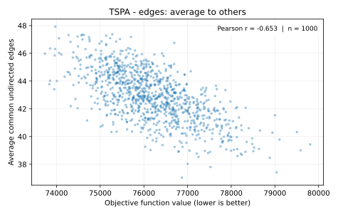
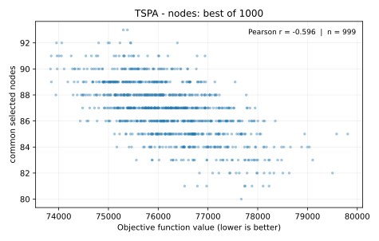
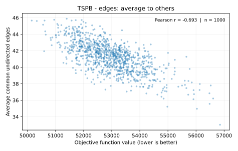
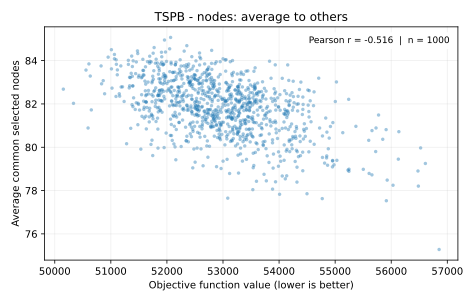

# Assignment 8 - Global Convexity Tests

**Students:** Baris Surmelioglu (152048) and Ozan Polat (150918)  
**Course:** Evolutionary Computation - Poznan University of Technology  
**Implementation:** C++17 (search and checker), Python 3 (NumPy and Matplotlib)  
**Instances:** original TSPA and TSPB; 200 nodes, 100 selected  
**Experiment:** 1,000 random-start Greedy Local Search runs per instance; 2,000 local optima and 12 scatterplots

## 1. Problem and purpose

We continue the same problem from Assignments 1-7. A solution is an ordered cycle through exactly 100 different nodes chosen from 200. Its objective is the sum of rounded Euclidean distances of the cycle edges and the costs of the selected nodes. The goal is to minimize this value.

```text
D[u,v] = floor(sqrt((x[u]-x[v])^2 + (y[u]-y[v])^2) + 0.5)
f(T) = sum(cost[T[i]] + D[T[i], T[(i+1) mod m]])
       for i = 0 .. m-1, where m = 100
```

The purpose of this assignment is to examine whether better local optima tend to be structurally similar to other local optima or to a high-quality reference solution. We use two measures (common undirected edges and common selected nodes) and three reference choices (average to other sampled optima, best sampled optimum, and previous best ILS solution). This gives six comparisons per instance.

## 2. Generating local optima: implementation and pseudocode

### 2.1 Random initial solution

We reuse the Fisher-Yates random-tour generator from Assignment 1. A shuffled permutation of all 200 node indices is created and its first 100 entries form the initial cycle. The first node is not duplicated at the end; the closing edge is implicit. Each run starts from a new random solution, rather than from the previous local optimum.

```text
RANDOM-TOUR(n, m, rng):
    P = [0, 1, ..., n-1]
    shuffle P using Fisher-Yates and rng
    return P[0:m]
```

### 2.2 Full neighborhood and move deltas

We reuse the randomized first-improvement Greedy Local Search from Assignment 3 with 2-opt intra-route moves and selected/unselected replacement inter-route moves. We do not restrict the search to candidate lists (Assignment 4) or reuse stored deltas (Assignment 5).

A 2-opt move removes two nonadjacent edges (a,b) and (c,d), adds (a,c) and (b,d), and reverses the segment between the cuts. Because distances are symmetric, the internal reversed edges do not change the objective. A replacement changes one selected node to an unselected node at the same tour position, updating both incident edges and the selected-node cost.

```text
2OPT-DELTA(T, i, j):
    a = T[i]; b = T[(i+1) mod m]
    c = T[j]; d = T[(j+1) mod m]
    return D[a,c] + D[b,d] - D[a,b] - D[c,d]

REPLACE-DELTA(T, i, v):
    old = T[i]
    left = T[(i-1) mod m]; right = T[(i+1) mod m]
    return cost[v] - cost[old] + D[left,v] + D[v,right]
           - D[left,old] - D[old,right]
```

Both deltas take O(1) time after the distance matrix has been constructed. For m = 100, the joint neighborhood has 4,850 valid 2-opt moves and 10,000 replacements, for a total of 14,850 possible moves per full scan.

```text
MAKE-MOVES(m, outside_count):
    moves = empty list
    for i = 0 .. m-1:
        for j = i+1 .. m-1:
            if j == i+1 or (i == 0 and j == m-1): continue
            append (2OPT, i, j) to moves
    for i = 0 .. m-1:
        for k = 0 .. outside_count-1:
            append (REPLACE, i, k) to moves
    return moves
```

Replacement descriptors store an index into the current outside-node list, not a fixed outside vertex. That list is rebuilt after each accepted move. The descriptor list itself can be reused because the number of selected nodes remains fixed.

### 2.3 Randomized Greedy Local Search

In each scan, the two types of moves are in the same pool. An online Fisher-Yates shuffle chooses the next move uniformly from the unvisited part of the list. We immediately accept the first move with a negative delta, then restart the scan with the changed solution. This differs from Steepest Local Search, which evaluates the complete neighborhood before accepting the best move.

```text
GREEDY-LOCAL-SEARCH(initial, rng):
    T = copy(initial)
    f = EVALUATE(T)
    moves = MAKE-MOVES(m, n-m)
    accepted = 0; checks = 0
    repeat:
        outside = all nodes not in T, in ascending index order
        improved = false
        for k = 0 .. size(moves)-1:
            q = uniform_random_integer(k, size(moves)-1, rng)
            swap moves[k], moves[q]
            (kind, i, j) = moves[k]
            if kind == 2OPT:
                delta = 2OPT-DELTA(T, i, j)
            else:
                delta = REPLACE-DELTA(T, i, outside[j])
            checks = checks + 1
            if delta < 0:
                if kind == 2OPT: reverse T[i+1 .. j]
                else: T[i] = outside[j]
                f = f + delta
                accepted = accepted + 1
                improved = true
                break
        if not improved: return (T, f, accepted, checks)
```

Only strictly improving moves are accepted. Since the set of feasible tours is finite and each accepted move decreases the objective, the procedure terminates. A complete scan without an improvement establishes local optimality under both move types, not global optimality. No full neighboring tour is evaluated during the scan.

### 2.4 Experiment runner

For each instance, the distance matrix is built once. The MT19937 generator is initialized once per instance (TSPA: 20260801; TSPB: 20260901). Its state is carried across runs; it is not reset for each start. The runner records all final tours, not just their objective values. Duplicate optima would remain separate observations, but none occurred in the saved experiment.

```text
GENERATE-OPTIMA(instance, seed):
    load original coordinates and node costs
    build rounded distance matrix D
    rng = MT19937(seed)
    samples = empty list
    for run = 0 .. 999:
        start_timer()
        initial = RANDOM-TOUR(200, 100, rng)
        (T, f, accepted, checks) = GREEDY-LOCAL-SEARCH(initial, rng)
        elapsed = stop_timer()
        assert EVALUATE(T) == f
        save (instance, run, f, accepted, checks, elapsed, T)
        append (T, f) to samples
    return samples
```

The timing includes random-tour generation and local search, but not the final objective consistency check or CSV writing. Timings depend on the machine. The analysis uses the saved tours and objective values, not the timings.

## 3. Similarity measures and pseudocode

### 3.1 Common undirected edges and selected nodes

Let N(T) be the set of selected nodes and E(T) the set of undirected edges of a cycle T. Both have 100 elements. For edges we store the smaller endpoint first, so traversing the same cycle in the opposite direction does not change the edge set. The closing edge is included. Common nodes ignore visit order; common edges also capture connections between nodes.

```text
FEATURES(T, measure):
    if measure == NODES: return set(T)
    E = empty set
    for i = 0 .. size(T)-1:
        u = T[i]; v = T[(i+1) mod size(T)]
        add (min(u,v), max(u,v)) to E
    return E

SIMILARITY(A, B, measure):
    return size(FEATURES(A, measure) intersection FEATURES(B, measure))
```

Both similarity measures range from 0 to 100 and are counts, not percentages. For example, cycles (1,2,3,4) and (1,2,4,3) have four common selected nodes but only two common undirected edges. A rotation or reversal of a cycle preserves both feature sets.

### 3.2 Average similarity to all other local optima

For every sampled solution i, we calculate the average overlap with the other 999 solutions. We exclude the solution itself to avoid adding an artificial overlap of 100. Instead of repeatedly intersecting every pair of feature sets, we count how frequently each feature occurs across the sample.

```text
AVERAGE-OVERLAP(F[0 .. s-1]):
    frequency = empty counter with default value 0
    for each feature set A in F:
        for each feature a in A:
            frequency[a] = frequency[a] + 1
    for i = 0 .. s-1:
        total = 0
        for each feature a in F[i]:
            total = total + frequency[a] - 1
        average[i] = total / (s-1)
    return average
```

The formula is equivalent to sum over all j != i of |F[i] intersection F[j]| divided by 999. Each feature contributes exactly the number of other tours containing it. With s solutions of m features, the frequency method takes expected O(s*m) time using hash sets/counters, instead of expected O(s*s*m) for direct pairwise intersections. The two approaches were cross-checked on selected sample rows.

### 3.3 Similarity to the best sampled local optimum

The reference is the sample with the smallest objective among the 1,000 Greedy results. If there is a tie, the first minimum is selected. We exclude that reference run from its own comparison, so these scatterplots contain 999 points. The run IDs in the CSV are zero-based.

```text
COMPARE-TO-SAMPLE-BEST(samples, F):
    b = first index with minimum samples[i].objective
    points = empty list
    for i = 0 .. 999:
        if i == b: continue
        y = size(F[i] intersection F[b])
        append (samples[i].objective, y) to points
    return points
```

### 3.4 Similarity to the previous best solution

We use the best ILS solutions saved in Assignment 6, independently of the 1,000 Greedy runs. These are not assumed to be globally optimal. The reference objective is 71,503 for TSPA and 48,149 for TSPB. Both are better than the corresponding best sampled Greedy result. All 1,000 sample rows are included in these comparisons.

```text
COMPARE-TO-PREVIOUS-BEST(samples, F, previous_tour, measure):
    R = FEATURES(previous_tour, measure)
    points = empty list
    for i = 0 .. 999:
        y = size(F[i] intersection R)
        append (samples[i].objective, y) to points
    return points
```

The reference tours are loaded from `Assignment 6/results/best_solutions.txt`. Their objectives are independently recomputed from the original coordinates and costs. The exact reference tours and their provenance are saved in `results/references.txt`.

## 4. Pearson correlation and complete analysis pseudocode

For each comparison we plot objective value x on the horizontal axis and similarity y on the vertical axis. Pearson's correlation coefficient is computed from exactly the plotted points. Let x_mean and y_mean denote their arithmetic means.

```text
r = sum((x[i]-x_mean)*(y[i]-y_mean)) /
    sqrt(sum((x[i]-x_mean)^2) * sum((y[i]-y_mean)^2))
```

Pearson r ranges from -1 to +1. Because the objective is minimized, a negative r indicates that lower-cost solutions tend to have higher similarity. A value near zero indicates a weak linear relationship, not necessarily absence of any relationship. The implementation uses NumPy's corrcoef and returns NaN for constant input arrays; no such case occurred in this experiment.

```text
ANALYZE(instance, samples, previous_tour):
    assert size(samples) == 1000
    independently verify every saved tour and objective
    independently verify previous_tour and its objective
    for measure in [EDGES, NODES]:
        F = [FEATURES(T, measure) for T in samples]
        assert every feature set has size 100
        avg = AVERAGE-OVERLAP(F)
        cross-check avg against direct intersections on selected rows
        P1 = [(samples[i].objective, avg[i]) for i = 0 .. 999]
        P2 = COMPARE-TO-SAMPLE-BEST(samples, F)
        P3 = COMPARE-TO-PREVIOUS-BEST(samples, F, previous_tour, measure)
        for (reference, points) in [(AVERAGE,P1), (SAMPLE_BEST,P2),
                                    (PREVIOUS_ILS,P3)]:
            x, y = objective and similarity columns of points
            r = PEARSON(x, y)
            save points, r, count, mean/min/max similarity
            draw scatterplot(x, y, r, count)

MAIN:
    for (instance, seed) in [(TSPA,20260801), (TSPB,20260901)]:
        samples = GENERATE-OPTIMA(instance, seed)
        reference = load previous ILS tour for instance
        ANALYZE(instance, samples, reference)
```

In the actual implementation, generation and analysis are separate programs; MAIN describes their combined workflow. The analysis produces 2 instances x 2 measures x 3 references = 12 scatterplots. Best-sample plots contain 999 points; the other plots contain 1,000.

## 5. Computational results

### 5.1 Local-optimum sample statistics

| Instance | Runs | Minimum | Mean | Maximum | Best run | Previous ILS |
|---|---:|---:|---:|---:|---:|---:|
| TSPA | 1,000 | 73,734 | 76,179.858 | 79,808 | 816 | 71,503 |
| TSPB | 1,000 | 50,153 | 52,961.384 | 56,854 | 997 | 48,149 |

Each instance contains 1,000 distinct selected-node sets and 1,000 distinct ordered tours. The previous ILS reference improves on the sampled minimum by 2,231 objective units for TSPA and 2,004 for TSPB. These are descriptive comparisons, not a controlled comparison of algorithm performance or equal computational budgets.

### 5.2 Pearson correlation results

| Instance | Measure | Reference | Points | Pearson r |
|---|---|---|---:|---:|
| TSPA | Edges | Average to others | 1,000 | -0.653 |
| TSPA | Edges | Best of 1,000 | 999 | -0.523 |
| TSPA | Edges | Previous best ILS | 1,000 | -0.604 |
| TSPA | Nodes | Average to others | 1,000 | -0.460 |
| TSPA | Nodes | Best of 1,000 | 999 | -0.596 |
| TSPA | Nodes | Previous best ILS | 1,000 | -0.689 |
| TSPB | Edges | Average to others | 1,000 | -0.693 |
| TSPB | Edges | Best of 1,000 | 999 | -0.415 |
| TSPB | Edges | Previous best ILS | 1,000 | -0.640 |
| TSPB | Nodes | Average to others | 1,000 | -0.516 |
| TSPB | Nodes | Best of 1,000 | 999 | -0.472 |
| TSPB | Nodes | Previous best ILS | 1,000 | -0.692 |

### 5.3 Mean similarity values

| Measure and reference | TSPA | TSPB |
|---|---:|---:|
| Edges - average to others | 42.929 | 41.225 |
| Edges - best of 1,000 | 45.976 | 45.660 |
| Edges - previous best ILS | 50.292 | 46.345 |
| Nodes - average to others | 86.559 | 81.843 |
| Nodes - best of 1,000 | 86.842 | 82.683 |
| Nodes - previous best ILS | 87.490 | 80.895 |

These are the means of the similarity values plotted for each comparison. Selected-node overlap is generally higher than edge overlap; the same nodes can be visited in different orders, resulting in different connections. A higher mean similarity does not automatically imply a stronger correlation.

## 6. Scatterplots

Every point represents one sampled local optimum. The x-axis is its objective value (lower is better). The y-axis is the selected similarity measure. All plots include the Pearson coefficient and the number of observations. Repeated integer similarity values can cause points to overlap.

### TSPA - Common edges - Average to others



### TSPA - Common edges - Best of 1,000


### TSPA - Common edges - Previous best ILS


### TSPA - Selected nodes - Average to others


### TSPA - Selected nodes - Best of 1,000



### TSPA - Selected nodes - Previous best ILS


### TSPB - Common edges - Average to others



### TSPB - Common edges - Best of 1,000


### TSPB - Common edges - Previous best ILS


### TSPB - Selected nodes - Average to others



### TSPB - Selected nodes - Best of 1,000


### TSPB - Selected nodes - Previous best ILS


## 7. Discussion of results

All 12 correlations are negative. The strongest observed correlation is TSPB common edges against the average of other optima (r = -0.693), while the weakest is TSPB common edges against the best sampled optimum (r = -0.415). Even the weakest comparison shows a negative linear tendency.

**Average to others:** for both instances, the correlation is stronger for edges than for nodes (TSPA: -0.653 versus -0.460; TSPB: -0.693 versus -0.516). Better tours tend to contain edges that occur frequently across the sampled local optima.

**Best sampled optimum:** node similarity has a stronger correlation than edge similarity in both instances (TSPA: -0.596 versus -0.523; TSPB: -0.472 versus -0.415). A single sample-best tour may have particular edges that other good tours do not share. The sample-best reference is selected from the same data, so it is not independent of the experiment.

**Previous best ILS:** selected-node similarity has a stronger correlation than edge similarity in both instances (TSPA: -0.689 versus -0.604; TSPB: -0.692 versus -0.640). The external reference supports the observation that good local optima tend to contain similar selected vertices. The previous ILS reference also gives a stronger correlation than the sample-best reference for both measures and both instances.

These observations are consistent with a fitness-similarity relationship. In evolutionary or iterated search, preserving useful nodes or edges when perturbing or recombining good solutions might be beneficial. However, this is a possible implication of the results, not a tested improvement in Assignment 8. Scatterplots contain considerable variation, and correlation alone does not establish a single global basin, causation, or the location of the global optimum.

## 8. Verification and reproducibility

### 8.1 Independent local-optimum checker

A separate C++ checker reads the original coordinate files, not the search's precomputed matrix. It verifies the size of each tour, node bounds and uniqueness, the full objective including the closing edge, and every legal move in the full neighborhood. It also checks sequential run IDs and exactly 1,000 rows per instance.

```text
CHECK-LOCAL-OPTIMUM(T, reported_f, original_data):
    assert size(T) == 100 and size(set(T)) == 100
    assert every node index belongs to [0,199]
    reconstruct rounded distance matrix from coordinates
    assert full objective(T) == reported_f
    for i = 0 .. 99:
        for j = i+2 .. 99:
            if i == 0 and j == 99: continue
            assert independent 2-opt delta(T,i,j) >= 0
    for i = 0 .. 99:
        for v in all unselected nodes:
            assert independent replacement delta(T,i,v) >= 0
    return PASS
```

### 8.2 Recorded tests

| Check | Recorded result |
|---|---|
| CMake Release compilation and CTest | PASS (1/1 test) |
| Full independent checker | PASS (2,000/2,000 tours) |
| Python similarity unit tests | PASS (5/5 tests) |
| Independent Python objective and ILS reference checks | PASS |
| Average overlap vs direct intersections | PASS on selected rows |
| AddressSanitizer / UndefinedBehaviorSanitizer | PASS on C++ unit tests |
| Seed reproducibility | First 10 tours per instance matched |
| Deliberately changed objective | Rejected by checker |
| Scatterplots and coefficients | 12 generated |

These are the recorded tests from `TESTING.md` and `results/test_output.txt`. They were executed in a Linux container with CMake, g++ and Python, not manually on a physical student's laptop. This report revision retains the existing experiment results; it does not claim that a new experiment was executed.

### 8.3 Reproduction commands

Run from the Assignment 8 directory. The C++ implementation uses the standard library; analysis requires NumPy and Matplotlib.

```sh
cmake -S . -B build -DCMAKE_BUILD_TYPE=Release
cmake --build build --config Release
ctest --test-dir build -C Release --output-on-failure
./build/assignment8 '../Assignment 1/data' results/local_optima.csv 1000
./build/assignment8_checker '../Assignment 1/data' results/local_optima.csv
python3 -m unittest discover -s scripts -p 'test_*.py' -v
python3 scripts/analyze.py
```

The complete tours are stored in `results/local_optima.csv`; exact plot coordinates in `results/points.csv`; coefficients and similarity statistics in `results/metrics.csv`; objective statistics in `results/optima_summary.csv`; reference tours in `results/references.txt`. All 12 SVG charts are in `results/charts/`. The source code is in `src/` and `scripts/`.

## 9. Conclusions

The experiment generated 1,000 verified Greedy local optima for each of TSPA and TSPB using the same full 2-opt and replacement neighborhood. We compared them using two structural measures and three reference choices. All 12 Pearson coefficients were negative, supporting the tendency for lower-cost local optima to be more structurally similar to other optima or good reference solutions.

Edge similarity was more strongly related to objective when comparing with the average sample. Node similarity was more strongly related to objective when comparing with either of the best-solution references. The previous ILS solutions were better than the sampled minima and gave stronger correlations than the sample-best references for both instances and measures.

The results are evidence of a fitness-similarity relationship in these samples. They do not prove global convexity or global optimality. The findings depend on the instances, similarity measures, sampling procedure and selected neighborhood.
