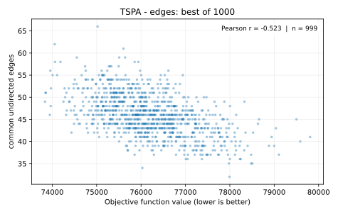
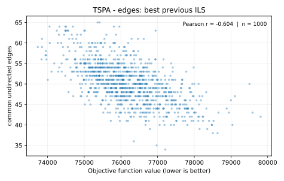
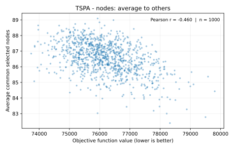
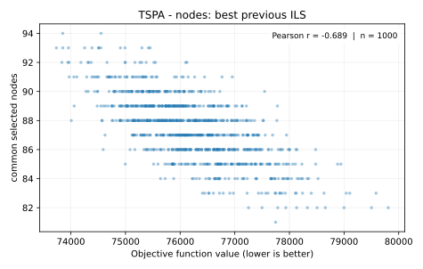
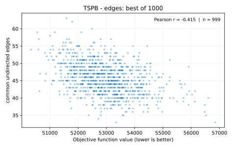
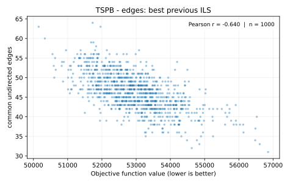
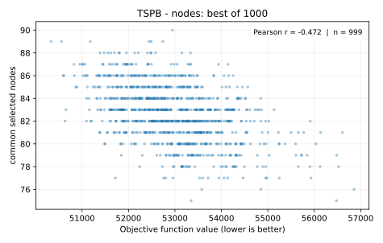
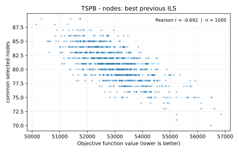

# Assignment 8 - Global convexity tests

**Students:** Baris Surmelioglu - 152048; Ozan Polat - 150918  
**Course:** Evolutionary Computation, Poznan University of Technology  
**Instances:** original TSPA and TSPB (200 nodes; 100 selected per cycle)  
**Experiment:** 1,000 random-start Greedy Local Search runs per instance; 12 scatterplots

## 1. Generating local optima

We generate a random solution with the Fisher-Yates method and run **Greedy Local Search (randomized first improvement)** to a local optimum. The neighborhood includes **2-opt** (reverse a tour segment by changing two edges) and **replacement of a selected node by an unselected node**. We use objective deltas instead of recalculating the complete tour for each potential move. We stop when a complete pass finds no improving move. The same neighborhood is used for both instances.

For reproducibility, the separate `mt19937` seeds are **20260801** for TSPA and **20260901** for TSPB. Within each instance, the generator's random state is carried across the 1,000 runs. We retain all 1,000 tours, not just their objective values. Duplicate local optima would count as separate runs, but none occurred in this experiment.

```text
FOR EACH instance in {TSPA, TSPB}:
    rng = MT19937(instance_seed)
    repeat run = 0 .. 999:
        start = RANDOM_SOLUTION(rng)  # 100 different nodes
        tour = GREEDY_LOCAL_SEARCH(start, 2-opt + replacement, rng)
        save run, objective(tour), and the ordered 100-node cycle
```

## 2. Similarity calculations

We used two different measures. An **undirected edge** is stored as the ordered pair `(min(u,v), max(u,v))`, so reversing or rotating a cycle does not change its edge set. The closing edge is included. The selected-node set contains the 100 indices in the tour, regardless of visiting order.

```text
common_edges(A, B) = |undirected_edges(A) intersection undirected_edges(B)|
common_nodes(A, B) = |selected_nodes(A) intersection selected_nodes(B)|
```

Each similarity is a *count* between 0 and 100, not a percent. We use three reference choices for **each** measure:

1. **Average to other local optima:** for a sampled solution `i`, average its common edges/nodes over the other **999** sampled solutions. It is not compared with itself.
2. **Best of the 1,000 sampled local optima:** calculate overlap with the lowest-objective sampled tour, but remove that specific best sample row from the corresponding scatterplot. Therefore this plot contains **999** points.
3. **Previous best solution:** calculate overlap with the best **ILS** tour stored in the previous experiments (TSPA objective **71,503**; TSPB **48,149**). This tour was produced independently of the 1,000 Greedy runs, so these scatterplots contain all **1,000** samples.

Average similarity is calculated efficiently from feature frequencies. If `freq(e)` is the number of sample tours containing edge or node `e`, then:

```text
average_overlap(i) = sum(freq(e) - 1 for e in features(i)) / 999
```

The subtraction of one excludes solution `i` itself. We cross-checked this formula by explicitly intersecting sets for selected sample rows.

For each of the 12 plots, the **x-axis is the objective value** (smaller means better), and the **y-axis is the corresponding similarity value**. We calculate Pearson's coefficient `r` from the exact plotted points; it ranges from -1 to +1. A negative value means that lower-cost samples tend to have higher similarity.

## 3. Sample statistics and references

| Instance | Runs | Minimum | Mean | Maximum | Best sample run | Previous ILS reference |
| --- | ---: | ---: | ---: | ---: | ---: | ---: |
| TSPA | 1,000 | 73,734 | 76,179.858 | 79,808 | 816 | 71,503 |
| TSPB | 1,000 | 50,153 | 52,961.384 | 56,854 | 997 | 48,149 |

Both samples contain 1,000 distinct ordered tours and 1,000 distinct selected-node sets. The previous ILS tours are better than the best sampled Greedy tours, so they are reasonable external reference solutions. The reference tours and their 100 node indices are in `results/references.txt`.

## 4. Pearson correlation results

Each value was computed from the exact points in the corresponding SVG chart. Counts are included so that the excluded best-sample row is clear.

| Instance | Similarity measure | Reference | Points | Pearson r |
| --- | --- | --- | ---: | ---: |
| TSPA | Common edges | Average to other optima | 1000 | -0.653 |
| TSPA | Common edges | Best of 1000 | 999 | -0.523 |
| TSPA | Common edges | Previous best ILS | 1000 | -0.604 |
| TSPA | Common selected nodes | Average to other optima | 1000 | -0.460 |
| TSPA | Common selected nodes | Best of 1000 | 999 | -0.596 |
| TSPA | Common selected nodes | Previous best ILS | 1000 | -0.689 |
| TSPB | Common edges | Average to other optima | 1000 | -0.693 |
| TSPB | Common edges | Best of 1000 | 999 | -0.415 |
| TSPB | Common edges | Previous best ILS | 1000 | -0.640 |
| TSPB | Common selected nodes | Average to other optima | 1000 | -0.516 |
| TSPB | Common selected nodes | Best of 1000 | 999 | -0.472 |
| TSPB | Common selected nodes | Previous best ILS | 1000 | -0.692 |

## 5. Charts

The complete set of **12 SVG scatterplots** is in [`results/charts/`](results/charts/). There is one chart for each of the two instances, three references, and two similarity measures. Each plot includes the Pearson coefficient and its sample size. Exact numeric coordinates are in `results/points.csv`.

**TSPA - common edges**





**TSPA - common selected nodes**





**TSPB - common edges**





**TSPB - common selected nodes**





## 6. Discussion

All 12 Pearson coefficients are **negative**. In these samples, lower-objective local optima tend to share more edges or selected nodes with strong solutions, or with the rest of the sampled optima. The effect is visible for both TSPA and TSPB, but its strength depends on the similarity measure and reference. For example, correlation with the external ILS reference is stronger for **selected-node overlap** than for edge overlap on both instances.

The results are consistent with a fitness-similarity relationship in these problem instances. They do **not** prove global convexity or guarantee that the global optimum has been found. Correlation is a descriptive result for these 1,000 samples and the chosen local-search neighborhood.

## 7. Verification

- The C++ test program checks Greedy Local Search on random small instances, including full-neighborhood local optimality and objective consistency.
- A separate C++ checker independently recomputes all 2,000 tour objectives from the original node coordinates and checks that no improving 2-opt or replacement move remains.
- Python checks the full objective again for all 2,000 tours, verifies both previous ILS reference tours, and verifies sample run indices.
- Unit tests cover undirected-edge orientation, cycle reversal/rotation, node set overlap, Pearson sign and self-exclusion. Average-overlap calculations are compared with brute-force pairwise set intersections.
- The 12 charts and coefficients are generated from saved run data, not manually entered into the plotting script.

The exact commands and execution environment are in `TESTING.md`. Tests were run in a Linux container; we did not claim they were conducted on a particular physical laptop.
